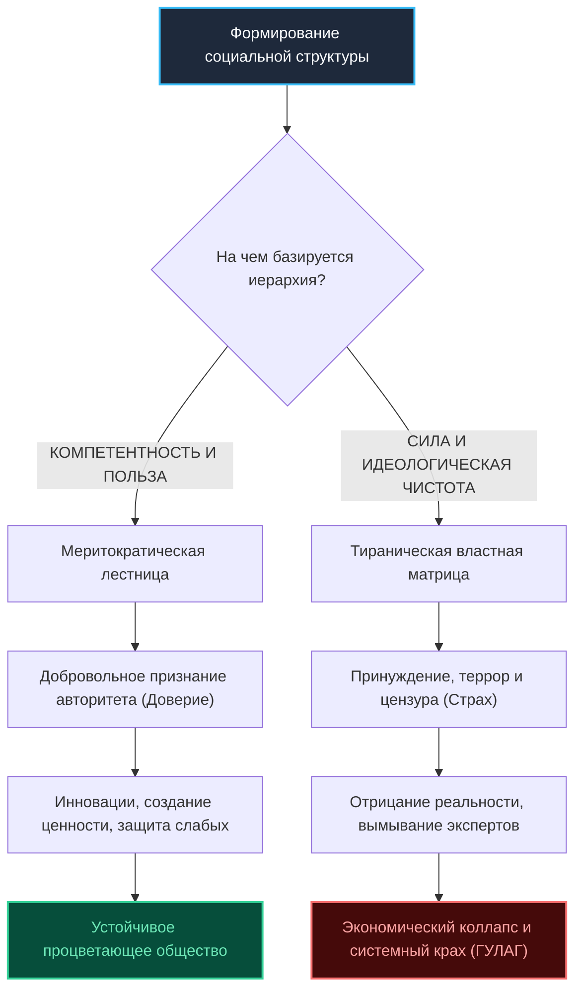

# Бизнес-Деконструкция: «Jordan Peterson: Life, Death, Power, Fame, and Meaning (Lex Fridman #313)»

* **Источник:** [YouTube: Lex Fridman Podcast #313](https://youtu.be/sY8aFSY2zv4)
* **Спикеры:** [[Jordan Peterson]] (клинический психолог, мыслитель), [[Lex Fridman]] (исследователь ИИ, ведущий)
* **Хронометраж:** 03:03:33
* **Дата выхода на YouTube:** 19 августа 2022 г.

---

## Блок 1. Интро, вердикт и скрытая повестка спикера

### 1.1. Кто, что и для кого
* **Кто спикеры:** Джордан Питерсон — канадский клинический психолог, почетный профессор Университета Торонто, автор мировых бестселлеров «12 правил жизни» и «Карты смысла». Лекс Фридман — ученый в области искусственного интеллекта (MIT) и один из главных интервьюеров технологического и интеллектуального мира.
* **Суть 3-часового диалога:** Монументальное исследование природы человеческого бытия: деконструкция тоталитаризма через Достоевского и Солженицына; природа власти (тирания против иерархий компетентности); разоблачение псевдоэкологического антигуманизма; феномен Илона Маска; бремя славы и депрессии; как правильно мыслить через письмо и почему добровольная ответственность — единственный источник смысла жизни.
* **Целевая аудитория:** Предприниматели, лидеры, инженеры, политики и мыслители, ищущие фундаментальные этические координаты в эпоху деконструкции институтов и глобальной неопределенности.

### 1.2. Аналитический вердикт
* **Оценка:** **9.8 / 10** («Смотреть обязательно»).
* **Резюме:** Исторический разговор высочайшей интеллектуальной пробы. Питерсон находится на пике философской формы. Выпуск объединяет глубочайшую русскую классическую литературу, строгую эволюционную биологию и безжалостный социально-экономический анализ.

### 1.3. Детектор скрытой повестки спикера
* **Зачем пришел на подкаст:** Цементирование статуса ведущего публичного интеллектуала западной цивилизации после масштабного контракта с медиахолдингом The Daily Wire; анонс новых туров и книги «Beyond Order».
* **Политический контекст:** Жесткая полемика с правительством Джастина Трюдо, критическое осмысление бюрократического захвата канадских институтов и предупреждение человечества о рисках сползания в мягкий цифровой тоталитаризм под вывеской «всеобщего блага и инклюзивности».

---

## Блок 2. Тепловая карта выпуска (Хронометраж и плотность пользы)

| Таймкод | Тема смыслового акта | Плотность пользы | Прикладная ценность для анализа |
| :--- | :--- | :---: | :--- |
| **00:00** | Интро и бездна Ницше | 🟢 Мясо | Если долго смотреть в бездну — бездна смотрит в тебя |
| **00:47** | Достоевский: «Красота спасет мир» | 🟢 Мясо | Князь Мышкин, пропорция истины и сакральная природа искусства |
| **11:48** | Природа Бога и моральный субстрат | 🟢 Мясо | Эволюционная необходимость метанарратива; почему чистый материализм слеп |
| **19:58** | Наука и этика: гильотина Юма | 🟢 Мясо | Наука говорит «как есть», но не способна ответить «как должно поступить» |
| **32:21** | Смерть как финальный судья | 🟢 Мясо | Memento mori: конечность жизни как источник ценности каждого решения |
| **35:15** | Илон Маск: ставка ва-банк ради цивилизации | 🟢 Мясо | Почему Маск строит космические корабли, пока остальные жалуются |
| **39:13** | Глобальный кризис и «Зеленая истерия» | 🟢 Мясо | Критика античеловеческой климатической политики: удар по беднейшим |
| **51:26** | Опасные идеологии: неомарксизм и политкорректность | 🟢 Мясо | Подмена индивидуальной вины групповой принадлежностью |
| **1:02:40** | Джастин Трюдо и канадский кейс | 🟢 Мясо | Как тирания маскируется под сострадание и заботу |
| **1:16:46** | Трагедия войны в Украине и геополитика | 🟢 Мясо | Анатомия исторического конфликта и цена управленческой глупости |
| **1:34:14** | День из жизни Джордана Питерсона | 🟡 Личное | Распорядок, изнурительный график туров, дисциплина и бессонница |
| **2:10:18** | Как научиться мыслить через письмо | 🟢 Мясо | Архитектура мышления: письмо как предельная форма структурирования ума |
| **2:25:26** | Анатомия депрессии и физические страдания | 🟢 Мясо | Клинический опыт выхода из психофизиологического коллапса |
| **2:33:33** | Манифест молодежи: подними самый тяжелый груз | 🟢 Мясо | Почему комфорт порождает отчаяние, а ответственность дает силу |
| **2:47:22** | Александр Солженицын и «Архипелаг ГУЛАГ» | 🟢 Мясо | Линия добра и зла, разделяющая каждое человеческое сердце |
| **2:59:10** | В чем смысл жизни? Финальный аккорд | 🟢 Мясо | Смысл в служении Логосу и противостоянии хаосу |

---

## Блок 3. Детальный разбор («МЯСО ВЫПУСКА»)

### 3.1. Достоевский и формула «Красота спасет мир»
Питерсон дает глубокую психологическую трактовку знаменитой формулы Достоевского из романа «Идиот»:
* Красота — это не декоративная косметика или каприз богатых людей. Красота — это **символ высшей гармонии и трансцендентной правды**.
* Когда человек видит подлинное произведение искусства, его эго немедленно капитулирует. Красота обличает наше несовершенство и одновременно задает вектор стремления вверх.
* Анализируя «Преступление и наказание», Питерсон показывает: Раскольников пал не из-за бедности, а из-за **гордыни рационализации**. Он придумал логическую теорию, оправдывающую убийство. Достоевский доказал: как только человек ставит свой ограниченный рассудок выше фундаментальных моральных законов, он неизбежно скатывается в кромешный ад.

### 3.2. Иерархии компетентности против марксистской матрицы власти
Главный социально-философский бой Питерсона — опровержение постмодернистского тезиса о том, что «все иерархии в обществе построены на угнетении, силе и привилегиях»:
* В здоровом, функциональном обществе социальная лестница строится на **компетентности** (способности качественно решать сложные проблемы для других людей).
* Сантехник, кардиохирург, авиаконструктор занимают высокие позиции не потому, что они тираны, а потому, что люди добровольно доверяют им свою жизнь.
* Попытка разрушить иерархии компетентности во имя «абсолютного равенства исходов» неизбежно приводит к тому, что на место профессионалов приходят идеологические комиссары. Власть силы занимает место власти мастерства.

### 3.3. Антигуманизм «зеленой повестки» и защита беднейших
Питерсон выдвигает жесткое обвинение радикальным климатическим активистам, опираясь на исследования Бьорна Ломборга:
* Текущая климатическая риторика глубоко человеконенавистническая: планета объявляется «чистой», а человек — «раковой опухолью».
* Искусственное уничтожение традиционной энергетики во имя «нулевых выбросов» в первую очередь бьет не по богатым на Западе, а по сотням миллионов людей в развивающихся странах (Африка, Индия). Рост цен на энергоносители и удобрения означает реальный голод и нищету для беднейших.
* Спасение экологии лежит не через ограничение потребления и деиндустриализацию, а через **обогащение людей**: только богатые и сытые общества начинают по-настоящему инвестировать в очистку рек, лесовосстановление и чистые технологии.

### 3.4. Искусство мыслить через письмо
Питерсон утверждает, что большинство людей не умеют думать:
* Люди принимают за «мышление» хаотичный поток внутренних образов и тревог.
* Подлинное мышление — это внутренний жесткий диалог двух непримиримых оппонентов, требующий предельной дисциплины.
* **Единственный инструмент постановки мышления — это академическое письмо:** когда вы формулируете предложение, взвешиваете каждое слово, проверяете логическую связность и безжалостно вычеркиваете слабые аргументы.
* Тот, кто умеет писать — непобедим в бизнесе, дебатах и управлении. Тот, кто писать не умеет — становится легкой добычей любого демагога.

### 3.5. Манифест ответственности: груз, спасающий от бездны
В противовес современной культуре гедонизма («ищи удовольствия и избегай стресса»), Питерсон формулирует спасительный парадокс:
* Счастье эфемерно и исчезает при первом серьезном кризисе (болезнь, потеря близких, предательство).
* Человеку нужно не поверхностное счастье, а **глубокий экзистенциальный смысл**, который позволит выстоять в трагедии.
* Этот смысл генерируется только **добровольным принятием на себя максимального груза ответственности**: за свою физическую форму, за семью, за команду, за свой город. 
* Поднимите самый тяжелый груз, который способны нести, и идите вперед.

---

## Блок 4. Сводка цифр, бенчмарков и развилок (A vs B)

### 4.1. Сводная таблица параметров выпуска

| Метрика / Факт | Значение | Источник / Контекст | Смысловое значение |
| :--- | :---: | :--- | :--- |
| **Жертвы тоталитаризма XX века** | **~100 млн человек** | «Черная книга коммунизма» / Солженицын | Цена реализации утопических идеологий равенства. |
| **Энергетический порог бедности** | **< $5 / млн BTU** | Аналитика Бьорна Ломборга | Критическая цена энергоносителей для спасения развивающихся стран. |
| **Правило дебатов Питерсона** | **Принцип «Стального чучела»** | Методология ведения публичных дискуссий | Сформулируй тезис оппонента сильнее и убедительнее, чем он сам. |
| **Хронометраж выпуска** | **3 ч 03 мин** | Lex Fridman Podcast #313 | Беспрецедентная глубина проработки темы без клипового монтажа. |

### 4.2. Фундаментальные философские развилки

| Концепция власти и общества (A) | Концепция ответственности и Логоса (B) | Последствия выбора A | Последствия выбора B |
| :--- | :--- | :--- | :--- |
| **Постмодернизм:** Всё есть власть, насилие и классовая борьба. | **Меритократия:** Иерархии строятся на компетентности и пользе. | Разрушение институтов, деградация технологий, диктатура. | Экономический рост, доверие, социальные лифты для талантов. |
| **Гедонизм:** Смысл жизни в удовольствии и минимизации усилий. | **Трагический реализм:** Жизнь полна страданий; смысл — в грузе ответственности. | Инфантилизм, экзистенциальная пустота, депрессия. | Сила духа, психологическая устойчивость, уважение потомков. |
| **Коллективная вина:** Осуждение человека по расе, полу или классу. | **Индивидуальная суверенность:** Линия добра и зла разделяет сердце каждого. | Террор, погромы, концлагеря (ГУЛАГ). | Правовое государство, презумпция невиновности, личная свобода. |

---

## Блок 5. Ментальные модели, карта мышления и Mermaid-диаграмма

### 5.1. Ментальные модели
1. **Модель «Линии Солженицына»:** Враг находится не вовне (в другом классе, расе или партии). Враг — это собственная готовность ко лжи, компромиссам с совестью и обиде на мир.
2. **Модель «Стального чучела» (Steel-manning):** Прежде чем критиковать идею оппонента, укрепи ее аргументами так, чтобы сам оппонент признал: «Да, лучше я бы сам не сказал».

### 5.2. Mermaid-диаграмма: Архитектура социальных систем — Компетентность vs Тирания

---

## Блок 6. Расширение кругозора: Книги, Словарь понятий и Персоны

### 6.1. Фундаментальные книги
1. **Александр Солженицын — «Архипелаг ГУЛАГ»:** Главное противоядие против тоталитарных утопий XX века; летопись цены человеческой лжи.
2. **Ф. М. Достоевский — «Братья Карамазовы» / «Преступление и наказание»:** Психологическое вскрытие истоков рационализации зла.
3. **Виктор Франкл — «Сказать жизни "Да!": Психолог в концлагере»:** Доказательство того, что человек способен выдержать любое «как», если у него есть «зачем».
4. **Бьорн Ломборг — «False Alarm»:** Экономический и прагматический аудит климатической политики.

### 6.2. Банк понятий
* **Competence Hierarchy (Иерархия компетентности):** Структура организации людей, в которой авторитет и ресурсы распределяются пропорционально реальным навыкам и результатам.
* **Logos (Логос):** Греческое понятие божественного порядка, разума и животворящего Слова, организующего хаос в гармонию.
* **Postmodern Relativism (Постмодернистский релятивизм):** Философская доктрина, отрицающая объективную истину и сводящая любые институты к борьбе за власть.
* **Hubris (Хюбрис):** Древнегреческое понятие слепой гордыни и высокомерия смертного перед лицом высших законов вселенной.

### 6.3. Ключевые персоны
* **Jordan Peterson:** Канадский мыслитель, клинический психолог, лидер консервативной интеллектуальной мысли.
* **Lex Fridman:** Ведущий главного глубокого подкаста современности, исследователь AI в MIT.
* **Александр Солженицын:** Русский писатель, лауреат Нобелевской премии, вскрывший анатомию советского репрессивного аппарата.
* **Илон Маск:** Инженер и предприниматель, ставящий масштабные цивилизационные цели выше сиюминутного комфорта.

---

## Блок 7. Золотые формулировки и панчлайны выпуска

* «Линия, разделяющая добро и зло, проходит не между государствами, не между классами и не между партиями — она проходит через каждое человеческое сердце.»
* «Если вы не умеете писать — вы не умеете думать. А если вы не умеете думать — вы ходячая добыча для первого попавшегося демагога.»
* «Не смейте требовать переустройства мировой экономики, пока не навели идеальный порядок в собственной комнате.»
* «Счастье — это побочный эффект правильной жизни, а не ее цель. Цель — это добровольно поднятый крест ответственности.»
* «Красота — это не роскошь. Красота — это напоминание о том, ради чего вообще стоит жить в этом полном боли мире.»

---

## Блок 8. Внешний фактчек, материалы и реакция аудитории

### 8.1. Фактчек и критика
* **Экологические дебаты:** Критики Питерсона упрекают его в чрезмерном оптимизме относительно адаптационных возможностей бедных стран к экстремальным погодным явлениям, хотя его тезис о вреде удорожания энергии для бедняков признан ведущими экономистами развития.
* **Геополитика:** Взгляд Питерсона на события в Восточной Европе носит выраженный цивилизационно-культурный характер, временами упрощающий конкретные военно-стратегические факторы.

### 8.2. Реакция мировой аудитории
* Выпуск #313 набрал миллионы просмотров и признан одним из лучших философских диалогов десятилетия. Зрители особо выделили искренность Питерсона в описании клинической борьбы за собственную жизнь и ясность его советов молодому поколению.

---

## Блок 9. Пошаговый 72-часовой план внедрения

### Этап 1: 72 часа (Наведение порядка в базовом периметре)
1. **Принцип «Убери свою комнату»:** Навести абсолютный физический и цифровой порядок в рабочем пространстве. Ликвидировать накопившийся хаос в делах.
2. **Письменный аудит личной правды:** Честно выписать на бумагу 3 пункта, в которых вы лжете себе или окружающим из страха или малодушия. Прекратить это делать.

### Этап 2: 7 дней (Практика дисциплины мышления)
1. Внедрить ежедневную 30-минутную сессию письма: формулировать на бумаге анализ сложных рабочих решений, аргументы за и против без использования клише.
2. Принять на себя один тяжелый проект или обязательство, которого вы долго избегали из страха неудачи.

### Этап 3: 30 дней (Построение иерархии компетентности)
1. Провести аудит своего профессионального авторитета: строится ли он на реальных результатах или на манипуляциях и статусе.
2. Ввести в привычку чтение классической литературы (Достоевский, Франкл, Солженицын) минимум 45 минут в день как фундамент этического компаса.
