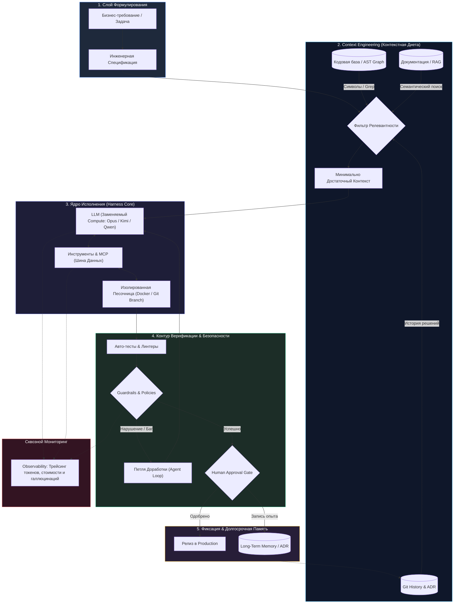

# Бизнес-Деконструкция: «AI-инженерия с нуля — Полный гайд для разработчика»

* **Источник:** [YouTube: Владилен Минин](https://youtu.be/WT0yDhfOjaA)
* **Спикер:** [[Владилен Минин]] (IT-предприниматель, основатель [[Irreplaceable AI]] и [[Simple Claw]], экс-ведущий фронтенд-педагог русскоязычного YouTube)
* **Дата выпуска / разбора:** 29 октября 2026 г.
* **Хронометраж:** 1 час 02 минуты 53 секунды (12 глав)

---

## Блок 1. Интро, вердикт и скрытая повестка спикера

### Кто, что и для кого
* **Кто:** **[[Владилен Минин]]** — один из самых авторитетных русскоязычных IT-педагогов (обучает программированию с 2018 года), сооснователь образовательной экосистемы [[Irreplaceable AI]] и прокси-инфраструктуры [[Simple Claw]]. На протяжении последних 2 лет системно занимается R&D в области агентских систем, практическим внедрением LLM в коммерческую разработку и анализом мировой практики AI-инженерии.
* **Что:** Системный 63-минутный архитектурный манифест о смене базовой парадигмы в software-инженерии: почему генерация кода перестала быть узким местом IT-индустрии, в чем смертельная опасность хайпа вокруг «вайбкодинга» для коммерческих систем, что такое «налог на верификацию» (Verification Tax & Verification Debt), как проектируется **Harness** (управляющая среда, превращающая стохастическую нейросеть в детерминированного исполнителя), подробный разбор 6 слоев агентской архитектуры, уровни зрелости кодовых баз по бенчмарку [[Stanford AI Lab]] (L0–L4) и фундаментальное разделение между «финансовым пузырем венчурных инвестиций» и «необратимостью фундаментальной технологии ИИ».
* **Для кого:** Сеньор-разработчики, техлиды, программные архитекторы, CTO и фаундеры технологических стартапов. Материал жизненно необходим тем, кто устал от инфантильного хайпа в духе «мы за один промпт собрали клон Uber» и хочет выстроить промышленный контур разработки с контролируемой стоимостью токенов, предсказуемым ревью и нулевыми галлюцинациями.

> [!NOTE] ⚖️ Вердикт Бизнес-Деконструктора
> **Смотреть обязательно.** Это редчайший для русскоязычного IT-пространства пример трезвой, математически и архитектурно выверенной деконструкции ИИ без мотивационной шелухи. Владилен точно артикулирует те боли, с которыми сталкиваются зрелые инженерные команды при попытке прикрутить Claude или GPT к продакшн-репозиториям: генерация кода обходится в копейки, но лавинообразно парализует сеньоров на этапе ревью. Ролик задает четкую понятийную сетку новой профессии — **AI-инженер**.

> [!WARNING] 🕵️‍♂️ Детектор скрытой повестки спикера
> 1. **Продажа флагманского практикума «AI-инженер»:** Видео служит высококлассным контентным лид-магнитом для набора на платную практическую программу (на платформе [[Irreplaceable AI]]), где студенты за 10 шагов собирают собственную архитектуру агентской OS на TypeScript (на базе Health Coach с переносом 80% ядра на другие домены).
> 2. **Инфраструктурный апсейл сервиса [[Simple Claw]]:** Владилен монетизирует санкционные и платежные барьеры для разработчиков из СНГ, продвигая свой прокси-сервис для бесшовного доступа к Claude Code, Codex и моделям OpenAI с оплатой российскими картами от 50 рублей.
> 3. **Репозиционирование персонального бренда (Senior/CTO Tier):** Долгие годы имя спикера ассоциировалось с видеокурсами по JavaScript/React для начинающих. Данный выпуск — мощная заявка на закрепление в статусе визионера корпоративной AI-архитектуры и лидера мнений для зрелых инженеров (уровня Lead / Architect / CTO).

---

## Блок 2. Тепловая карта выпуска

| Таймкод | Тема главы | Плотность | Фокус анализа |
| :--- | :--- | :---: | :--- |
| **00:00 – 02:54** | О чем гайд: Смена дефицита в IT | 🟢 Мясо | Код перестал быть дефицитом; дефицит сместился на контекст, архитектуру и roadmap. |
| **02:54 – 08:59** | Код больше не проблема: Парадокс дешевого кода | 🟢 Мясо | Естественный язык как новый уровень абстракции; почему продукты не подешевели кратно. |
| **08:59 – 14:06** | Мифы про вайбкодинг: Демка vs Продукт | 🟢 Мясо | Разница между 1 сессией чата и годами поддержки: edge-cases, миграции, роли, безопасность. |
| **14:06 – 21:57** | Реальные ограничения AI агентов | 🟢 Мясо | Контекстное окно (1M токенов не панацея), стохастическая природа, анатомия контекста [[Anthropic]]. |
| **21:57 – 26:34** | Проблема проверки кода: Verification Tax & Debt | 🟢 Мясо | Почему скорость вывода фичей падает; бенчмарки [[METR]]; прирост производительности всего ~19%. |
| **26:34 – 32:10** | Что такое Harness: Архитектурный обвяз | 🟢 Мясо | Определение Harness; кейс удешевления токенов в 3–10 раз при переходе с Opus/GPT-5 на Kimi/GLM. |
| **32:10 – 47:12** | Агентская Архитектура: 6 слоев | 🟢 Сверх-мясо | Контекст-инжиниринг, Tools/MCP, Memory/State, Observability/Tracing, Sandboxing, Guardrails. |
| **47:12 – 50:57** | Практика создания агентской OS | 🔴 Промо | Презентация практикума по созданию Agentic Core на TypeScript без «магических» фреймворков. |
| **50:57 – 53:23** | Уровни зрелости проектов по Stanford Benchmark | 🟢 Мясо | Шкала L0–L4 ([[Stanford AI Lab]]): от единичных промптов к оркестрируемым мультиагентным системам. |
| **53:23 – 56:24** | Кто такой AI Инженер: Профиль профессии | 🟢 Мясо | Почему это не ML-исследователь и не промптер, а системный архитектор с классической базой. |
| **56:24 – 59:39** | Что если AI пузырь лопнет? Необратимость ИИ | 🟡 Аналитика | Аналогия с крахом Dotcom и крипты; открытые веса ([[Qwen]], [[Moonshot AI|Kimi]]), локальные контуры. |
| **59:39 – 01:02:53** | Резюме выпуска и локация под Петербургом | 🟡 Резюме / 🔴 | Финальный синтез тезисов + нативная благодарность глэмпингу [[Шинрин Йоку]]. |

---

## Блок 3. Детальный разбор («Мясо»)

### 1. Сдвиг дефицита в IT: Код обесценился, контекст подорожал
* **Суть:** Последние 20 лет главным дефицитом в IT были «переводчики» с бизнес-требований на машинный код — программисты. С приходом LLM естественный язык стал новым языком программирования высшего уровня. Однако кратного удешевления и ускорения выпуска программных продуктов не произошло. Код стал дешевым побочным продуктом, а главным дефицитом стали контекст, целостное видение архитектуры, управление зависимостями и глубокое понимание бизнес-домена.
* **Инсайты и выводы:**
  * *Тезис:* Если функция пишется за 5 секунд одним промптом, это не значит, что проект готов к релизу. Скорость печати символов никогда не была фундаментальным ограничением бизнеса — ограничением всегда было понимание **что именно** нужно построить и как это повлияет на устойчивость системы.
  * *Для предпринимателя:* Перестаньте оценивать производительность команды строками кода или закрытыми тикетами на «генерацию». Ценность программиста сегодня — это способность отсечь 95% вероятностного мусора, который генерирует ИИ, и удержать архитектурный каркас.
  * **Ментальная модель: «Парадокс дешевого кода»** — падение себестоимости генерации артефакта до нуля взвинчивает себестоимость его фильтрации и верификации до небес.
* **Применение и риски:**
  * *Если применять:* Переводить грейды разработчиков с написания типового CRUD-кода на управление системным контекстом и спецификациями.
  * *Если переборщить:* Риск уволить крепких мидлов, посчитав, что «один джуниор с Claude Code заменит команду», и получить через 3 месяца полностью неремонтопригодный спагетти-репозиторий.

---

### 2. Мираж «Вайбкодинга»: Демка против Промышленного продукта
* **Суть:** Хайповая волна «вайбкодинга» (написание сервисов на расслабленном промптинге за чашкой кофе) создает у нетехнических фаундеров опасную иллюзию всемогущества. Собрать эффектный MVP, прототип лендинга или простого Telegram-бота за 1–2 промпта в рамках чистой сессии действительно легко. Но реальный программный продукт существует годами, накапливает миллионы исторических решений, нетипичные клиентские edge-кейсы, тонкие схемы миграции данных, разграничение прав доступа (RBAC) и требования информационной безопасности.
* **Инсайты и выводы:**
  * *Тезис:* Чистое контекстное окно новой сессии модели скрывает технический долг. В чистом окне у модели нет конфликтов, но как только проект разрастается до 50+ модулей, «вайбкодер» оказывается в тупике: одно изменение ломает пять соседних подсистем.
  * *Для предпринимателя:* Демка, написанная за выходные фаундером-вайбкодером, почти всегда подлежит 100% переписыванию при первых 1000 платящих пользователей, если изначально не была заложена культура модульности.
  * **Ментальная модель: «Айсберг вайбкодинга»** — 10% видимой верхушки (интерфейс, базовый happy path) создаются за день, 90% подводной части (безопасность, миграции, обработка сбоев, edge-кейсы) требуют классической инженерной школы.
* **Применение и риски:**
  * *Если применять:* Использовать вайбкодинг строго как инструмент скоростного прототипирования гипотез (throwaway prototypes), заранее закладывая их утилизацию.
  * *Если переборщить:* Попытка вывести «навайбкоженный» прототип в статус ядра корпоративного сервиса приводит к утечкам данных, каскадным падениям и миллионным убыткам.

---

### 3. Фундаментальные ограничения агентов: Контекстная слепота и стохастический хаос
* **Суть:** Агент, запускаемый в репозиторий, не обладает человеческим кругозором и исторической памятью команды. Каждая сессия стартует из вакуума («черный ящик»), где агент пытается по обрывкам доступных файлов восстановить архитектуру. Даже декларируемые контекстные окна в 1 миллион токенов (как у моделей уровня [[Anthropic]] Opus или Gemini) на практике страдают от эффекта «растворения внимания» (Attention Dilution / Lost in the Middle) и галлюцинируют при перегрузке.
* **Инсайты и выводы:**
  * *Тезис:* LLM — это строго вероятностный механизм предсказания токенов, а не детерминированный исполнитель. Надежность одного шага в 90% при цепочке из 10 последовательных шагов дает итоговую вероятность успеха всего $(0.9)^{10} pprox 34.8\%$. Без жесткого внешнего контроля цепочка распадается.
  * *Для бизнеса:* Нельзя надеяться, что выход условной «GPT-6» или «Opus 5» автоматически решит проблему проекта. Попытка «залить весь репозиторий в промпт» — тупиковый путь. Единственное решение — инженерная фильтрация и подача строго дозированной информации.
  * **Ментальная модель: «Экспоненциальная деградация цепочки шагов»** — чем длиннее автономный цикл агента без внешней верификации промежуточных состояний, тем ближе результат к чистому хаосу.
* **Применение и риски:**
  * *Если применять:* Изучить и внедрить принципы статьи [[Anthropic]] «Анатомия эффективного контекстного окна»: изолировать контекст, скармливать агенту микро-задачи и минимально достаточный набор файлов.
  * *Если переборщить:* Избыточное дробление контекста может лишить модель понимания глобальных сайд-эффектов изменений.

---

### 4. Налог на верификацию (Verification Tax & Verification Debt)
* **Суть:** Скорость генерации кода нейросетью многократно превосходит биологическую скорость восприятия и валидации этого кода человеком. Возникает феномен **Verification Tax** («налог на верификацию») — скрытые временные затраты на то, чтобы вдумчиво прочитать сгенерированный дифф, понять его скрытые сайд-эффекты и убедиться в отсутствии дыр. Если команда не успевает верифицировать код, он оседает в репозитории в виде **Verification Debt** («долга по верификации»).
* **Инсайты и выводы:**
  * *Тезис:* Исследования конца 2025 года зафиксировали парадокс: субъективно разработчики рапортуют о росте скорости в 2–3 раза, однако реальный прирост завершенных фичей по рынку составил скромные **19%** (а в ряде команд с незрелыми процессами показал отрицательную динамику из-за вала багов).
  * *Для бизнеса:* Если вы наняли разработчиков и выдали им подписки на Claude Code без перестройки процессов ревью и тестирования, вы просто перегрузили сеньоров и тимлидов ревью-параличом. Сеньоры превращаются в уставших контролеров бесконечного потока низкокачественного кода.
  * **Ментальная модель: «Бутылочное горлышко ревью»** — пропускная способность конвейера определяется не скоростью генератора заготовок, а скоростью контролера качества.
* **Применение и риски:**
  * *Если применять:* Инвестировать в автоматизацию первого эшелона проверки: авто-линтеры, статический анализ, строгие E2E-тесты и запуск сгенерированного кода в изолированных песочницах до того, как PR попадет на глаза человеку.
  * *Если переборщить:* Попытка полностью убрать человека из петли утверждения критических изменений (Zero Human Oversight) неизбежно приведет к компрометации production-базы.

---

### 5. Что такое Harness: Модель как CPU, Harness как материнская плата
* **Суть:** **Harness** (дословно «упряжь» / «обвязка») — это управляющая инженерная среда вокруг языковой модели, которая превращает вероятностный ИИ в предсказуемого, повторяемого и надежного программного исполнителя. Модель сама по себе — это просто сырой процессор (Compute Core). Без «материнской платы», шины данных, оперативной памяти, портов ввода-вывода и системы охлаждения процессор бесполезен.
* **Инсайты и выводы:**
  * *Тезис:* Сила команды определяется не тем, к какой модели у нее есть доступ (топовые LLM одинаково доступны всем по API), а зрелостью ее Harness. Зрелый Harness позволяет решать сложнейшие задачи на дешевых и быстрых моделях (например, [[Moonshot AI|Kimi]], [[Zhipu AI|GLM]], [[DeepSeek]]), экономя компании бюджет в **3–10 раз** по сравнению с «голыми» вызовами флагманов GPT-5/Opus.
  * *Для бизнеса:* Инвестиции в кастомный Harness окупаются мгновенно за счет радикального снижения стоимости API-токенов и ликвидации галлюцинаций. Простейший Harness начинается с файлов инструкций (`CLAUDE.md`, `AGENTS.md`), но в зрелом виде перерастает в полноценную внутреннюю платформу.
  * **Ментальная модель: «Архитектурная развязка (Model-Agnostic Engine)»** — модель должна быть легко заменяемой деталью в вашем контуре. Вышел новый дешевый лидер в Open Weights — меняем endpoint в провайдере, вся обвязка продолжает стабильно работать.
* **Применение и риски:**
  * *Если применять:* Проектировать архитектуру систем взаимодействия с ИИ через единый абстрактный слой провайдера (Unified Model Gateway), изолируя бизнес-логику от специфики конкретных промптов.
  * *Если переборщить:* Чрезмерное усложнение Harness на ранних стадиях проекта (Over-engineering) может сожрать больше ресурсов, чем сэкономит на токенах.

---

### 6. Анатомия агентской архитектуры: 6 критических слоев управления
Владилен раскладывает полноценный промышленный Harness на 6 обязательных функциональных подсистем:
1. **Context Engineering & Retrieval (RAG следующего поколения):** Принцип «контекстной диеты». Задача слоя — собрать минимально достаточный набор данных. Использование не только семантического поиска по эмбеддингам, но и графа зависимостей (AST / Dependency Graph), Git-истории, трекера задач и grep по символам.
2. **Tools & [[Model Context Protocol|MCP]]:** Механизм, отвечающий на вопрос «что агент может делать». Разделение на примитивные инструменты (Tools) и стандартизированные протоколы взаимодействия со сторонними системами ([[Model Context Protocol|MCP]]), дающие доступ к базам данных, API и внешним сервисам.
3. **Memory & State Management:** Долгосрочная и оперативная память. Разделение на сессионный контекст, память о принятых исторических архитектурных решениях (ADR) и векторные хранилища фактов.
4. **Observability, Tracing & Evaluation:** Контур наблюдаемости. Невозможно управлять тем, что нельзя измерить. Логирование цепочек рассуждений (Agent Loop), замер стоимости токенов каждого шага, трейсинг падений и синтетическая оценка качества выдачи (LLM-as-a-Judge).
5. **Sandboxing (Изоляция среды):** Выполнение кода агента строго в изолированных средах (Docker-контейнеры, временные ветки Git, изолированные тестовые базы). Агент не имеет права трогать локальную машину разработчика или прод без изоляции.
6. **Guardrails & Human Approvals:** Жесткие структурные запреты (например, табу на модификацию `.env`, удаление таблиц или прямое изменение системных файлов) плюс точки обязательного утверждения человеком (Human-in-the-loop) перед слиянием изменений в основную ветку.

---

### 7. Шкала зрелости Stanford AI Benchmark (L0 → L4)
* **Суть:** Исследование [[Stanford AI Lab]] (*Stanford AI Engineering Practices Benchmark*) оценивает готовность кодовой базы к работе с ИИ не по субъективным опросникам, а путем запуска автономных агентов-аудиторов в репозиторий.
* **Уровни зрелости:**
  * **L0 (No Observable AI Use):** Ручная разработка по старинке, полное отсутствие правил и инструментов ИИ.
  * **L1 (Opportunistic Prompting):** Хаотичные промпты, локально сохраняемые отдельными энтузиастами; отсутствие стандартов и единого репозитория промптов.
  * **L2 (Systematized Prompting):** В репозитории появляются версионируемые правила (`AGENTS.md`, `CLAUDE.md`), шаблоны промптов, стандарты кодирования, общие для всей команды.
  * **L3 (Agent Backend Development):** Создание специализированных переиспользуемых субагентов под типовые доменные задачи (агент миграций, агент написания тестов, агент ревью).
  * **L4 (Orchestrated Agentic Workflows):** Мультиагентные пайплайны под управлением центрального оркестратора, где агенты ставят задачи друг другу, валидируют работу коллег и работают в изолированных песочницах.
* **Инсайты для бизнеса:** Большинство компаний в 2026 году застряли на уровне **L1**, неся все издержки хаоса. Цель технологического лидера — перевести кодовую базу минимум на уровень **L2–L3** для получения измеримого ROI.

---

### 8. Роль AI-инженера: Архитектор взаимодействия, а не ML-математик
* **Суть:** На рынке труда кристаллизуется новая ключевая позиция — **AI-инженер**. Это не Data Scientist и не ML-исследователь, обучающий веса нейросетей на кластерах GPU. Это классический Software Engineer (уровня Senior/Lead), который в совершенстве понимает архитектуру ПО, базы данных, CI/CD, безопасность и поверх этого проектирует Harness для стохастических моделей.
* **Ключевой функционал AI-инженера:**
  * Проектирование каналов контекста и стратегий ретривала.
  * Настройка циклов агента (Agent Loop) и условий их безопасного останова (Termination Conditions).
  * Выстраивание контура Observability и анализ трейсов падений.
  * Разработка Guardrails и интеграция с корпоративными политиками безопасности.
  * Оптимизация костов на токены путем переключения задач между легковесными и тяжелыми моделями.
* **Инсайт:** Классическая база computer science (алгоритмы, сети, архитектурные паттерны) не обесценилась — она стала в 10 раз важнее, так как теперь нужно валидировать работу не живого джуниора, а сверхбыстрого алгоритма.

---

### 9. Лопание AI-пузыря vs Технологическая необратимость
* **Суть:** Постоянный страх бизнеса: «Что будет, если финансовый пузырь вокруг ИИ лопнет, венчурные триллионы сгорят, а OpenAI и Anthropic обанкротятся? Стоит ли вообще перестраивать процессы?». Владилен проводит железную историческую параллель с крахом доткомов (Dotcom Bubble 2000 г.) и криптовалютными зимами: крах акций не уничтожил Интернет и протокол TCP/IP, а криптозимы не уничтожили стейблкоины и блокчейн-расчеты.
* **Инсайты и выводы:**
  * *Тезис:* Даже если венчурные субсидии прекратятся прямо завтра, технология уже необратимо овеществлена в открытых весах (**Open Weights**). Модели уровня [[Qwen]] (32B/72B) и появившийся в открытом доступе [[Moonshot AI|Kimi]] k1.5/k2 демонстрируют качество рассуждений на уровне флагманов закрытого бигтеха.
  * *Для предпринимателя:* Вы можете развернуть локальную модель на собственном сервере с видеокартами, обвязать ее кастомным Harness и навсегда обезопасить свой бизнес от краха любых внешних AI-корпораций. Джинн выпущен из бутылки — мир никогда не вернется к исключительно ручному набору кода.

---

## Блок 4. Сводка цифр, бенчмарков и управленческих развилок (A vs B)

### Таблица жестких цифр и бенчмарков
| Показатель / Факт | Значение спикера | Контекст и значение для бизнеса | Оценка реалистичности |
| :--- | :---: | :--- | :--- |
| **Реальный прирост продуктивности в IT** | **~19%** | Зафиксированный фактологический прирост закрытых задач на конец 2025 года вопреки мифу о «росте в 300%». | Абсолютно реалистично. Подтверждается исследованиями GitHub и DORA. |
| **Экономия бюджета на токенах** | **В 3–10 раз** | Снижение затрат на вызовы API при переходе с топовых моделей (GPT-5/Opus) на дешевые (Kimi/GLM) благодаря зрелому Harness. | Подтверждено на практике: качественный контекст компенсирует размер модели. |
| **Объем декларируемого контекста** | **256k – 1M токенов** | Верхний предел современных моделей (Opus, Gemini), при заполнении которого нарастают галлюцинации и слепота к деталям. | Доказанный факт: «Needle In A Haystack» деградирует при объеме свыше 100k токенов. |
| **Переиспользуемость ядра Harness** | **~80%** | Доля кодовой базы агентской OS, которая остается неизменной при смене предметной области (Health Coach → FinTech). | Корректно: агентский цикл, шина MCP, память и песочница универсальны. |
| **Минимальная база для старта** | **50 строк TypeScript** | Объем кода на чистом TS для сборки первого работающего агентского цикла без сторонних монструозных фреймворков. | Точно: чистый цикл вызова функции модели и парсинга ответа не требует LangChain. |
| **Уровни зрелости кодовой базы** | **L0 – L4** | 5 градаций зрелости репозитория по шкале бенчмарка [[Stanford AI Lab]]. | Международный академический стандарт аудита кодовых баз. |

### Управленческие развилки (Dilemmas & Trade-offs)
* **Развилка 1: Сверхдорогие Foundation Models «в лоб» vs Дешевые модели + Собственный Harness**
  * *Выбор энтузиастов:* Использовать самые дорогие закрытые API (Claude 3.5/Opus, GPT-5) с минимальными промптами.
  * *Выбор зрелого бизнеса:* Инвестировать в Harness (контекст, RAG, графы вызовов) и запускать задачи на моделях в 5 раз дешевле (Kimi, DeepSeek, Qwen).
  * *Trade-off:* Дороже в разработке на старте, но колоссально снижает OPEX и устраняет вендор-лок при масштабировании.
* **Развилка 2: Скоростной «Вайбкодинг» vs Архитектурная строгость**
  * *Выбор стартапа:* Быстро навайбкодить прототип без тестов за 3 дня ради питча инвесторам.
  * *Выбор энтерпрайза:* Написание строгих спецификаций, типизация, автотесты и изолированные песочницы.
  * *Trade-off:* Вайбкодинг идеален для гипотез-однодневок, но гарантирует катастрофический технический долг в продакшене.
* **Развилка 3: Человеческое ревью всего кода (Review Bottleneck) vs Автоматизированные Guardrails**
  * *Выбор консерваторов:* Сеньор вручную вычитывает каждый коммит, сгенерированный ИИ (паралич команды).
  * *Выбор AI-Native:* Автоматический запуск тестов в песочнице, проверка линтерами, авто-оценка через LLM-as-a-Judge, человек аппрувит только архитектуру и бизнес-критичные точки.
  * *Trade-off:* Требует серьезных инвестиций в инфраструктуру тестирования, но полностью снимает «налог на верификацию».

---

## Блок 5. Ментальные модели, карта мышления и диаграмма

### Ключевые ментальные модели выпуска:
1. **«Процессор и Материнская плата» (Compute vs Harness):**  
   LLM — это кремниевый чип, производящий вероятностные вычисления. Harness — материнская плата, направляющая токи, распределяющая память и обеспечивающая безопасность. Нельзя продать компьютер, состоящий из одного процессора.
2. **«Налог на верификацию» (Verification Tax):**  
   Любая дешевизна производства на первом этапе переносится в скрытые издержки контроля на втором. Если генерация бесплатна, стоимость верификации стремится к стоимости всего проекта.
3. **«Контекстная диета» (Context Pruning):**  
   Качество ответа модели обратно пропорционально объему информационного шума в ее окне. Искусство AI-инженерии — не загрузить в модель весь проект, а вырезать 99% лишнего, оставив строго 1% критически важных сигналов.
4. **«Инфраструктурная необратимость»:**  
   Технологические революции необратимы с момента появления открытых стандартов и открытых весов. Финансовые пузыри смывают пену спекулянтов, но оставляют инфраструктуру в руках практиков.

### Mermaid-диаграмма: Полный замкнутый контур управления Harness

---

## Блок 6. Справочник сущностей (с [[Obsidian Wikilinks]])

### Компании, организации и модели:
* **[[Anthropic]]** — разработчик семейства моделей Claude и создатель открытого протокола [[Model Context Protocol|MCP]]; автор эталонных публикаций по анатомии контекстного окна.
* **[[OpenAI]]** — создатель GPT-4/GPT-5 и Codex; лидер венчурной гонки, задающий темп коммодитизации кода.
* **[[Stanford AI Lab]]** — исследовательский центр Стэнфордского университета, автор бенчмарка *AI Engineering Practices Benchmark* (шкала L0–L4).
* **[[METR]]** — независимая исследовательская организация, измеряющая реальное время автономной бессбойной работы ИИ-агентов без участия человека.
* **[[Moonshot AI|Kimi]]** — китайская frontier-модель с открытыми весами (Kimi k1.5 / Kimi 3), сопоставимая по рассуждениям с Claude Opus при кратно меньшей стоимости.
* **[[Qwen]]** — семейство моделей с открытыми весами от Alibaba (32B, 72B), де-факто стандарт для локального защищенного контура разработки.
* **[[Zhipu AI|GLM]]** / **[[DeepSeek]]** — экономичные модели рассуждений, используемые в зрелых Harness-системах для оптимизации бюджетов.

### Проекты, сервисы и инструменты:
* **[[Simple Claw]]** — инфраструктурный сервис Владилена Минина для прямого доступа к Claude Code и API без зарубежных карт с оплатой в рублях.
* **[[Irreplaceable AI]]** («Клуб Незаменимых») — образовательная платформа и профессиональное комьюнити AI-инженеров.
* **[[Model Context Protocol|MCP]]** — открытый протокол компании Anthropic для стандартизированного подключения моделей к данным и инструментам.
* **[[Docker]]** — инструмент контейнеризации, фундаментальный компонент слоя Sandboxing для безопасного прогона агентского кода.
* **[[TypeScript]]** — базовый язык создания строгой агентской архитектуры и управляющих циклов.
* **[[Шинрин Йоку]]** — загородный спа-отель в японском стиле под Санкт-Петербургом, локация съемок видео.

### Архитектурные антипаттерны:
* **«Vibe Coding Mirage» (Мираж вайбкодинга):** Вера в то, что демо, написанное за 15 минут в одном чате, является коммерческим продуктом без необходимости закладывать архитектуру.
* **«Context Flooding» (Контекстное затопление):** Попытка скормить модели всю кодовую базу целиком, приводящая к каскадным галлюцинациям и пропуску критических инструкций.
* **«Verification Bottleneck» (Бутылочное горлышко верификации):** Накопление десятков непроверенных Pull Request от ИИ, парализующее старших разработчиков.
* **«Black Box Execution» (Слепое исполнение):** Запуск агента без сквозного трейсинга, логирования расхода токенов и мониторинга промежуточных решений.

---

## Блок 7. Золотые формулировки и панчлайны выпуска

1. > *«Профессия программиста 20 лет заключалась в переводе с человеческих требований на язык машины. Теперь этот перевод делает модель, а привилегия написания кода перешла на новый уровень абстракции — человеческую речь».*
2. > *«Хороший контекст — это не когда мы запихали в промпт как можно больше информации. Это когда мы оставили ровно столько данных, сколько необходимо для единственно верного решения».*
3. > *«Harness — это управляющая инженерная среда вокруг модели, которая превращает вероятностный искусственный интеллект в повторяемого программного исполнителя».*
4. > *«Выигрывает уже давно не тот, кто генерирует больше кода. Выигрывать будет тот, кто научился превращать бизнес-запросы в реально работающие, устойчивые системы».*
5. > *«Искусственный интеллект не отменяет классическую инженерию. Он поднимает ее на следующий уровень абстракции. Раньше мы писали программы — теперь мы проектируем системы, которые сами пишут, тестируют и поддерживают программы под нашим контролем».*

---

## Блок 8. Внешний фактчек, материалы и реакция аудитории

### Материалы выпуска и официальные ссылки:
* [Бесплатный курс по ИИ-разработке (9 уроков)](https://irreplaceable-ai.ru/products/ai-engineer/start) — базовый вход в инструментарий для разработчиков.
* [SimpleClaw — Доступ к Claude Code и API за рубли](https://simple-claw.ru) — инфраструктурный шлюз без VPN.
* [Платформа «Клуб Незаменимых»](https://irreplaceable-ai.ru) — закрытое сообщество практиков AI-разработки.
* [Telegram-пост с подборкой исследований](https://t.me/vladm/1566) — ссылки на бенчмарк Стэнфорда, пейперы Anthropic и METR.
* [Локация съемок — Глэмпинг Shinrin-yoku](https://shinrin-glamping.ru/) — японский эко-отель в Ленинградской области.

### Анализ реакции инженерной аудитории (Топ-комментарии):
1. **Подтверждение гипотезы Harness сеньор-архитекторами:**  
   Пользователь `@motochaseRR` (Senior Architect, 8 лайков) подтверждает центральный тезис: *«Я тут харнесс построил сам, а потом увидел в видео, что он существует ахахах. Мы ушли с фокуса "агент-эксперт" на фокус "данные снаружи — агенты пользуются". Тем самым распараллелили задачи без дубликации... Моя эра, ребята! Реализация концепции требует жесткого инженерного скилла»*. Это прямое доказательство, что рынок нащупал эту архитектуру на практике.
2. **Скепсис по поводу мифа о коде как узком месте:**  
   Пользователь `@andrewxd5705` отмечает важную циничную деталь: *«Написание кода никогда и не было узким местом, пока ИИ-вендоры не продали всем эту идею, потому что на других этапах пайплайна разработки ИИ практически бесполезен»*. Замечание справедливо: продажи подписок OpenAI базировались на упрощении всей разработки до «набора текста».
3. **Грядущая чистка рынка от «выпускников курсов»:**  
   Пользователь `@Shorey-z4x` детально описывает тестирование локальных моделей на железе без видеокарт и делает жесткий вывод: *«Грядет зачистка не джунов, а выпускников поверхностных курсов. Возрастет ответственность и бюрократия, востребованы будут только фундаментальные T-shaped специалисты»*.
4. **Легкая ирония к смене амплуа спикера:**  
   Часть аудитории шутит по поводу «японского монастыря» (`@vr4836`) и ностальгирует по временам уроков по Vue.js 2018 года, отмечая высокое качество продакшна и структуры материала.

---

## Блок 9. Применение: Чек-лист и вопросы к себе

### Чек-лист действий для Техлида / CTO (на ближайшие 7–30 дней):
1. [ ] **Провести аудит уровня репозитория по шкале Stanford (L0–L4):** Оценить текущие проекты компании. Если в репозитории нет базовых файлов инструкций (`AGENTS.md` / `CLAUDE.md`), проект находится на стихийном уровне L1.
2. [ ] **Внедрить жесткие регламенты для агентских систем (L2):** Создать в корне репозитория файл инструкций с описанием архитектурных стандартов, правил именования, структуры модулей и запрещенных действий (табу на правку `.env`, миграций без аппрува).
3. [ ] **Устранить «налог на верификацию» (Verification Tax):** Запретить разработчикам отправлять в ревью PR, сгенерированные ИИ, без покрытия авто-тестами и успешного прохождения локального CI-линтера.
4. [ ] **Настроить изолированные песочницы (Sandboxing):** Ограничить запуск агентских инструментов изолированными Docker-контейнерами или выделенными ветками, чтобы исключить повреждение рабочего окружения.
5. [ ] **Провести тест «контекстной диеты»:** Переписать текущие системные промпты команды, убрав из них общие рассуждения. Настроить скрипты для точечной подгрузки только связанных интерфейсов и сигнатур функций через AST / grep.
6. [ ] **Оценить экономику моделей (Model Arbitrage):** Протестировать выполнение рутинных задач на легковесных моделях (Kimi / GLM / DeepSeek) через abstraction-провайдер вместо автоматического слива бюджета на Claude 3.5 Sonnet / Opus.
7. [ ] **Собрать первый микро-harness на чистом коде:** Отказаться от монструозных фреймворков-оберток для внутренних задач в пользу простого детерминированного цикла на TypeScript/Python (до 100 строк).

### Вопросы к себе (для стратегической рефлексии фаундера и техлида):
1. *Не платит ли моя компания скрытый «налог на верификацию», радуясь тому, как быстро джуниоры штампуют Pull Request’ы, которые затем неделями переделывают сеньоры?*
2. *Если завтра OpenAI и Anthropic поднимут цены на API в 5 раз или заблокируют корпоративные аккаунты, насколько жизнеспособна наша внутренняя разработка? Сможем ли мы за 1 день переключиться на open-weights модели?*
3. *Не страдаем ли мы иллюзией «вайбкодинга», пытаясь решить сложнейшие архитектурные и интеграционные проблемы нахрапом через одно бесконечное контекстное окно?*
4. *Является ли наш стек действительно AI-Native, или мы просто прикрутили плагин автокомплита к устаревшим процессам 2015 года?*
5. *Кто в моей команде уже готов взять на себя роль AI-инженера — человека, связывающего хрупкий вероятностный мир моделей с железобетонным миром продакшн-инженерии?*
