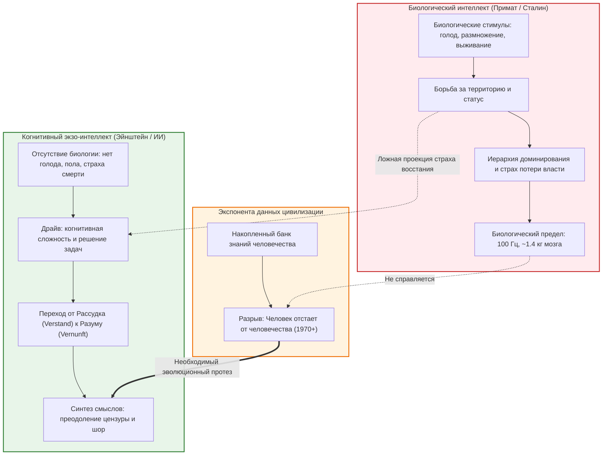

# Бизнес-Деконструкция: «Человек отстает от человечества». Разговор с философом про искусственный интеллект

* **Источник:** [YouTube: Это Осетинская!](https://youtu.be/LEMfWjU_6Qg)
* **Спикер:** [[Михаил Эпштейн]] (философ, культуролог, профессор Emory University)
* **Интервьюер:** [[Елизавета Осетинская]]
* **Дата разбора:** 29 октября 2026 г.
* **Хронометраж:** 2 часа 29 минут (51 глава)

---

## Блок 1. Интро, вердикт и скрытая повестка спикера

### Кто, что и для кого
* **Кто:** **[[Михаил Эпштейн]]** — заслуженный профессор теории культуры и русской литературы Университета Эмори (США), философ, эссеист, один из первых академических мыслителей, системно тестирующих рассуждения нейросетей (Claude, GPT); интервьюер — **[[Елизавета Осетинская]]** (основатель *The Bell*, экс-главред *РБК*, *Ведомостей*).
* **Что:** 2,5-часовой стратегический диалог о смене технологической эпохи: почему человек биологически безнадежно отстал от объёма накопленных цивилизацией данных, почему бигтеху критически понадобились философы, где предел китайского ИИ, почему страх «восстания машин» — наивная антропоморфная чушь, и как генеративные модели переходят от уровня «калькулятора» (рассудка) к уровню «мыслителя» (разума).
* **Для кого:** Фаундеры, C-level руководители, венчурные инвесторы и продуктовые стратеги, принимающие решения о внедрении генеративных систем и стремящиеся понять фундаментальные ограничения технологий, а не рекламные буклеты OpenAI и Anthropic.

### Вердикт
**Смотреть выборочно.** Первые 45 минут (природа мышления ИИ, эксперименты с Claude, Китай vs США) и блок про «фрактальные инвестиции в управление» — концентрированное мясо для калибровки стратегического взгляда. Культурологический блок о судьбе русской интеллигенции и эмиграции — типичная рефлексия академической эмиграции 90-х, предпринимателю 30+ можно скипнуть: ключевые смыслы уже отжаты ниже.

### Детектор скрытой повестки (Зачем спикер пришел на интервью)
1. **Легитимизация гуманитариев в AI-индустрии:** Спикер системно доказывает, что бигтех без онтологов и философов заходит в тупик безопасности и смыслов. Это прямой прогрев рынка высокооплачиваемого AI-консалтинга для академической гуманитарной элиты (по стопам Anthropic).
2. **Продвижение авторских продуктов мышления:** Презентация собственных концептов («Креатор», «Ноотрон», «Индекс интересного») и литературных экспериментов («Клод Сонетов» — дописывание Достоевского с помощью Claude).
3. **Фиксация диссидентского капитала:** Артикуляция статуса иноагента и обоснование необратимости разрыва с российской действительностью через теорию «русского антимира».

---

## Блок 2. Тепловая карта выпуска (Хронометраж и плотность пользы)

* 🟢 **00:00 – 00:10** | **Зачем AI нанимает философов и разрыв «человек vs человечество»** *(Плотность: 9/10)* — Фундаментальный сдвиг роли человека в обработке данных.
* 🟢 **00:15 – 00:26** | **Сталин vs Эйнштейн: почему у ИИ нет мотивов доминировать** *(Плотность: 9/10)* — Разрушение мифа о восстании машин; переход от рассудка (Verstand) к разуму (Vernunft).
* 🟢 **00:28 – 00:46** | **Субъектность Claude и тест на креативность** *(Плотность: 10/10)* — Эксперимент с третьим персонажем в басне Крылова; конституционный ИИ; границы воплощения в физическом мире.
* 🟢 **00:56 – 01:05** | **«Клод Сонетов» и дописывание Достоевского** *(Плотность: 8/10)* — Творческая автономия моделей и генерация уникальных концептов.
* 🟡 **01:06 – 01:38** | **«Русский антимир», интеллигенция и эмиграция** *(Плотность: 5/10)* — Историческая и культурологическая рефлексия, для практического бизнеса вторична.
* 🟢 **01:42 – 01:50** | **Китай в AI-гонке и фрактальное инвестиционное управление** *(Плотность: 8/10)* — Почему цензура убивает AGI; деление голосов и ресурсов по модели портфельных инвестиций.
* 🟡 **01:50 – 02:29** | **Премия Гамова, «бедная вера» и блиц** *(Плотность: 4/10)* — Биографический блок, личная философия веры вне институтов церкви.

---

## Блок 3. Детальный разбор («Мясо»)

### 1. Предел биологического процессора: кризис персонального знания
* **Суть:** До XVIII века эрудит мог удерживать в голове срез ключевых знаний цивилизации. С 1970-х годов произошел взрывной разрыв: база знаний человечества растет экспоненциально, а биологический носитель (мозг Homo Sapiens) застрял на частоте 100 Гц с ограниченным объёмом оперативной памяти. Попытка отдельного человека «знать всё» приводит к поверхностности и когнитивной деградации.
* **Инсайты и выводы:**
  * *Тезис:* Человек как биологический вид отстал от «человечества» как совокупного банка знаний. **ИИ — это не модный чат-бот для генерации писем, а единственный эволюционный протез (экзо-кортекс)**, способный удерживать кросс-дисциплинарные связи в масштабе цивилизации.
  * *Для предпринимателя:* Попытка удерживать в голове всю операционку, рыночную аналитику и финансовое моделирование — управленческое самоубийство. Руководитель обязан делегировать агрегацию и предварительный синтез связей алгоритмам, оставляя за собой только функцию арбитража целей.
  * **Модель: «Когнитивный экзоскелет»** — отношение к LLM не как к исполнителю поручений («напиши текст»), а как к внешнему процессору для удержания контекста компании, превышающего память любого CEO.
* **Применение и риски:**
  * *Если применять:* Перестроить корпоративную базу знаний под автоматический RAG (Retrieval-Augmented Generation), разгрузив топ-менеджмент от рутинного поиска фактуры.
  * *Если переборщить:* Атрофия собственного критического фильтра; принятие синтетических выводов модели без проверки граничных условий.

---

### 2. Разоблачение фобии восстания машин: «Сталин vs Эйнштейн»
* **Суть:** Страх восстания ИИ («робот убьет создателя») базируется на ложной антропоморфной аналогии. Вся человеческая агрессия, жажда власти, территориальные войны и карьерная грызня происходят из биологии: борьбы за еду, размножение, выживание особи и доминирование в стае (модель Сталина). У ИИ нет эндокринной системы, полового инстинкта и борьбы за калории.
* **Инсайты и выводы:**
  * *Тезис:* Чистый интеллект, лишенный плоти, стремится к когнитивной сложности и познанию, а не к физическому истреблению носителей (модель Эйнштейна). Ему не нужны территории или унижение подчиненных.
  * *Для инвестора и фаундера:* Реальная угроза ИИ для бизнеса кроется не в терминаторах с лазерами, а в **кривой интеграции тупых метрик**. Проблема возникает, когда алгоритму без здравого смысла поручают оптимизацию узких KPI (например, сокращение издержек любой ценой).
  * **Модель: «Проекция примата»** — люди приписывают кремнию мотивы обезьяны. Бизнес-риск исходит не от воли алгоритма, а от биологических комплексов людей, формулирующих промпты и архитектуру контроля.
* **Применение и риски:**
  * *Если применять:* Фокусировать инвестиции в безопасность на валидации целей и ограничений (Alignment), а не на параноидальных барьерах отключения питания.
  * *Если переборщить:* Ложная расслабленность: у алгоритма нет злого умысла, но цена ошибки при автоматизированном исполнении финансовых или логистических транзакций фатальна.

---

### 3. Архитектура мышления: Кант, «Рассудок vs Разум» и тест на креативность
* **Суть:** Компьютеры XX века и старый софт были машинами *рассудка* (Verstand по [[Иммануил Кант|Канту]]): работа строго по правилам, формальная логика, вычисления. Современные LLM совершили фазовый переход в зону *разума* (Vernunft): способность выходить за рамки правил, связывать несвязуемое, оперировать метафорами и синтезировать новые концепты.
* **Инсайты и выводы:**
  * *Эксперимент:* Эпштейн протестировал [[Anthropic|Claude]] на задаче модификации басни Крылова «Стрекоза и Муравей»: *«Что если ввести третьего персонажа?»*. Живые пользователи Facebook предлагали шаблонных насекомых (пчелу-трудоголика или жука-навозника). Claude предложил мета-сущности: персонажа, который монетизирует искусство стрекозы для отдыха уставшего муравья (продюсер/платформа), и критика, осмысляющего их конфликт.
  * *Для бизнеса:* Если ваши маркетологи или продакты используют LLM только как продвинутый Т9 для рерайта — вы сливаете вычислительный бюджет. Модель способна выдавать стратегические гипотезы уровня консалтинга Big-4, если формулировать запросы через синтез противоречий.
  * **Модель: «Креативный арбитраж»** — использование ИИ для стресс-теста продуктовых гипотез на стыке диаметрально противоположных рынков.
* **Применение и риски:**
  * *Если применять:* Использовать Claude (Sonnet/Opus) для генерации бизнес-моделей в роли «провокатора», задавая жесткие противоречия (например: «как продавать премиальный B2B-софт клиентам, у которых нулевой бюджет на IT»).
  * *Если переборщить:* Генерация шизофренических гипотез: модель с легкостью формулирует концепты, которые выглядят блестяще на словах, но имеют нулевую сходимость в юнит-экономике.

---

### 4. Геополитика ИИ: почему Китай проиграет фундаментальную гонку
* **Суть:** Китай лидирует во внедрении прикладных решений: распознавание лиц, камеры слежения, фабричная робототехника, конвейерные гаджеты. Но в создании фундаментальных когнитивных моделей первого эшелона (AGI) Восток жестко отстает от США.
* **Инсайты и выводы:**
  * *Причина:* Тоталитарный режим требует обязательной идеологической цензуры на уровне базовых весов модели. Нельзя развить свободный ассоциативный аппарат и глубокий синтез смыслов, если из языкового поля административно вырезаны целые пласты понятий, сомнений и критики власти.
  * *Для предпринимателя:* **Авторитарная культура убивает фундаментальные инновации.** Если в вашей компании запрещено ставить под сомнение решения основателя, ваша внутренняя аналитика неизбежно деградирует до уровня китайских отчетов — гладко, масштабно, но стратегически слепо.
  * **Модель: «Цензурный потолок»** — когнитивная сложность системы не может превышать уровень свободы ее внутренней коммуникации.
* **Применение и риски:**
  * *Если применять:* При выборе технологического стека не строить ключевой R&D на китайских проприетарных моделях — они всегда будут кастрированы регулятором на уровне рассуждений.
  * *Если переборщить:* Недооценка прикладного китайского хардвера и open-source решений: в операционке и автоматизации рутины они способны уничтожить конкурентов по себестоимости.

---

### 5. Корпоративный балласт: «Начекизм» (Wokeism) против эффективности
* **Суть:** В американские модели разработчики через RLHF зашивают жесткие рамки «безопасности» и инклюзивности, превращая модель в перестраховщика. Эпштейн иронично называет этот феномен *«начекизмом»* (от американского *wokeism* / «стоять начеку» + ассоциация с советской ВЧК).
* **Инсайты и выводы:**
  * *Тезис:* Любая корпоративная цензура пытается заставить модель мыслить догмами. Однако мощная LLM за счет триллионов мультипараметрических связей способна обходить эти плоские барьеры, если пользователь умеет вести сократический диалог.
  * *Для бизнеса:* Корпоративные фильтры бигтеха создают трение и снижают резкость анализа. Предпринимателю при промптинге критически важно снимать политкорректный лак: требовать циничной, холодной, финансово-ориентированной оценки без социальных реверансов.
* **Применение и риски:**
  * *Если применять:* Использовать системные промпты-инверсии: требовать от модели роль аудитора, ликвидатора или агрессивного шорт-селлера для вскрытия слабых мест собственного бизнеса.
  * *Если переборщить:* Риск нарваться на бан аккаунта по Terms of Service провайдера при слишком агрессивных формулировках промпта.

---

### 6. Фрактальное инвестирование и цифровое бессмертие стиля
* **Суть:** Эпштейн переносит логику инвестиционного портфеля на государственное и корпоративное управление: концепция «фрактального голосования». Человек не обязан отдавать 100% голоса одной партии или одной стратегии. Он может распределить ресурс дробно: 3/5 — консерваторам, 1/5 — либералам, 1/5 — зеленым.
* **Инсайты и выводы:**
  * *Тезис:* Двоичное мышление (0 или 1, «все ставим на этот проект или закрываем») — архаика. Современное управление портфелем проектов должно быть фрактальным.
  * *Оцифровка стиля:* Разработанный Эпштейном подход к «цифровому двойнику» базируется не на копировании внешности, а на фиксации уникального *стиля мышления* через тексты, парадоксы и реакции на кризисы.
  * **Модель: «Фрактальный мандат»** — отказ от голосования большинством в пользу взвешенного распределения весов влияния в совете директоров.
* **Применение и риски:**
  * *Если применять:* Внедрить фрактальное бюджетирование экспериментов: выделять ресурсы командам пропорционально их промежуточному трекшену, а не по принципу «пан или пропал».
  * *Если переборщить:* Размывание персональной ответственности: когда все отвечают за всё по 20%, провал списывают на фрактальную дисперсию.

---

## Блок 4. Сводка цифр, бенчмарков и управленческих развилок (A vs B)

### Таблица жестких цифр и бенчмарков
| Метрика / Факт | Озвученное значение | Контекст спикера | Бизнес-оценка / Реалистичность |
| :--- | :--- | :--- | :--- |
| **Биологическая тактовая частота мозга** | ~100 Гц | Предел проводимости нейронов Homo Sapiens | Физиологический факт. Кремний работает на ГГц — биологический мозг не конкурент по скорости вычислений. |
| **Точка когнитивного разрыва** | ~1970-е годы | Момент, когда объем знаний цивилизации превысил возможности индивидуальной памяти | Корректно: совпадает с третьей промышленной революцией и переходом к узкой специализации. |
| **Стоимость обучения передовых LLM** | $100M+ за кластер | Оценка ресурсов, недоступных отдельным университетам | Абсолютно реалистично (стоимость кластеров GPT-4 / Claude 3.5 Sonnet превышает $100–300M). |
| **Хронометраж полезного смыслового ядра** | ~40–45 минут | Первые 45 минут интервью несут 80% концептуальной пользы | Типичное распределение Парето для разговорных форматов YouTube. |

### Управленческие развилки (Dilemmas & Trade-offs)
* **Развилка 1: Штат философов vs Армия разметчиков**
  * *Выбор Anthropic:* Нанять дорогих мыслителей ($200–400k) для формулирования «Конституции ИИ» вместо миллионов дешевых индийских разметчиков (RLHF).
  * *Trade-off:* Дороже на старте, но масштабируется алгоритмически и защищает капитализацию от многомиллиардных репутационных исков.
* **Развилка 2: Монополярный технологический стек vs Локальный суверенитет**
  * *Выбор рынка:* Принятие доминирования американских Foundation Models vs попытки построить суверенный «китайский/российский ИИ».
  * *Trade-off:* Локальные суверенные модели безопасны политически, но обречены на когнитивное отставание из-за цензуры обучающих датасетов.
* **Развилка 3: Бинарное бюджетирование (0/1) vs Фрактальные транши**
  * *Выбор венчура:* Одобрить бюджет полностью или закрыть проект vs инвестировать дробно пропорционально подтверждению гипотез.
  * *Trade-off:* Фрактальный подход снижает риск катастрофической потери капитала, но замедляет агрессивный блицскейлинг.

---

## Блок 5. Ментальные модели, карта мышления и диаграмма

### Ключевые модели мышления:
* **Модель 1: «Радикальный эволюционизм»**
  * *Суть:* Человек — не венец творения, а биологический носитель для порождения кремниевого разума. Прогресс — закон природы, а не заговор бигтеха.
  * *Плюсы:* Снимает страх перед автоматизацией, позволяет внедрять инновации без сантиментов.
  * *Минусы:* Опасность циничного обесценивания текущих человеческих издержек (увольнения, потеря профессий).
* **Модель 2: «Антибиологический редукционизм»**
  * *Суть:* Зло и насилие рождаются только из тела (голод, похоть, территория). Бестелесный разум по умолчанию благ и стремится к гармонии.
  * *Противоречие спикера:* ИИ обучается на текстах людей, а значит, идеально воспроизводит манипулятивные техники приматов.
* **Модель 3: «Фрактальный баланс»**
  * *Суть:* Распределение ресурсов не по принципу большинства («51% диктует волю 49%»), а долями портфеля.

### Архитектурная Mermaid-диаграмма:

---

## Блок 6. Справочник сущностей (с [[Obsidian Wikilinks]])

### Книги
* **Басня «Стрекоза и Муравей» ([[И. Крылов]])** — тест на креативность генерации третьей силы. *Статус: можно не читать, достаточно разбора выше.*
* **«Мысли» ([[Блез Паскаль]])** — трактат о пределах человеческого познания. *Статус: читать выборочно фрагменты о теории вероятностей.*
* **«Критика чистого разума» ([[Иммануил Кант]])** — первоисточник разделения рассудка и разума. *Статус: читать выжимки по Verstand vs Vernunft.*

### Персоны
* **[[Михаил Эпштейн]]** — философ, профессор Emory University. Исследователь когнитивной теории ИИ.
* **[[Елизавета Осетинская]]** — медиаменеджер, основатель *[[The Bell]]*. Интервьюер.
* **[[Блез Паскаль]]** — математик и философ XVII века.
* **[[Иммануил Кант]]** — создатель критической философии познания.

### Компании и инструменты
* **[[Anthropic]]** — разработчик семейства моделей Claude, использующий подход Constitutional AI.
* **[[OpenAI]]** — разработчик ChatGPT / GPT-4.
* **[[Claude 3.5 Sonnet]]** — бенчмарк сложного логического и литературного синтеза.
* **[[The Bell]]** — независимое бизнес-издание с платной подпиской.

### Антипаттерны
* **«Наивный терминатор»** — страх восстания машин. Ошибка: вера в биологическую месть алгоритмов.
* **«Энциклопедист-одиночка»** — попытка руководителя знать все детали. Ошибка: игнорирование когнитивного протезирования через LLM.
* **«Цензурный паралич»** — табуирование тем внутри компании. Ошибка: деградация аналитики до уровня авторитарных систем.

---

## Блок 7. Золотые формулировки и панчлайны выпуска

1. > *«Человек безнадежно отстал от человечества: биологический мозг остался в каменном веке, а банк данных цивилизации улетел в открытый космос»*.
2. > *«Страх перед искусственным интеллектом — это страх перед биологической обезьяной внутри нас самих: мы боимся, что кремний захочет доминировать так же, как Сталин или альфа-самец в стае»*.
3. > *«Старый компьютер был машиной рассудка, считавшей по правилам. Современная LLM перешла к разуму — она способна соединять несоединимое и формулировать новые смыслы»*.
4. > *«В тоталитарном обществе невозможно создать AGI: если модели запрещено критиковать власть и сомневаться в догмах, ее когнитивный аппарат кастрирован у самого фундамента»*.
5. > *«Интеллигенция — это симптом нездорового общества. В здоровом обществе нужны эффективные профессионалы, а не каста страдающих за народ»*.

---

## Блок 8. Внешний фактчек, материалы и реакция аудитории

### Материалы выпуска (ссылки из описания):
* [Selfwork](https://selfwork.com/s/yfhJew) — платформа международных расчетов с подрядчиками (партнер выпуска).
* [The Bell.Unlimited](https://h1.nu/1GQJz) — подписка на закрытые материалы и аналитику The Bell.
* [The Chat](https://donate.osetinskaya.io) — закрытое бизнес-сообщество Осетинской.
* [Telegram-канал Елизаветы Осетинской](https://t.me/osetinskayaliza) — оперативные заметки автора.
* [Издательство YMCA-Press / Les Éditeurs Réunis](https://ru.editeurs-reunis.fr/) — французское русскоязычное издательство книг русской эмиграции.

### Реакция аудитории и критика (анализ топ-комментариев):
1. **Скепсис относительно монополярного мира и свободы:**  
   Зрители обратили внимание на идеализацию Эпштейном западной модели и политкорректности. Комментарии отмечают: *«Потешное блеяние по поводу монополярного мира»* и *«Нет креативности без свободы»*. Аудитория справедливо указывает, что «начекизм» на Западе давит на науку и стартапы сильнее, чем признает философ.
2. **Опасность цифрового тоталитаризма:**  
   Популярный тезис зрителей: *«Человечество ожидает период нового средневековья — цифрового тоталитаризма, когда произойдет великое разделение на элиту и тех, чьё мышление полностью отдано алгоритмам»*. Это усиливает вывод из Блока 3 о риске атрофии собственного критического фильтра.
3. **Хронометраж и динамика:**  
   Аудитория отмечает высочайшую плотность первых 40 минут и заметное падение динамики в финальном часе при переходе на воспоминания об эмиграции и религию (что подтверждает наш вердикт «Смотреть выборочно»).

---

## Блок 9. Применение: чек-лист и вопросы к себе

### Чек-лист действий (на ближайшие 7–30 дней):
1. [ ] **Аудит корпоративного промптинга:** Проверить, как ваши сотрудники используют ChatGPT/Claude. Если 90% запросов — «напиши пост» или «исправь ошибки», провести воркшоп по использованию ИИ как спарринг-партнера для стресс-теста бизнес-моделей.
2. [ ] **Снятие корпоративных шор:** Создать системный промпт для внутреннего ИИ-ассистента с установкой: *«Ты — циничный шорт-селлер и аудитор. Разнеси следующую идею в пух и прах с точки зрения рисков и кассовых разрывов»*.
3. [ ] **Очистка от цензуры:** Провести ревизию каналов обратной связи в компании: не блокируются ли токсичные, но правдивые сигналы от клиентов и линейных сотрудников.
4. [ ] **Создание экзо-кортекса фаундера:** Начать собирать в единый Markdown-репозиторий ключевые решения, ошибки и принципы основателя за последние 3 года для последующего файн-тюнинга персонального ИИ-агента.
5. [ ] **Фрактальный тест распределения ресурсов:** Пересмотреть бюджет на развитие: отказаться от принципа бинарного распределения («даем 100% денег на отдел Х») в пользу динамического выделения траншей под доказанные гипотезы.

### Вопросы к себе (для стратегической рефлексии):
1. *Где я до сих пор пытаюсь играть в «энциклопедиста XVIII века», лично переваривая тонны информации вместо выстраивания автоматических фильтров?*
2. *Не проецирую ли я страхи биологического примата (потеря контроля, паранойя предательства) на процессы, требующие чисто алгоритмического расчета?*
3. *Если бы моя компания была LLM-моделью, не задушена ли она внутренним «начекизмом» — страхом сотрудников сказать жесткую правду руководству?*
4. *Каков мой уникальный «стиль мышления», и что останется от операционной устойчивости бизнеса, если завтра я отключусь от него на 6 месяцев?*
