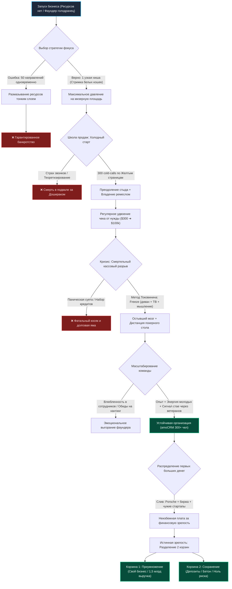

# Бизнес-Деконструкция: «Токовинин: привычка, из-за которой 97% людей бедны (и как это исправить)»

* **Источник:** [YouTube: Глеб Соломин](https://youtu.be/ZFQsEs0jR1I)
* **Спикер:** [[Михаил Токовинин]] — серийный предприниматель, сооснователь экосистемы [[amoCRM]] (выручка >1,5 млрд руб./год, стратегическая сделка с [[1С]]) и веб-интегратора [[Qsoft]].
* **Интервьюер:** [[Глеб Соломин]] (автор подкаста «Подкаст Соломина»)
* **Дата разбора:** 30 октября 2026 г.
* **Хронометраж:** 1 час 04 минуты 33 секунды (24 темы/главы)

[](https://youtu.be/ZFQsEs0jR1I)

---

## Блок 1. Интро, вердикт и скрытая повестка спикера

### Кто, что и для кого
* **Кто:** **[[Михаил Токовинин]]** — один из самых прагматичных, опытных и непублично-системных технологических предпринимателей России. Прошел путь от веб-студии в подвале (основал [[Qsoft]] в 2002 году, питаясь «Дошираком» и играя в шутеры) до построения международного SaaS-гиганта [[amoCRM]] с миллионами пользователей, сотнями тысяч платящих B2B-клиентов и годовой выручкой свыше 1,5 млрд рублей. В 2016 году провел знаковую M&A-сделку, продав контрольный пакет (51%) компании [[1С]] Бориса Нуралиева, сохранив при этом операционный контроль и статус идеолога продукта.
* **Что:** Жесткий, лишенный коучинговой шелухи и романтики 64-минутный мастер-класс по теории вероятностей в бизнесе, физике позиционирования, ремеслу продаж и операционной психологии. Токовинин препарирует бизнес не как «гениальную идею», а как стохастический марафон в условиях неопределенности: почему бизнес — это покер, а не шахматы; почему первая попытка новичка гарантированно обречена на крах и почему ставить на нее кредиты или квартиру бабушки — финансовое самоубийство; формула фокуса для компаний без ресурсов («Давление = Сила / Площадь»); анатомия холодных продаж от «Желтых страниц» и потных ладоней до чеков в $100 000 и $1 000 000; реальный кейс спасения от кассового разрыва случайным чеком на $10 000; фундаментальный антагонизм между приумножением и сохранением капитала (Porsche и слив депозита на бирже); и почему в момент катастрофического стресса самое продуктивное управленческое действие — лечь на диван, смотреть телевизор и ничего не делать.
* **Для кого:** Действующие собственники малого и среднего бизнеса (B2B, IT, ритейл, агентства), операционные директора, коммерческие руководители, а также наемные топ-менеджеры, стоящие на распутье между высокооплачиваемой корпоративной карьерой и запуском собственного рискованного дела.

### Вердикт
**Смотреть обязательно.** В русскоязычном бизнес-сегменте YouTube 90% контента — это либо инфобизнесовая мотивационная «жвачка», либо показной гламур без погружения в матчасть. Интервью с Токовининым — редчайший концентрат циничной практической мудрости человека, который 25 лет лично варился в кассовых разрывах, увольнениях, судебных рисках и конкурентных войнах. Каждая мысль проверена миллионами рублей личных потерь и побед.

### Детектор скрытой повестки спикера & Разоблачение кликбейта
* **Разоблачение кликбейта названия:** Заголовок подкаста («привычка, из-за которой 97% людей бедны») — стопроцентная выдумка команды Соломина для выкручивания CTR на массовую аудиторию. В самом ролике **нет ни слова** про «97% нищих» и «магические привычки богатых». Токовинин презирает эзотерику и прямо заявляет, что универсальных рецептов успеха не существует, а попытка подогнать всех под единый шаблон губительна.
* **Истинная повестка Токовинина (Зачем он пришел):**
  1. **Запуск и накачка собственных медиаканалов:** В финале выпуска Токовинин открыто объявляет о запуске собственного YouTube-канала и раскрутке авторского Telegram-канала (`@mtokovinin`). Аудитория Соломина (молодые предприниматели, разработчики, маркетологи) — идеальное ядро для первичного посева.
  2. **HR-магнит высшего уровня:** Токовинин транслирует образ анти-корпоративного, предельно прямого лидера («Мне плевать, любят ли меня люди, но делу они должны быть преданы»). Для сильных, голодных до результатов специалистов работа под началом такого фаундера привлекательнее, чем забюрократизированные структуры бигтеха.
  3. **Культурный цемент для экосистемы партнеров [[amoCRM]]:** amoCRM держится на 10 000+ независимых интеграторах. Подобные программные выступления основателя укрепляют веру партнерской сети в устойчивость и непотопляемость платформы.

---

## Блок 2. Тепловая карта выпуска (Хронометраж и плотность пользы)

| Таймкод | Тема главы | Плотность | Суть и бизнес-ценность |
| :--- | :--- | :---: | :--- |
| **00:00 – 01:02** | Трейлер и ключевые хуки | 🟢 Мясо | Выручка amoCRM 1,5 млрд руб., 51% акций у 1С, «без продаж шансов нет», покер vs шахматы. |
| **01:02 – 03:28** | Москва vs Регионы: Ловушка ложной локации | 🟢 Мясо | Где твой клиент? Маркетплейсы, автосервисы и ритейл лучше строить в Перми и Воронеже; Москва — аномалия и нужна только для Enterprise/Banking. |
| **03:28 – 06:16** | Физика давления: 1 точка из 50 | 🟢 Мясо | Давление = Сила / Площадь. Чем ты голодранее, тем уже фокус («стрижем белых кошек в Воронеже»). Страх выбора парализует новичков. |
| **06:16 – 08:26** | Партнерство и закон Спенсера | 🟢 Мясо | «Survival of the Fittest» — выживает наиболее адаптированный. В партнерство идут закрывать свои органические дефициты, а не дружить. |
| **08:26 – 13:14** | Фокус vs Диверсификация: Иллюзия блогерских бизнесов | 🟢 Мясо | Тимати в бургерных — это аренда трафика, а не рестораторство. Вести 2 стартапа одновременно — гарантия провала обоих (инвесторский ред-флаг). |
| **13:14 – 17:07** | Стратегия выхода и ДНК компании | 🟢 Мясо | Либо трансформируй бизнес под ИИ, либо продавай за 8–10 годовых прибылей. Универсального «успешного ДНК» нет. |
| **17:07 – 24:42** | Команда: Циничная лояльность vs Эффективность | 🟢 Мясо | «Мне плевать, как ко мне относятся люди». Почему в штате на 300 чел. выгодно держать неэффективных старых друзей (сигнал стае о защите). |
| **24:42 – 28:01** | Опыт vs Энергия и LTV сотрудника | 🟢 Мясо | Опытные кадры приходят со своим стеклянным потолком; молодые и голодные расширяют предел возможного компании. |
| **28:01 – 30:51** | Предательство и корпоративный хантинг | 🟢 Мясо | Яндекс хантит команду конференций. Вкладываешься как в детей, а они уходят за деньги. Антипаттерн «влюбленности в сотрудников». |
| **30:51 – 34:49** | Институциональный спор партнеров | 🟢 Мясо | Конфликт Токовинина («вылизывание пикселей») и Егора («тяп-ляп в продакшн») как идеальный динамический баланс качества и скорости. |
| **34:49 – 38:01** | Фундаментальность продаж | 🟢 Мясо | «Без продаж в жизни шансов нет». Продажи идеи, себя, продукта, компании. 300 холодных звонков делают продавцом даже абсолютного бездаря. |
| **38:01 – 43:16** | Рост чека от нужды: $300 ➔ $100 000 | 🟢 Мясо | Кейс [[Qsoft]]: продавали сайты по $300 при себестоимости $500. Чтобы выжить, удваивали цену каждый квартал. Рекорд — контракт >$1 000 000. |
| **43:16 – 45:09** | Две корзины: Приумножение vs Сохранение | 🟢 Мясо | Приумножение — это высокий риск в бизнесе. Сохранение — нулевой риск (бетон, депозиты). Ошибка — пытаться сохранять в крипте и стартапах. |
| **45:09 – 48:21** | Первые деньги, Porsche и слив на бирже | 🟢 Мясо | Закономерность: первые заработанные деньги фаундер обязательно сольет на б/у кабриолет Porsche, биржевую торговлю и глупые инвестиции. |
| **48:21 – 50:27** | Антистресс: Главное — ничего не делать | 🟢 Мясо | Суета в кризис заставляет бегать по кругу старых ошибок. Метод Токовинина: лечь, смотреть ТВ, отключиться, пока мозг не остынет. |
| **50:27 – 53:20** | Кейс спасения от кассового разрыва: Дима и $10 000 | 🟢 Мясо | Денег на зарплату нет, долги. Звонок неизвестного парня Димы: приехал через час, оставил $10 000 наличными за магазин и исчез. |
| **53:20 – 55:01** | Теория вероятностей: Бизнес как покер | 🟢 Мясо | Везение — функция от количества попыток. Бизнес — игра мастерства против неопытных оппонентов с элементом случая на короткой дистанции. |
| **55:01 – 57:02** | Почему 1-й бизнес гарантированно прогорит | 🟢 Мясо | Ты новичок за столом профессионалов. Запрет на кредиты и продажу квартир родственников: цель первого бизнеса — выжить и сделать попытку №2. |
| **57:02 – 01:01:54** | Драйверы Токовинина: Эксплуатация детского азарта | 🟢 Мясо | Обыватель прокачивает танчики до 50 уровня, а фаундер с тем же фанатизмом ковыряет финучет и Excel. Почему в найме часто денег больше. |
| **01:01:54 – 01:04:33** | Философия Панды и главное напутствие | 🟢 Мясо | Правило 2 лет для экспертности. Метафора мультфильма «Кунг-фу Панда»: «Не меняй себя — используй себя. Не создавай волну — оседлай ее». Главное — не накосячить по-крупному. |

---

## Блок 3. Детальный разбор («Мясо»)

### 1. Физика позиционирования: Закон гидравлического давления (1 точка из 50)
* **Суть:** Начинающие предприниматели страдают синдромом распыления: боясь ошибиться со ставкой, они открывают «шаурмичную, автомойку, барбершоп и агентство маркетинга» одновременно. Имея скудный стартовый капитал, они размазывают его тонким слоем, создавая околонулевое давление на рынок, и закономерно проигрывают специализированным игрокам.
* **Инсайты и выводы:**
  * **Тезис:** Успех микробизнеса прямо пропорционален узости его позиционирования. *Формула давления:* $P = F / S$. Чем меньше сила ($F$, ресурсы), тем микроскопичнее должна быть площадь ($S$, ниша), чтобы пробить сопротивление рынка ($P$).
  * **Ментальная модель:** «Стрижка только белых кошек в Воронеже». Заявив ультра-узкую специализацию, ты становишься безальтернативным выбором №1 для целевого сегмента и отсекаешь 99% нерелевантных костов.
  * **География клиента:** Нельзя переезжать в Москву «за деньгами», если твой клиент в регионе. В Москве аномальная плотность населения и дикая себестоимость. Сеть автосервисов или торговлю на Wildberries фаундер из Перми построит в разы дешевле и эффективнее, чем москвич, потому что понимает менталитет и экономику провинции. В Москву переезжают только ради Enterprise-клиентов (банки, штаб-квартиры холдингов).
* **Развилка решений:**
  * *Если применять на практике:* Жестко вычеркнуть 49 направлений из 50. Сфокусировать 100% энергии команды на одном монопродукте для конкретной микро-ЦА, доведя конверсию до отраслевого рекорда.
  * *Если переборщить (Риск):* Сузить нишу до емкости, в которой физически нет объема денег для масштабирования (Total Addressable Market меньше точки безубыточности компании).

### 2. Партнерство как компенсация органических изъянов (Перфекционист vs Бракодел)
* **Суть:** Партнерство в бизнесе — это не эмоциональная дружба за пивом, а вынужденная биологическая кооперация для выживания. Токовинин цитирует Герберта Спенсера (*«Survival of the Fittest»* — выживание наиболее приспособленного, ошибочно приписываемое Дарвину): побеждает организм, способный лучше адаптироваться к агрессивной среде.
* **Инсайты и выводы:**
  * **Тезис:** Партнер нужен исключительно там, где ты сам органически слаб и где в одиночку бизнес погибнет. Брать партнера с похожим психотипом и компетенциями — управленческая шизофрения.
  * **Кейс amoCRM (Токовинин vs Егор):** Токовинин — маниакальный перфекционист («вылизываю пиксели, торможу релизы ради идеала»). Его партнер Егор — радикальный операционист скорости («жуткий бракодел: тяп-ляп в продакшн, главное — лететь вперед»).
  * **Институциональный конфликт:** Вечный спор между партнерами создает точку золотого сечения. Если побеждает только скорость — продукт тонет в багах и технологическом долге. Если побеждает только перфекционизм — продукт умирает в лаборатории, не дожив до первого платящего клиента.
* **Развилка решений:**
  * *Если применять на практике:* Нанимать и брать в сооснователи антиподов, сознательно легализуя жесткую конструктивную дискуссию на уровне архитектуры и продуктовой стратегии.
  * *Если переборщить (Риск):* Превратить институциональный спор в личную войну эго, парализующую принятие операционных решений и ведущую к корпоративному разводу.

### 3. Циничная архитектура команды: Лояльность, опыт и предательство
* **Суть:** Отношения собственника с персоналом подчиняются жестким законам масштаба. То, что является смертельным ядом для стартапа из трех человек, становится высокорентабельной инвестицией для корпорации в 300 сотрудников.
* **Инсайты и выводы:**
  * **Парадокс старых друзей:** В микробизнесе держать слабого сотрудника из жалости нельзя — компания обанкротится. В компании на 300 человек Токовинин сознательно платит зарплату нескольким неэффективным ветеранам только за то, что они «хорошие старые ребята». *Зачем?* Это мощнейший публичный сигнал всей стае: «На меня можно делать жизненную ставку. Я не выкину вас на помойку, когда вы устанете или допустите ошибку».
  * **Опыт vs Энергия:** Опытные топ-менеджеры приходят с багажом чужих готовых решений и собственным потолком представлений о «возможном». Молодые, голодные и амбициозные новички не знают границ, заряжают команду витальной энергией и расширяют предел компании.
  * **Антипаттерн «Влюбленности в сотрудников»:** Фаундеры часто вкладываются в ключевых специалистов больше, чем в собственных детей, выстраивая иллюзии вечной преданности. Когда Яндекс или конкуренты переманивают человека повышенным чеком, фаундер испытывает сокрушительное разочарование. *Рецепт Токовинина:* Никогда эмоционально не привязываться к подчиненным. Уход сотрудника — нормальный закон рыночной конкуренции, а не предательство.
* **Развилка решений:**
  * *Если применять на практике:* Четко разделять эмоциональный контур и бизнесовый. Выстраивать систему преемственности, при которой уход любого топ-менеджера не останавливает операционные процессы.
  * *Если переборщить (Риск):* Скатиться в ледяной социопатический цинизм, выжигающий корпоративную культуру и превращающий компанию в токсичную текучую «мясорубку».

### 4. Ремесло продаж: От холодных баз до чеков в $1 000 000
* **Суть:** В бизнесе и жизни ценность идеи равна нулю. Вся реальная ценность сконцентрирована исключительно в реализованной и проданной идее. Продажи — это не врожденный дар харизматиков, а механическое ремесло, нарабатываемое статистической повторяемостью.
* **Инсайты и выводы:**
  * **«Без продаж шансов нет»:** Ты продаешь непрерывно: продукт клиентам, идею инвесторам, вакансию соискателям, свои правила партнерам. Пока ты не взял в руки справочник «Желтые страницы» и не начал дрожащими руками звонить вхолодную («Здравствуйте, вам сайт не нужен?») — ты праздный теоретик, а не предприниматель.
  * **Закон 300 попыток:** Первый cold-call — это стресс, пот и унизительный посыл на три буквы («Обосрался и пошел домой»). Но после 300-го холодного контакта любой бездарный интроверт неизбежно трансформируется в уверенного продавца благодаря калибровке скриптов и потере страха отказа.
  * **Кейс масштабирования чека [[Qsoft]]:** Основатели начали продавать сайты по $300, когда реальная себестоимость разработки составляла $500. Чтобы закрыть разрыв по предыдущему проекту, следующий приходилось продавать дороже. *Решение:* Каждые 3 месяца директивно удваивали прайс (300 ➔ 600 ➔ 1 200 ➔ ... ➔ 100 000). За 2,5 года дошли до чека в $100 000, а исторический рекорд компании превысил $1 000 000.
* **Развилка решений:**
  * *Если применять на практике:* Внедрить регулярную практику директивного повышения среднего чека с одновременным углублением ценностного предложения для отсева неплатежеспособной токсичной аудитории.
  * *Если переборщить (Риск):* Задрать ценник без подтвержденной продуктовой ценности и рыночной репутации, полностью обрушив воронку входящих сделок.

### 5. Две противоположные корзины капитала: Приумножение vs Сохранение
* **Суть:** Сохранение капитала и приумножение капитала — это две фундаментально несовместимые ментальные модели с взаимоисключающим риск-профилем. Попытка смешать их приводит к гарантированной потере накоплений.
* **Инсайты и выводы:**
  * **Приумножение (Бизнес):** Высочайший контролируемый риск, где инвестор лично влияет на операционные показатели. Это лучший инструмент генерации доходности.
  * **Сохранение («Деньги в тумбочке»):** Минимальный риск с нулевой тягой к сверхдоходности. Инструменты: консервативная недвижимость, банковские депозиты, надежные государственные облигации.
  * **Ошибка неофитов:** Считать криптовалюту, венчурные стартапы друзей и фондовый рынок «сохранением капитала». Это спекулятивные инструменты высокого риска.
  * **Личные грабли Токовинина:** Заработав первые серьезные дивиденды в Qsoft, они с партнером первым делом купили по подержанному кабриолету Porsche, после чего Михаил слил крупный капитал на биржевой торговле и вложился в несколько идиотских стартапов, потеряв всё. *Вывод:* Первый заработанный капитал обречен на слив — это неизбежная плата за финансовое взросление.
* **Развилка решений:**
  * *Если применять на практике:* Жестко изолировать операционную прибыль бизнеса от личного резервного фонда. Личные резервы парковать исключительно в низкорисковых активах без кредитного плеча.
  * *Если переборщить (Риск):* Заморозить весь свободный кэш в низкодоходных инструментах на ранней стадии компании, лишив растущий бизнес необходимого оборотного топлива.

### 6. Бизнес как покер: Матожидание, попытки и спасение от кассового разрыва
* **Суть:** В обществе укоренилось заблуждение, что бизнес подобен шахматам — детерминированной игре с полной информацией, где побеждает тот, кто просчитал партию на 10 ходов вперед. Токовинин доказывает: бизнес — это чистый покер.
* **Инсайты и выводы:**
  * **Фактор случая и дистанция:** В покере слабый новичок может сорвать банк в конкретной раздаче благодаря слепой удаче. Но на дистанции в 1000 раздач профессионал неизбежно заберет стек у дилетанта за счет знания математического ожидания, психологии и управления банком.
  * **Везение = f(Количество Попыток):** Успех — это не разовое озарение, а интеграл под кривой попыток. Чем больше гипотез ты генерируешь, тем выше вероятность поймать «черного лебедя» с позитивной доходностью.
  * **Кейс парня Димы и кассового разрыва:** На 2–3 год работы студия Qsoft попала в классическую пирамиду кассового разрыва. До выплаты зарплат оставалось 2 дня, касса была абсолютно пуста, основатели судорожно искали долги. Раздался звонок: незнакомый парень Дима спросил дорогу, приехал через полчаса, заказал интернет-магазин, выложил на стол $10 000 наличными (при озвученной цене $15 000) и ушел. Проект так и не завершили, Дима пропал, но его аванс спас компанию от гибели. *Вывод:* Это чистое стохастическое везение, которое случается только с теми, кто находится в активном движении за столом.
  * **Табу на кредиты для первого бизнеса:** Первый бизнес с вероятностью 95%+ закончится крахом просто из-за отсутствия наигранности. Брать под него кредиты или закладывать недвижимость родственников — преступление. Новичок обязан тестировать ниши на свои карманные деньги, сохраняя право на следующие 5–10 попыток.
* **Развилка решений:**
  * *Если применять на практике:* Относиться к запускам как к серии недорогих итеративных экспериментов с фиксированным лимитом допустимого убытка (stop-loss на гипотезу).
  * *Если переборщить (Риск):* Обесценить планирование и стратегию, превратив компанию в хаотичное казино без контроля unit-экономики и сходимости метрик.

### 7. Ментальная экология фаундера: Пауза в стрессе, Excel вместо «Танчиков» и философия Панды
* **Суть:** Психологическая устойчивость основателя базируется на двух китах: умении останавливать реактивную суету в кризис и принятии своей аутентичной органической природы.
* **Инсайты и выводы:**
  * **Управленческий «Freeze» при катастрофе:** Когда бизнес накрывает кризис, инстинкт требует немедленных действий. Это ловушка: в панике человек суетится и лишь воспроизводит старые паттерны, загнавшие его в тупик. *Протокол Токовинина:* Полностью изолироваться, лечь на диван, смотреть телевизор и не делать НИЧЕГО. Только в состоянии расслабления мозг выходит из туннельного зрения стресса и синтезирует нестандартное решение.
  * **Сублимация любопытства:** Все взрослые люди сохраняют детское любопытство. Но большинство сублимирует его в деструктивное русло — прокачивают танки в World of Tanks до 50 уровня, становясь там «богами». Предприниматель направляет этот же маниакальный азарт на созидательные сущности: кайфует от формул в Excel, финансового учета, конверсий и продуктовых фичей.
  * **Философия «Кунг-фу Панды»:** Токовинин ссылается на любимый мультфильм своего партнера: «Не пытайся изменить себя — используй себя. Не пытайся создать новую волну — оседлай существующую волну». Попытка сломать свой психотип под чужой образ «идеального CEO» гарантирует невроз и банкротство. Эксплуатировать нужно свои врожденные перекосы и таланты.
  * **Главное пожелание:** «Сильно не накосячить». Жизнь ломают не мелкие ошибки, а одна фатальная глупость (уголовное дело, кабальный долг, потеря репутации). Задача предпринимателя — ошибаться часто, но исключительно по мелочи.
* **Развилка решений:**
  * *Если применять на практике:* Провести аудит личных деструктивных таймкиллеров, перенаправив фокус внимания на оцифровку собственного бизнеса; ввести мораторий на принятие решений в состоянии аффекта.
  * *Если переборщить (Риск):* Использовать «ничегонеделание» как алиби для лени, избегания операционной ответственности и прокрастинации.

---

## Блок 4. Сводка цифр, бенчмарков и развилок (A vs B)

### Сводная таблица ключевых метрик и фактов

| Метрика / Факт | Значение спикера | Контекст и бизнес-механика | Реалистичность |
| :--- | :--- | :--- | :---: |
| **Выручка [[amoCRM]]** | **1,5+ млрд руб./год** | Масштаб компании в B2B SaaS-сегменте; сотни тысяч платных клиентов, глобальное присутствие. | 10/10 (СПАРК / отчетность) |
| **Доля [[1С]] в amoCRM** | **51% акций** | Стратегическая сделка 2016 года с Борисом Нуралиевым; сохранение операционной автономии фаундеров. | 10/10 (Публичная M&A) |
| **Стартовая экономика [[Qsoft]]** | **$300 выручка / $500 себестоимость** | Классическая яма заказной веб-разработки начала 2000-х; кассовый дефицит стимулировал подъем цен. | 10/10 (Типично для студий) |
| **Динамика роста чека** | **$300 ➔ $100 000 за 2,5 года** | Ежеквартальное удвоение стоимости сайта из-за нужды покрывать операционные кассовые разрывы. | 9/10 (Рынок заказного веба) |
| **Рекордный контракт Qsoft** | **>$1 000 000** | Крупнейший заказной Enterprise-проект в истории студии (продан уже наемными сейлзами). | 10/10 (Рыночный факт) |
| **Спасительный транш от разрыва** | **$10 000 наличными** | Аванс от случайного клиента Димы за 2 дня до зарплатного коллапса студии без подписания договора. | 10/10 (Жизненный стохастик) |
| **Порог конверсии в продавца** | **300 попыток** | Объем холодных звонков/встреч, гарантированно снимающий психологический блок и формирующий навык. | 9/10 (Психология ремесла) |
| **Мультипликатор продажи бизнеса** | **8–10 годовых прибылей** | Оценка автономного бизнеса: бизнес с 12 млн руб. чистой прибыли в год продается за ~100 млн руб. | 8/10 (Реально для стабильного СМБ) |
| **Срок освоения новой ниши** | **1–2 года** | Ежедневное глубокое чтение профильных новостей делает человека экспертом уровня топ-1%. | 9/10 (Когнитивная норма) |

### Управленческие развилки (Dilemmas & Trade-offs)

```
                     ┌─────────────────────────────────────────────────────────┐
                     │           УПРАВЛЕНЧЕСКИЕ РАЗВИЛКИ ТОКОВИНИНА            │
                     └────────────────────────────┬────────────────────────────┘
                                                  │
         ┌────────────────────────────────────────┼────────────────────────────────────────┐
         │                                        │                                        │
         ▼                                        ▼                                        ▼
┌───────────────────┐                    ┌───────────────────┐                    ┌───────────────────┐
│     ДИЛЕММА 1     │                    │     ДИЛЕММА 2     │                    │     ДИЛЕММА 3     │
│   ПОКЕР vs ШАХМАТЫ│                    │ СКОРОСТЬ vs ПИКСЕЛИ│                    │ 1 ТОЧКА vs 50 ТОЧЕК│
├───────────────────┤                    ├───────────────────┤                    ├───────────────────┤
│ Покер: марафон    │                    │ Бракодел Егор:    │                    │ 1 точка: колосса- │
│ вероятностей,     │                    │ быстрый релиз на  │                    │ льное давление    │
│ право на ошибку   │                    │ сырой рынок       │                    │ микро-ресурсом    │
│        vs         │                    │        vs         │                    │        vs         │
│ Шахматы: хрупкая  │                    │ Токовинин: маниа- │                    │ 50 точек: размазы-│
│ иллюзия полного   │                    │ кальный перфек-   │                    │ вание сил и гибель│
│ контроля и расчета│                    │ ционизм и UX      │                    │ от дефицита кэша  │
└───────────────────┘                    └───────────────────┘                    └───────────────────┘
```

---

## Блок 5. Ментальные модели, карта мышления и Mermaid-диаграмма

### Ключевые когнитивные модели спикера
1. **Модель «Покерного марафона»:** Бизнес — стохастическая среда с асимметричной информацией. Цель игрока — не сорвать банк в первой же раздаче, рискуя вылетом из турнира, а максимизировать число сыгранных рук с положительным матожиданием.
2. **Модель «Гидравлического фокуса»:** Маленькая сила, приложенная к микроскопической площади иглы, пробивает броню. Та же сила, распределенная по плоскости плиты, не оставляет следа. Смертный грех голодного стартапа — мультипродуктовость.
3. **Модель «Двух непересекающихся корзин капитала»:** Деньги для приумножения требуют готовности к 100% потере и операционного контроля (бизнес). Деньги для сохранения требуют нулевой волатильности и защиты от человеческой глупости (бетон, депозит).
4. **Модель «Панды По (Самопринятие)»:** Эволюция бизнеса происходит не через насилие над собственной личностью, а через подбор рыночной ниши, в которой твои природные «недостатки» становятся конкурентными преимуществами.

### Mermaid-диаграмма: Архитектура выживания и масштабирования бизнеса



---

## Блок 6. Справочник сущностей (с Obsidian Wikilinks)

### Персоны
* **[[Михаил Токовинин]]** — сооснователь [[amoCRM]] и [[Qsoft]], идеолог продуктового минимализма, автор концепции прагматичного управления B2B-бизнесом.
* **[[Глеб Соломин]]** — автор и ведущий одного из крупнейших подкастов на YouTube об образовании, науке и бизнесе.
* **[[Борис Нуралиев]]** — основатель и бессменный руководитель корпорации [[1С]], стратег сделки по приобретению 51% акций amoCRM.
* **[[Егор]]** — многолетний бизнес-партнер Токовинина по Qsoft и amoCRM, операционный драйвер, противовес перфекционизму («тяп-ляп в продакшн»).
* **[[Олег Тиньков]]** — серийный предприниматель; пример спикера о естественной эволюции фаундера через смену ниш с разным потолком (электроника ➔ пельмени «Дарья» ➔ пиво ➔ Тинькофф Банк).
* **[[Герберт Спенсер]]** — английский философ и социолог XIX века, истинный автор термина *«Survival of the Fittest»*, часто ошибочно приписываемого Чарльзу Дарвину.
* **[[Стив Джобс]]** & **[[Стив Возняк]]** — сооснователи Apple; пример идеального тандема продавца/визионера и замкнутого инженерного гения.

### Компании, бренды и продукты
* **[[amoCRM]]** — флагманская облачная CRM-система для малого и среднего бизнеса с фокусом на автоматизацию digital-воронок продаж (выручка >1,5 млрд руб.).
* **[[Qsoft]]** — один из пионеров российской заказной веб-разработки и электронной коммерции для крупного бизнеса, стартовая площадка Токовинина.
* **[[1С]]** — крупнейший российский софтверный холдинг и франчайзинговая сеть делового ПО, владелец контрольного пакета amoCRM.
* **[[Яндекс]]** — технологический гигант; упомянут как агрессивный корпоративный хедхантер готовых команд с рынка (кейс хантинга организаторов конференций).
* **[[Porsche]]** — немецкий производитель спорткаров; символ инфантильного слива первых шальных денег предпринимателей (покупка подержанного кабриолета).
* **[[World of Tanks]]** — танковый ММО-симулятор; пример паразитической растраты врожденного человеческого азарта взрослыми людьми вместо бизнеса.

### Ключевые концепции и антипаттерны
* **[[Survival of the Fittest]]** — эволюционный закон выживания наиболее адаптированного организма через симбиоз и компенсацию слабостей.
* **[[Кассовый разрыв]]** — временная нехватка денежных средств в кассе при формальной бухгалтерской прибыльности бизнеса; главная причина банкротств стартапов.
* **[[Антипаттерн Ва-банк]]** — смертоносная привычка новичков ставить все семейные активы на непроверенную гипотезу в первой же попытке бизнеса.
* **[[Антипаттерн Влюбленности в команду]]** — смешение личной симпатии с профессиональным контрактом, рождающее чувство предательства при рыночном переходе сотрудника.

---

## Блок 7. Золотые формулировки и панчлайны выпуска

1. *О фундаментальности продаж:*
   > **«Без продаж у тебя в жизни шансов нет. Пока ты не поднял трубку телефона и не сказал: "Здравствуйте, вам сайт не нужен?" — ты теоретик, а не бизнесмен».**
2. *Об ошибках холодных звонков:*
   > **«Обосрался — пошел домой. И первое публичное выступление — ты обосрался и пошел домой. Так и должно быть. Никто не может не научиться продавать после трехсотой попытки».**
3. *О теории вероятностей и покере:*
   > **«Везение — функция от количества попыток. Бизнес намного больше похож на покер, чем на шахматы. Суть не в том, чтобы сорвать куш, а в том, чтобы пересидеть за столом менее опытных игроков».**
4. *О законе позиционирования:*
   > **«Чем ты голодранее, тем уже должен быть твой фокус. Успешный бизнес — это когда ты говоришь: "Мы ничего не делаем, только стрижем кошек, только белых, только в Воронеже"».**
5. *О выходе из кризисного стресса:*
   > **«Когда у меня неприятности или трудности, я стараюсь максимально ничего не делать. Отключиться, лечь на диван и смотреть телевизор. Если ты суетишься и дрыгаешься — ты мало думаешь и просто повторяешь старые ошибки».**
6. *О самопринятии (Философия Панды):*
   > **«Не пытайся себя менять — используй себя. Не пытайся создать волну — пытайся оседлать волну. В этом же весь прикол: ничего не ломай, пользуйся сложившимися обстоятельствами».**
7. *Главный совет молодым:*
   > **«Самое главное — сильно не накосячить. Жизнь ломает не серия мелких промахов, а один большой фатальный косяк. Чуть-чуть косячьте, но по-крупному — никогда».**

---

## Блок 8. Внешний фактчек, материалы и реакция аудитории

### Фактчек упомянутых событий
* **Сделка с 1С (2016):** Полностью подтверждена. В сентябре 2016 года фирма «1С» приобрела 51% акций компании amoCRM. Сделка вошла в число крупнейших на российском SaaS-рынке, при этом Михаил Токовинин и Егор Цыганков сохранили операционное управление.
* **Выручка amoCRM >1,5 млрд руб.:** Подтверждается данными ФНС и СПАРК: суммарный оборот юридических лиц группы компаний amoCRM уверенно превышает 1,5–1,8 млрд рублей в год при высокой чистой рентабельности.
* **История создания Qsoft (2002):** Студия была создана в начале 2000-х годов и долгое время входила в топ-5 ведущих веб-интеграторов России, специализируясь на высоконагруженном Enterprise e-commerce (клиенты: Эльдорадо, Связной, 1С-Битрикс).

### Материалы выпуска и официальные ссылки
* [Telegram-канал Михаила Токовинина](https://t.me/mtokovinin) — авторские заметки о бизнесе, продукте и менеджменте без цензуры.
* [Закрытый Telegram-канал Глеба Соломина](https://t.me/gleb_solomin/4107) — бэкстейджи и материалы подкаста.
* [Подкаст Соломина на платформах](https://glebsolomin.mave.digital/ep-68) — аудиоверсия выпуска на Mave.

### Реакция аудитории и комментарии
* **Разоблачение кликбейта аудиторией:** Зрители в комментариях мгновенно высмеяли попытку Соломина привязать глубокий разговор к популизму («Привычка из-за которой 97% бедны называется КАПИТАЛИЗМ...», «Очень много кликбейтных вопросов, придуманных на ходу»).
* **Отклик на историю про Porsche и биржу:** Комментарий пользователя `@barney2023-July` собрал массу реакций: *«Мы каждый квартал поднимали цены, потому что денег катастрофически не хватало! И потом я купил кабриолет и спустил остальные на бирже 😂»* — зрители оценили предельную самоиронию и честность фаундера.
* **Признание полезности без инфоцыганства:** Предприниматели в комментариях отмечают, что мысль про «бизнес как покер и выживание через количество попыток» сняла с многих комплекс вины за первые проваленные стартапы.

---

## Блок 9. Применение: Чек-лист и вопросы к себе

### Чек-лист действий на 7–30 дней
- [ ] **1. Аудит точек распыления (День 1–3):** Выписать все текущие проекты, направления и услуги компании. Безжалостно отрезать 80% низкомаржинальных и распыляющих внимание инициатив, сфокусировав команду на одном флагманском продукте.
- [ ] **2. Тест гидравлического давления (День 4–7):** Сформулировать моно-позиционирование компании по формуле: *«Мы делаем только [X] только для [Y] в локации [Z]»*. Проверить, отсекает ли это нецелевых клиентов.
- [ ] **3. Норматив 300 попыток (День 8–15):** Для любого нового продукта или направления запретить делать глубокие выводы об отказе рынка раньше, чем совершено 300 реальных холодных звонков или прямых питчей потенциальным клиентам.
- [ ] **4. Протокол директивного подъема цен (День 16–20):** Проанализировать себестоимость и поднять прайс на 25–50% для следующей когорты лидов. Оценить влияние на конверсию и чистую маржинальность.
- [ ] **5. Инвентаризация двух корзин капитала (День 21–25):** Провести четкую демаркационную линию между оборотным капиталом бизнеса и личной подушкой безопасности. Вывести личные резервы из высокорисковых спекулятивных активов в ультра-консервативные инструменты.
- [ ] **6. Внедрение антистресс-протокола «Freeze» (День 26–30):** При возникновении следующего серьезного кризиса или кассового разрыва объявить 24-часовой мораторий на суетливые решения; дать мозгу остыть и сформулировать альтернативный план.

### Вопросы к себе для стратегической рефлексии
1. *«Если бизнес — это покер, на сколько еще дешевых попыток мне гарантированно хватит фишек за этим столом, если текущая ставка сгорит?»*
2. *«Не совершаю ли я грех новичка, пытаясь давить на 50 точек сразу вместо концентрации всего веса в одной игле?»*
3. *«Где физически находится мой клиент, и не плачу ли я "московский налог" за аренду и статус там, где эффективнее работать из региона?»*
4. *«В чем заключается органический дефицит моих качеств как лидера, и компенсирует ли его мой текущий партнер или топ-менеджер?»*
5. *«Не нахожусь ли я в иллюзии "влюбленности в команду", ожидая сыновней верности от людей, заключивших со мной рыночный контракт?»*
6. *«Какую фатальную большую ошибку я рискую совершить прямо сейчас, поддавшись панике или тщеславию?»*
