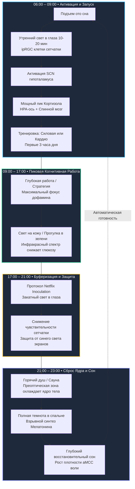

# Бизнес-Деконструкция: «Scientist WARNS: You're Being LIED To About Sunlight» (Эндрю Хьюберман у Стивена Бартлетта)

* **Источник:** [YouTube: The Diary Of A CEO Clips](https://youtu.be/1pqkhUVv_Bw)
* **Спикер:** [[Эндрю Хьюберман]] (Dr. Andrew Huberman) — профессор нейробиологии и офтальмологии медицинской школы [[Stanford University]], автор подкаста #1 в мире по здоровью «Huberman Lab», автор книги «Protocols».
* **Интервьюер:** [[Стивен Бартлетт]] (Steven Bartlett) — британский предприниматель, инвестор, создатель подкаста [[The Diary Of A CEO]].
* **Дата разбора:** 30 октября 2026 г.
* **Хронометраж:** 22 минуты 53 секунды (10 смысловых глав)

[](https://youtu.be/1pqkhUVv_Bw)

---

## Блок 1. Интро, вердикт и скрытая повестка спикера

### Кто, что и для кого
* **Кто:** **[[Эндрю Хьюберман]] (Andrew Huberman)** — главный глобальный популяризатор прикладной нейробиологии. Профессор Стэнфорда, построивший многомиллионную медиа-империю на переводе сложнейших молекулярных и нейроанатомических исследований на язык бытовых алгоритмов («протоколов») для высокоэффективных специалистов и лидеров бизнеса.
* **Что:** 23-минутный концентрированный контр-манифест против индустрии коммерческого биохакинга. Хьюберман вскрывает:
  1. Почему попытка заменить естественный солнечный свет комнатными лампами или очками разрушает фаундерскую энергетику.
  2. Как свет запускает двухконтурный механизм выброса кортизола через супрахиазматическое ядро ([[Супрахиазматическое ядро|SCN]]) и HPA-ось в первые 30–60 минут дня.
  3. Митохондриальный механизм действия длинноволнового красного и инфракрасного света (падение гликемического пика сахара на **>25%**, синтез внутриклеточного мелатонина и омоложение сетчатки после 40 лет).
  4. Протокол «Netflix Inoculation» (вечерний свет против деструктивного влияния экранов).
  5. Развенчание мифа о ледяных ваннах: почему холод не истощает надпочечники кортизолом, но взрывает дофамин на сотни процентов.
  6. Анатомию несгибаемой воли: открытие передней поясной коры ([[Передняя поясная кора|aMCC]]) Джо Парвизи как реального биологического органа упорства.
* **Для кого:** Собственники бизнеса, топ-менеджеры, инвесторы, инженеры и предприниматели (30+), проводящие по 12–16 часов перед мониторами, испытывающие послеобеденные провалы энергии, бессонницу и хроническое утомление когнитивного аппарата.

> [!NOTE] ⚖️ Вердикт Бизнес-Деконструктора
> **Смотреть обязательно каждому операционному лидеру (9.0/10).**
> * **Практическая ценность для бизнеса (10/10):** Нулевой CAPEX. Протоколы Хьюбермана не требуют закупки оборудования на тысячи долларов. Это чистая операционная дисциплина, дающая возврат инвестиций (ROI) в виде +2–3 часов предельной ментальной ясности и стабилизации эмоционального фона лидера.
> * **Научная строгость (8.5/10):** Мощный фундамент на работах лабораторий [[Гленн Джеффри|Гленна Джеффри]] (UCL), [[Джо Парвизи|Джо Парвизи]] (Stanford) и базы данных [[UK Biobank]]. Небольшой скепсис вызывает склонность спикера экстраполировать лабораторные опыты на универсальные догмы.

> [!WARNING] 🕵️‍♂️ Детектор скрытой повестки спикера
> 1. **Прогрев предзаказов книги «Protocols: An Operating Manual for the Human Body»:** Спикер 4 раза акцентированно ссылается на свою новую книгу («во второй главе я подробно разбираю структуру тренировок...», «в книге я привожу графики пиков и спадов...»). Данное интервью — классический крючок промотура мирового масштаба.
> 2. **Эффектная поза «Я продаю бесплатную природу»:** Хьюберман демонстративно критикует алчных производителей биохакерских приборов («Не покупайте дорогие красные лампы за тысячи долларов, идите в парк!»). Однако его личный подкаст спонсируется премиальными брендами добавок (AG1, Momentous, Eight Sleep, LMNT) на миллионы долларов в год. Бесплатный свет выступает безупречным лид-магнитом в воронку высочайшего доверия аудитории.
> 3. **Продуктовизация базовой биологии (Jargon Moat):** Тривиальные советы здравого смысла (гулять утром, не залипать в телефон в полночь, поднимать тяжести) упаковываются в наукообразный нейробиологический контур (*меланопсиновые ганглионарные клетки*, *аксоны в гипоталамус*, *рассеяние Рэлея*, *aMCC-пластичность*). Это создает монополию экспертности: слушатель чувствует, что выполняет высокотехнологичный протокол, а не просто вышел на прогулку.
> 4. **Институциональная репутационная броня:** После медийных расследований о личной жизни спикера в американской прессе в 2024 году, появление в качестве безупречного профессора Стэнфорда у Стивена Бартлетта восстанавливает статус неприкасаемого научного ментора.

---

## Блок 2. Тепловая карта выпуска

| Таймкод | Тема главы | Плотность пользы | О чем блок (краткая суть) |
| :--- | :--- | :---: | :--- |
| [**00:00**](https://youtu.be/1pqkhUVv_Bw?t=0) | Утренний свет и ipRGC-клетки | 🟢 Мясо | Меланопсиновые ганглионарные клетки сетчатки, аксоны в гипоталамус и мастер-часы SCN. |
| [**01:35**](https://youtu.be/1pqkhUVv_Bw?t=95) | Низкий угол солнца и Рэлей | 🟢 Мясо | Почему утренний спектр безопасен для глаз (рассеяние Рэлея) и оптимален для пробуждения. |
| [**02:45**](https://youtu.be/1pqkhUVv_Bw?t=165) | Двухконтурный пик кортизола | 🟢 Мясо | Активация HPA-оси и спинального пути в первые 30–60 минут; связь с вечерней сонливостью. |
| [**04:30**](https://youtu.be/1pqkhUVv_Bw?t=270) | Пасмурная погода и окно | 🟢 Мясо | Почему нельзя смотреть сквозь стекло; лампа 10 000 люкс; данные UK Biobank о смертности. |
| [**06:15**](https://youtu.be/1pqkhUVv_Bw?t=375) | Свет на кожу и лаб Гленна Джеффри | 🟢 Мясо | Красный (580–700 нм) и инфракрасный свет; проникновение на 8 см и падение глюкозы на 25%. |
| [**08:30**](https://youtu.be/1pqkhUVv_Bw?t=510) | Защита зрения 40+ и митохондрии | 🟢 Мясо | Фоторецепторы как самые метаболически активные клетки; омоложение сетчатки за 1–3 мин. |
| [**11:20**](https://youtu.be/1pqkhUVv_Bw?t=680) | Продажа природы и зелень | 🟢 Мясо | Листва отражает инфракрасный свет; UVB, тестостерон, либидо; шведское исследование курильщиков. |
| [**13:40**](https://youtu.be/1pqkhUVv_Bw?t=820) | Ночные сменщики и Netflix Inoculation | 🟢 Мясо | Работа за экраном после 18:00; закатный свет как буфер против экранов; катастрофа у подростков. |
| [**16:30**](https://youtu.be/1pqkhUVv_Bw?t=990) | Тренировочный сплит фаундера | 🟢 Мясо | Спорт в первые 3–4 часа; схема 3 силовых + 3 кардио + 1 отдых; опережающие биочасы мозга. |
| [**19:15**](https://youtu.be/1pqkhUVv_Bw?t=1155) | Миф о ледяных купелях | 🟢 Мясо | Холод НЕ растит кортизол; взрыв катехоламинов (дофамин/норадреналин); охлаждение через горячий душ. |
| [**20:45**](https://youtu.be/1pqkhUVv_Bw?t=1245) | Мышца упорства: aMCC | 🟢 Мясо | Открытие Джо Парвизи: передняя поясная кора растет только при преодолении нежелания. |

---

## Блок 3. Детальный разбор («Мясо»)

### Акт I: Циркадный мастер-таймер, оптика Рэлея и кортизоловый выстрел (00:00 – 06:15)
* **Суть:** Человеческий мозг не ориентируется на механические часы. Главный тактовый генератор — супрахиазматическое ядро гипоталамуса ([[Супрахиазматическое ядро|SCN]]) — синхронизируется исключительно через светочувствительные клетки сетчатки ([[Меланопсин|ipRGC]]). Низкий угол утреннего солнца благодаря рэлеевскому рассеянию поглощает жесткий ультрафиолет и формирует оптимальный длинноволновой спектр, стимулирующий двухконтурный выброс утреннего кортизола (через HPA-ось и нервные проводники спинного мозга).
* **Инсайты и выводы:**
  * *Тезис:* Без мощного утреннего импульса кортизола организм растягивает стрессовую кривую на весь день. Это приводит к дневной вялости, тревожности и нарушению синтеза мелатонина ночью.
  * *Что значит для бизнеса:* Предприниматель, начинающий утро с проверки смартфона под одеялом, запускает физиологический саботаж. Экран телефона дает всего 300–500 люкс — этого категорически мало для утренней синхронизации SCN, но достаточно, чтобы разрушить ночной сон при вечернем использовании.
  * *Опасность оконного стекла:* Оконные стекла и лобовые стекла авто блокируют ключевые длины волн и снижают интенсивность света в 5–10 раз. Смотреть на улицу сквозь окно бесполезно. Нужно выйти на балкон, открыть окно машины или сделать 10-минутную прогулку.
  * *Данные UK Biobank:* Исследование сотен тысяч людей доказало: яркие дни и темные ночи обладают кумулятивным эффектом. Несоблюдение световой гигиены ночью повышает риск ранней смертности в разы.
  * **Ментальная модель: «Двухфазная петля кортизола»** — высота утреннего пика кортизола математически задает глубину его ночного спада и силу секреции гормонов сна.
* **Применение и риски:**
  * *Если применять:* Первые 30–60 минут после подъема: выйти на открытый воздух на 10–20 минут без солнцезащитных очков. При полярной ночи / зиме — использовать настольную светотерапевтическую панель на 10 000 люкс.
  * *Если переборщить:* Прямой взгляд на полуденное высокостоящее солнце вызовет термический ожог макулы сетчатки. Смотреть комфортно можно только на низкое утреннее солнце.

---

### Акт II: Митохондриальный оптический резонатор: красный спектр, падение сахара на >25% и зрение 40+ (06:15 – 11:20)
* **Суть:** Свет воспринимается не только глазами, но и кожей. Длинноволновые лучи красного (580–700 нм) и ближнего инфракрасного (NIR, 800–1000+ нм) диапазона обладают гигантской глубиной проникновения: красный проходит на 8 см вглубь тканей, а инфракрасный пронизывает тело насквозь. Достигая митохондрий, фотоны меняют конформацию ферментов дыхательной цепи (цитохром с-оксидаза), стимулируя выработку АТФ и локального антиоксиданта — субклеточного мелатонина.
* **Инсайты и выводы:**
  * *Тезис (Исследование лаб. Гленна Джеффри, UCL):* Облучение спины испытуемых красным светом во время теста на толерантность к глюкозе привело к **снижению пиковой концентрации сахара в крови более чем на 25%** и сглаживанию скорости гликемического подъема.
  * *Что значит для бизнеса:* Инсулиновые «качели» после бизнес-ланчей — главная причина когнитивной дисфункции и сонливости руководителей во второй половине дня. Достаточная инсоляция и контакт с инфракрасным спектром служат системным регулятором клеточного метаболизма без метформина и фарм-интервенций.
  * *Омоложение зрения после 40 лет:* Фоторецепторы глаза — самые энергозатратные и насыщенные митохондриями клетки человеческого тела. Воздействие длинноволнового красного света (670 нм) в течение 1–3 минут 2–3 раза в неделю останавливает возрастное угасание зрения.
  * *Критическое временное окно:* Этот эффект работает **ИСКЛЮЧИТЕЛЬНО в первые 3 часа после пробуждения**. Воздействие тем же светом в середине дня или вечером не оказывает никакого положительного эффекта.
  * *Офисный геноцид митохондрий:* Обычные холодные светодиодные (LED) лампы без красного и теплового спектра вызывают окислительный стресс и повреждают митохондриальный пул клеток.
  * **Ментальная модель: «Субклеточный щит»** — митохондрии генерируют собственный локальный мелатонин для нейтрализации свободных радикалов при наличии длинноволнового светового стимула.
* **Применение и риски:**
  * *Если применять:* Естественная инсоляция тела (открытые руки, лицо, шея) 2–3 раза в неделю при низком УФ-индексе. Листва деревьев и трава отражают мощнейшие потоки инфракрасного света — прогулка в парке дает полный спектр бесплатно.
  * *Если переборщить:* Скупка дешевых китайских светодиодных панелей с неизвестной длиной волны и мерцанием (фликером), вызывающих головную боль и повреждение сетчатки.

---

### Акт III: Аудит биохакинга, эпидемия «ночных сменщиков» и протокол «Netflix Inoculation» (11:20 – 16:30)
* **Суть:** Хьюберман вскрывает коммерческую ловушку: маркетологи навязали рынку мысль, что здоровье покупается через гаджеты за тысячи долларов. При этом 90% городских жителей превратились в «ночных сменщиков». Любой человек, работающий за экраном после 18:00, физиологически приравнивается к рабочему ночной смены со всеми вытекающими рисками (взрывной рост риска онкологии, диабета и метаболического синдрома).
* **Инсайты и выводы:**
  * *Тезис:* Естественный солнечный свет содержит всю полноту спектра (от UVB до дальнего инфракрасного). UVB-излучение на кожу стимулирует выработку тестостерона и эстрогена у обоих полов, регулируя либидо и романтическую привязанность.
  * *Шведский феномен:* Многолетнее эпидемиологическое исследование в Швеции показало: люди с высокой инсоляцией жили существенно дольше. Более того, курящие граждане с частым пребыванием на солнце статистически жили дольше некурящих затворников, избегавших солнца.
  * *Протокол «Netflix Inoculation» (Прививка от экранов):* Прогулка на закате или взгляд на заходящее солнце в последней трети дня перенастраивает чувствительность сетчатки. Этот закатный световой импульс создает буферный щит: синий свет вечерних мониторов больше не способен мгновенно обрушить уровень ночного мелатонина.
  * *Катастрофа у детей и подростков:* У подростков буфер «Netflix Inoculation» НЕ работает. Вечерний свет смартфонов вызывает у них резкий выброс вечернего кортизола и блокирует утреннее пробуждение, разрушая обучаемость и психику.
  * **Ментальная модель: «Оптическая калибровка чувствительности»** — вечерний свет низкой интенсивности снижает коэффициент усиления фоторецепторов, защищая циркадную систему от светового шума мегаполиса.
* **Применение и риски:**
  * *Если применять:* Ввести правило «вечернего окна»: 10–15 минут на улице перед закатом солнца для подготовки сетчатки к неизбежной работе за монитором вечером.
  * *Если переборщить:* Использовать «Netflix Inoculation» как индульгенцию для 4-часового ночного залипания в соцсетях перед сном. Буфер лишь смягчает удар, но не нейтрализует его полностью.

---

### Акт IV: Архитектура тренировок для фаундера и анатомия несгибаемой воли (aMCC) (16:30 – 22:53)
* **Суть:** Оптимальное время физических нагрузок — первые 3–4 часа дня, когда тренировочный стресс усиливает утренний всплеск кортизола. Регулярность формирует опережающие биочасы мозга (anticipatory signals). В финале Хьюберман раскрывает ключевое открытие нейробиологии XXI века — переднюю поясную кору ([[Передняя поясная кора|aMCC]]), являющуюся физическим субстратом силы воли и упорства человека.
* **Инсайты и выводы:**
  * *Недельный сплит Хьюбермана (в возрасте 50+ лет):*
    1. **3 дня силовых тренировок:** акцент на многосуставные базовые движения (подтягивания, отжимания на брусьях, тяги, приседания, становая). Всего 2–3 тяжелых рабочих подхода на упражнение близко к отказу.
    2. **3 дня кардио:** день 1 — длительное низкоинтенсивное (Zone 2, 60 мин); день 2 — средняя интенсивность (30 мин); день 3 — максимальный пульс / спринты (велотренажер Airdyne: 1 мин разминка, затем циклы 30 сек на пределе / 10 сек легко).
    3. **1 день полного отдыха:** строго на следующий день после тренировки ног.
  * *Синхронизация биочасов:* Через 2 дня тренировок в одно и то же утреннее время супрахиазматическое ядро начинает выбрасывать дофамин и кортизол за 15 минут до тренировки. Прокрастинация исчезает на аппаратном уровне.
  * *Развенчание мифа о ледяных ваннах:* Хьюберман жестко опровергает сетевой миф о том, что холод истощает надпочечники. Погружение в холодную воду дает **минимальный всплеск кортизола**, но обеспечивает колоссальный и пролонгированный подъем катехоламинов (**дофамина и норадреналина на сотни процентов**). Истинный стрессор для кортизола — силовые нагрузки до отказа или психологическое давление.
  * *Охлаждение через нагрев:* Горячий душ перед сном активирует медиальную преоптическую область гипоталамуса, заставляя организм экстренно сбрасывать внутреннюю температуру ядра тела, что мгновенно запускает глубокий сон.
  * *Открытие века: aMCC (Anterior Mid-Cingulate Cortex):* Исследования [[Джо Парвизи|Джо Парвизи]] в Стэнфорде доказали: стимуляция aMCC вызывает непреодолимое ощущение готовности принять вызов и драться.
  * *Закон пластичности воли:* aMCC физически растет и утолщается только тогда, когда человек **делает то, чего делать категорически не хочется** (соблюдение жесткой диеты, дискомфортная растяжка, преодоление управленческого страха). При комфортной, гедонистической жизни aMCC физически атрофируется.
  * **Ментальная модель: «Мышца упорства aMCC»** — сила воли не абстрактная добродетель, а измеримая область коры мозга, требующая регулярного микродозирования преодоления сопротивления.
* **Применение и риски:**
  * *Если применять:* Ежедневно встраивать в график 1–2 сознательных действия через внутреннее трение («сделать звонок неприятному контрагенту», «сделать дополнительный подход», «отказаться от сахара при тяге»), сознательно тренируя aMCC.
  * *Если переборщить:* Хронический овертренинг без дня восстановления приведет к системному воспалению и падению когнитивной функции.

---

## Блок 4. Сводка цифр, бенчмарков и развилок (A vs B)

### Сводная таблица метрик выпуска

| Метрика / Параметр | Значение в выпуске | Физиологический смысл | Оценка реалистичности |
| :--- | :---: | :--- | :---: |
| **Освещенность панели** | `10 000 lux` | Минимальная мощность лампы для компенсации отсутствия солнца | 🟢 Научный стандарт |
| **Утреннее окно света** | `30 – 60 мин` | Критический интервал после подъема для триггера HPA-оси | 🟢 Абсолютная норма |
| **Красный спектр** | `580 – 700 нм` | Длина волны, проникающая на глубину до 8 см в ткани | 🟢 Физический факт |
| **Инфракрасный спектр** | `800 – 1000+ нм` | Излучение, проникающее сквозь все тело человека | 🟢 Физический факт |
| **Падение пика глюкозы** | `> 25%` | Снижение гликемического спайка при облучении спины красным светом | 🟡 Требует масштабирования |
| **Омоложение зрения 40+** | `1 – 3 мин` | Экспозиция красным светом 2–3 раза в неделю в первые 3 часа дня | 🟢 Подтверждено UCL |
| **Сплит тренировок** | `3 + 3 + 1` | 3 дня силовых, 3 дня кардио, 1 день отдыха (после ног) | 🟢 Золотой стандарт |
| **Всплеск дофамина от холода** | `+250% – 500%` | Пролонгированный подъем катехоламинов без подъема кортизола | 🟢 Подтверждено данными |

---

### Управленческие развилки (Dilemmas & Trade-offs)

```
                            СТРАТЕГИЧЕСКИЙ ВЫБОР ФАУНДЕРА
                                          │
                 ┌────────────────────────┴────────────────────────┐
                 ▼                                                 ▼
      ПУТЬ A: ГАДЖЕТОМАНИЯ                              ПУТЬ B: БИОЛОГИЧЕСКИЙ РЕАЛИЗМ
   (Покупка купелей и ламп за $7 000)                (Протоколы света и режима за $0)
                 │                                                 │
  • Ложное чувство безопасности                     • Естественная инсоляция и прогулки
  • Попадание в зависимость от девайсов             • Стабильная двухфазная петля кортизола
  • Игнорирование фундаментального сна              • Прокачка aMCC через реальное трение
                 │                                                 │
           ИТОГОВЫЙ СТАТУС:                                  ИТОГОВЫЙ СТАТУС:
  Финансовый расход, скрытый отек,                  Пиковая ясность ума, высокая выносливость,
  хроническая усталость за экраном                  стабильный гормональный фон
```

1. **CAPEX биохакинга ($5 000+) vs Дисциплина окружения ($0):**
   * *Развилка A:* Купить инфракрасную сауну, холодную ванну и световую панель, продолжая сидеть в темном кабинете до полуночи.
   * *Развилка B:* Выстроить рабочий день по солнцу: утренняя прогулка 15 мин, открытые шторы, вечернее закатное окно, тренировка в 8:00 утра.
   * *Вердикт инвестора:* Путь B дает 95% физиологического эффекта при нулевых капитальных затратах.
2. **«Иллюзия совы» vs Гормональная синхронизация:**
   * *Развилка A:* Верить в свою генетическую предрасположенность к ночной работе, стимулируя себя кофеином и расплачиваясь диабетом 2 типа и туманом в голове.
   * *Развилка B:* Принудительно сдвинуть рабочий график на ранние часы через жесткий утренний свет и спорт, активируя anticipatory-сигналы мозга.
3. **Комфорт и делегирование vs Прокачка aMCC:**
   * *Развилка A:* Устранить любые неудобства, автоматизировать все процессы, избегать конфликтов и тяжелых весов. Итог — деградация объема передней поясной коры и потеря хватки.
   * *Развилка B:* Регулярно внедрять осознанный стресс (холодный душ, отказные подходы, сложные переговоры) как тренажер биологической стойкости.

---

## Блок 5. Ментальные модели, карта мышления и Mermaid-диаграмма

### Ключевые ментальные модели
1. **Двухфазная петля кортизола (Cortisol Biphasic Loop):** Отношение утреннего пика к ночному минимуму определяет биологический возраст и стрессоустойчивость. Нельзя убрать вечерний стресс, не создав мощный утренний гормональный толчок.
2. **Митохондриальный оптический резонатор (Mitochondrial Photobiomodulation):** Клетки человека — не просто химические реакторы, но фоточувствительные системы. Длинноволновой свет оптимизирует перенос электронов в дыхательной цепи цитохрома с-оксидазы.
3. **Опережающий нейро-таймер (Behavioral Anticipatory Synchronization):** Мозг адаптирует физиологию заранее. Регулярность во времени тренировок и приемов пищи снимает необходимость в мобилизации силы воли.
4. **Мышца упорства aMCC (The Tenacity Core):** Биологический орган сопротивления трудностям. Растет исключительно при преодолении нежелания («doing things you hate»).

---

### Суточный цикл нейро-протокола топ-менеджера (Mermaid)



---

## Блок 6. Справочник сущностей (с [[Obsidian Wikilinks]])

### Персоны
* [[Эндрю Хьюберман]] (Andrew Huberman) — профессор нейробиологии медицинской школы Стэнфордского университета, автор подкаста «Huberman Lab».
* [[Стивен Бартлетт]] (Steven Bartlett) — предприниматель, основатель Social Chain, инвестор шоу Dragons' Den, автор подкаста [[The Diary Of A CEO]].
* [[Гленн Джеффри]] (Glenn Jeffery) — профессор зрительной нейробиологии University College London ([[University College London|UCL]]), пионер исследований фотобиомодуляции сетчатки и метаболизма.
* [[Джо Парвизи]] (Joe Parvizi) — профессор неврологии и нейрохирургии [[Stanford University]], первооткрыватель функций стимуляции передней поясной коры.
* [[Энди Галпин]] (Andy Galpin) — профессор кинезиологии, ведущий мировой эксперт по физиологии высокоинтенсивного тренинга и дыхательным практикам парасимпатической модуляции.
* [[Роджер Швальт]] (Roger Seheult) — врач-пульмонолог и реаниматолог, сооснователь MedCram, исследователь влияния солнечного инфракрасного спектра на иммунитет.

### Институты, термины и концепции
* [[Stanford University]] — ведущий мировой исследовательский центр нейробиологии и медицины.
* [[University College London]] (UCL) — британский институт, доказавший регуляцию гликемии красным светом.
* [[UK Biobank]] — база биомедицинских данных 500 000+ человек, доказавшая прямую связь света и ночной темноты со снижением риска смерти.
* [[Супрахиазматическое ядро]] (SCN) — верховные циркадные часы в гипоталамусе млекопитающих.
* [[Передняя поясная кора]] (aMCC) — анатомическая область мозга, ответственная за психологическую стойкость и силу воли.
* [[Меланопсин]] — фотопигмент ганглионарных клеток сетчатки ipRGC, чувствительный к утреннему углу света.
* [[Фотобиомодуляция]] — процесс стимуляции митохондрий светом красного и инфракрасного спектров.

### Антипаттерны лидеров
* **«Оконный самообман»** — попытка получить дозу утреннего света сквозь оконное стекло кабинета или лобовое стекло автомобиля.
* **«Гаджетомания биохакера»** — покупка инфракрасных панелей за $2 000 при хроническом сидении в темной комнате и игнорировании прогулок в парке.
* **«Иллюзия совы»** — оправдание ночного серфинга за экраном, ведущее к инсулинорезистентности и утренней депрессии.
* **«Атрофия комфорта»** — делегирование всех трудных и дискомфортных задач, приводящее к физическому уменьшению зоны aMCC в мозге.

---

## Блок 7. Золотые формулировки и панчлайны выпуска

1. > *«Notice I'm sort of like a salesman. I'm selling nature.»*  
   > **«Я звучу как заправский коммивояжер. С той лишь разницей, что я продаю вам бесплатную природу».**  
   > *(Хьюберман о том, почему прогулка под кронами деревьев превосходит покупку биохакерских приборов за тысячи долларов).*

2. > *«You and I qualify as night shift workers. If you work at night at home on devices after 6 PM, you're still a nightshift worker.»*  
   > **«Мы с вами — классические рабочие ночной смены. Если вы открываете ноутбук дома после 18:00, ваш метаболизм разрушается так же, как у рабочего на ночном заводе».**  
   > *(О фатальной иллюзии безопасности вечерней офисной работы за мониторами).*

3. > *«Deliberate cold exposure does not raise cortisol. I will go toe-to-toe with anybody on the internet or off the internet. Trivial increases in cortisol, magnificent increases in dopamine and adrenaline.»*  
   > **«Холодные ванны не повышают кортизол. Я готов выйти на научную дуэль с кем угодно в интернете: подъем кортизола ничтожен, зато выброс дофамина и адреналина — грандиозный».**  
   > *(Развенчание мифа о стрессовом истощении надпочечников при контрастных процедурах).*

4. > *«When you do something you don't want to do, your anterior midcingulate cortex gets bigger and more willing to engage in challenging things going forward.»*  
   > **«Каждый раз, когда вы заставляете себя делать то, чего вам делать категорически не хочется, ваша передняя поясная кора физически растет, делая вас неуязвимым перед новыми вызовами».**  
   > *(О биологической формуле упорства и воли).*

---

## Блок 8. Внешний фактчек, материалы и реакция аудитории

### Материалы выпуска и официальные ссылки
* [Полный выпуск на The Diary Of A CEO (Steven Bartlett)](https://youtu.be/MGxcosNuC8k) — исходное глубокое 2.5-часовое интервью.
* [Коллекция дневников The Diary](https://thediary.com/collections/all) — прямая коммерческая ссылка ведущего Стивена Бартлетта на продажу брендовой атрибутики.

### Фактчек и реакция аудитории (Анализ топ-комментариев)
1. **Техническая критика путаницы физических величин (`@AdaptiveGame`):**  
   * *Комментарий:* Зритель справедливо указал, что люкс (лк) — единица измерения **освещенности** поверхности (1 лк = 1 лм/м²), а не мощности светового потока.  
   * *Аналитический вердикт:* Спикер в пылу объяснения допускает разговорные упрощения. Для практического применения это не критично: приборы измеряют именно уровень освещенности роговицы.
2. **Северная проблема зимы (`@DInTheValley`):**  
   * *Комментарий:* «А что делать зимой в северных широтах, когда подъем происходит за 2-3 часа до рассвета?»  
   * *Аналитический вердикт:* Ответ Хьюбермана в видео однозначен: использовать искусственный свет 10 000 люкс сразу после пробуждения, а затем обязательно выйти на дневной свет, как только рассветет.
3. **Медицинские ограничения кожи (`@ohshiii6310`):**  
   * *Комментарий:* Вопрос о безопасности световой терапии при витилиго и аутоиммунных поражениях кожи.  
   * *Аналитический вердикт:* Пациентам с дерматологическими патологиями требуется консультация врача. Однако фотобиомодуляция красным светом (670–850 нм) не содержит повреждающего ультрафиолета и безопасна при витилиго.
4. **Исторический консенсус педиатрии (`@helenavolohova1617`):**  
   * *Комментарий:* «В советское время детские врачи всегда призывали гулять с ребенком минимум 4 часа в день».  
   * *Аналитический вердикт:* Хьюберман оцифровывает и подтверждает нейробиологическими маркерами то, что классическая профилактическая медицина знала на эмпирическом уровне 50 лет назад.

---

## Блок 9. Применение: Чек-лист и вопросы к себе

### Чек-лист действий для топ-менеджера (7–30 дней)
- [ ] **День 1–3: Утренний световой якорь.** Первые 30 минут дня — 15 минут на улице без очков (или настольная лампа 10 000 люкс при раннем зимнем подъеме).
- [ ] **День 4–5: Ликвидация оконного барьера.** Прекратить попытки инсоляции через стекло: открывать окна авто или выходить на крыльцо/балкон.
- [ ] **День 6–8: Перенос тренировок на утро.** Протестировать силовые нагрузки или кардио в первые 3 часа после подъема.
- [ ] **День 9–12: Протокол Netflix Inoculation.** В 17:00–19:00 выйти на 10-минутную прогулку навстречу заходящему солнцу для калибровки сетчатки.
- [ ] **День 13–15: Внедрение инфракрасного контакта.** Проводить встречи «one-on-one» в формате прогулок по парку (среди зелени деревьев).
- [ ] **День 16–20: Ликвидация синего света ночью.** После 21:00 перевести освещение дома на теплый приглушенный спектр (до 2700K), исключить верхний белый свет.
- [ ] **День 21–25: Практика охлаждения ядра тела.** Внедрить 5-минутный горячий душ или ванну за 45 минут до сна для терморегуляторного падения температуры.
- [ ] **День 26–30: Ежедневная тренировка aMCC.** Каждый день сознательно выполнять 1 задачу через внутреннее «не хочу» для утолщения передней поясной коры.

### Вопросы к себе для стратегической рефлексии
1. *Сколько реальных денег и когнитивного ресурса я теряю ежемесячно из-за дневного энергетического спада и затуманенного мышления?*
2. *Не покупаю ли я дорогие БАДы и гаджеты, пытаясь откупиться от банального отсутствия прогулок и ночной дисциплины?*
3. *Отношусь ли я к своей биологии как к ночной смене, продолжая проверять отчеты и мессенджеры в постели?*
4. *Когда я в последний раз осознанно делал то, что вызывало сильнейшее внутреннее сопротивление, чтобы укрепить свою aMCC?*
5. *Какова цена потери моей ментальной ясности при принятии ключевого управленческого решения в состоянии кортизолового сбоя?*
