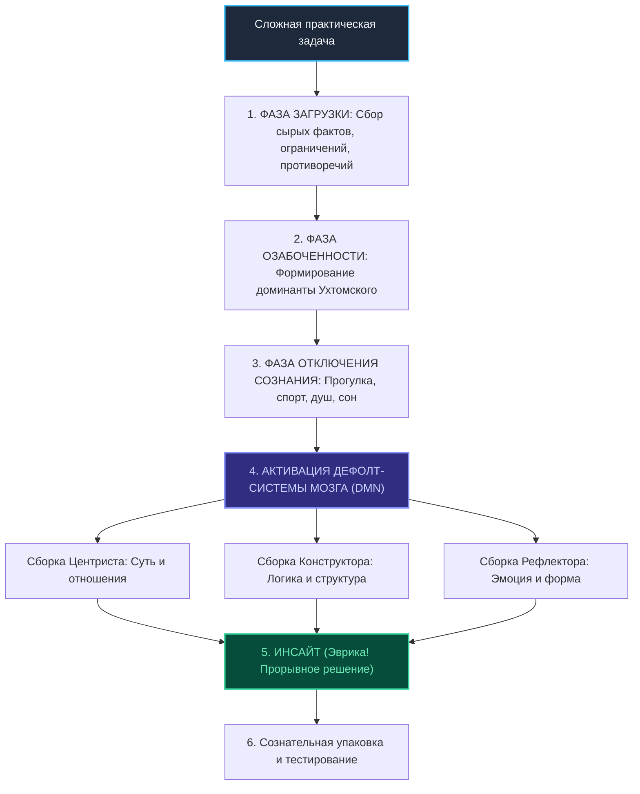

# Бизнес-Деконструкция: «Мозг: инструкция по применению. Механика сборки мышления»

* **Источник:** [YouTube: Design Prosmotr](https://youtu.be/953uZgYNj9g)
* **Спикер:** [[Андрей Курпатов]] (психотерапевт, президент Высшей школы методологии)
* **Хронометраж:** 51:14
* **Дата анализа:** 31 октября 2026 г.

---

## Блок 1. Интро, вердикт и скрытая повестка спикера

### 1.1. Кто, что и для кого
* **Кто спикер:** Андрей Курпатов — президент Высшей школы методологии, основатель интеллектуального кластера «Игры разума» (Санкт-Петербург), экс-руководитель холдинга «Красный Квадрат», автор фундаментальных бестселлеров по когнитивистике («Красная таблетка», «Чертоги разума»).
* **Суть лекции:** Разбор базовой архитектуры работы человеческого мозга для создателей интеллектуального и визуального продукта: почему сознание не принимает решений; как дефолт-система мозга (ДСМ) собирает гениальные идеи; почему цифровое потребление убивает креативность и как с помощью трех радикалов мышления собирать выдающиеся концепты.
* **Целевая аудитория:** Дизайнеры, арт-директора, фаундеры, продакт-менеджеры и предприниматели, управляющие созданием сложных смысловых продуктов.

### 1.2. Аналитический вердикт
* **Оценка:** **9.4 / 10** («Смотреть обязательно»).
* **Резюме:** Эталонный образец прикладной когнитивной методологии. Без академического занудства и без эзотерики Курпатов вскрывает инженерную ткань мышления. Каждая концепция подкреплена экспериментами нейрофизиологии (Либет, Рейхл, Ухтомский).

### 1.3. Детектор скрытой повестки спикера
* **Зачем выступает на Design Prosmotr:** Прогрев креативного и технологического сообщества перед масштабированием образовательного проекта «Академия Смысла» и популяризация интеллектуального кластера «Игры разума».
* **Что продает:** Концепцию методологии мышления (факт-карты, системный подход) и свои книги по когнитивистике. Курпатов позиционирует классическое творчество как иллюзию и предлагает строгий алгоритмический подход к сборке инсайтов через нейробиологию.

---

## Блок 2. Тепловая карта выпуска (Хронометраж и плотность пользы)

| Таймкод | Тема смыслового акта | Плотность пользы | Прикладная ценность для анализа |
| :--- | :--- | :---: | :--- |
| **00:00** | Мозг как орган: у кого кто есть? | 🟢 Мясо | Фундаментальный переворот: мы являемся производными нашего мозга |
| **04:15** | Иллюзия сознательного контроля | 🟢 Мясо | Сознание как верхушка айсберга и постфактум-интерпретатор |
| **07:31** | Эксперимент Бенджамина Либета | 🟢 Мясо | Разрыв в 7-8 секунд между решением нейросети и осознанием человека |
| **12:50** | Энергетика мозга: цена мысли | 🟢 Мясо | 2% массы тела потребляют 20% энергии; закон сохранения ментальных сил |
| **16:45** | Дефолт-система мозга (Default Mode Network) | 🟢 Мясо | Открытие Маркуса Рейхла: где рождается подлинное мышление |
| **21:20** | Цифровое потребление против мышления | 🟢 Мясо | Почему серфинг в соцсетях подавляет DMN и ведет к псевдодебильности |
| **26:40** | Интеллектуальный объект: единица мысли | 🟢 Мясо | Как мозг кодирует реальность через отношения между элементами |
| **31:15** | Три способа сборки реальности (Радикалы) | 🟢 Мясо | Базовая типология мышления Курпатова: Центрист, Конструктор, Рефлектор |
| **35:00** | Центрист: поиск сути и стайные отношения | 🟢 Мясо | Анализ сути, социальная проницательность, детекция правды |
| **38:20** | Конструктор: абстрактная логика и схемы | 🟢 Мясо | Создание сложных ментальных архитектур и концептов |
| **41:40** | Рефлектор: эмоциональная яркость и ценность | 🟢 Мясо | Оценка привлекательности, самопрезентация, вирусность |
| **44:10** | Формула гениальности: синтез трех радикалов | 🟢 Мясо | Как великие творцы и бизнесмены объединяют все три типа сборки |
| **47:30** | Доминанта Ухтомского и озабоченность | 🟢 Мясо | Физиологический очаг возбуждения как двигатель озарения |
| **49:50** | Как заставить мозг думать: алгоритм фаз | 🟢 Мясо | Загрузка данных -> Озабоченность -> Отключение контроля -> Инсайт |

---

## Блок 3. Детальный разбор («МЯСО ВЫПУСКА»)

### 3.1. У мозга есть мы, а не у нас есть мозг
Курпатов начинает с антропологического слома. Обыватель считает себя «хозяином» своего тела, обладающим сознательной волей. Нейробиология доказывает обратное:
* Мозг — это биологический компьютер массой ~1.4 кг, сформированный миллионами лет эволюции для выживания и репродукции.
* Наше сознательное «Я» — это лишь тонкая интерфейсная оболочка, созданная культурой и речью.
* Мы не генерируем мысли сознательно: мысли «случаются» в нейронных сетях, а сознание лишь считывает готовый результат и присваивает авторство себе.

### 3.2. Эксперимент Либета: смерть концепции свободной воли
Бенджамин Либет в 1980-х годах (и современные исследования Джона-Дилана Хайнса на фМРТ) зафиксировали:
* За **7–8 секунд** до того, как испытуемый осознает свое решение нажать кнопку, в моторной коре и подкорковых центрах формируется так называемый «потенциал готовности».
* Мозг уже принял решение, провел расчеты и отправил сигнал. 
* Сознание узнает об этом последним, придумывая красивую псевдорациональную историю: «Я решил нажать кнопку именно сейчас, потому что захотел».
* **Практический вывод:** Бессмысленно пытаться родить гениальный дизайн или бизнес-стратегию усилием сознания («сижу и вымучиваю»). Решение должно созреть в подкорковых структурах.

### 3.3. Дефолт-система мозга (DMN) и цифровой аутизм
В 2001 году Маркус Рейхл открыл дефолт-систему мозга:
* Когда человек сидит в тишине, не смотрит в экран и не решает сиюминутных задач, мозг не выключается — наоборот, активируются гигантские нейронные контуры DMN.
* DMN перебирает накопленный опыт, просчитывает социальные взаимосвязи и «сшивает» разрозненные факты в целостные концепции.
* **Трагедия цифровой эпохи:** Смартфоны заполнили все микропаузы. Мозг постоянно находится в режиме потребления стимулов (Dorsal Attention Network), что физически блокирует работу DMN. В результате человек потребляет тонны контента, но теряет способность к синтезу сложного продукта (информационная псевдодебильность).

### 3.4. Три радикала сборки реальности
Курпатов формулирует свою классификацию когнитивных стилей:
1. **Центрист (Стайный инстинкт):** Фиксируется на сущностных связях. Ищет скрытые мотивы людей, расстановку сил и реальное положение дел. Минус: не умеет эффектно упаковать результат.
2. **Конструктор (Половой/исследовательский инстинкт):** Мыслит структурными моделями, логическими схемами, формулами и алгоритмами. Минус: отрывается от реальности и человеческих эмоций.
3. **Рефлектор (Инстинкт самосохранения/эго):** Мыслит образами, эстетикой, ценой и впечатлением. Мастер формы, пиара и шоу. Минус: поверхностность и отсутствие системной глубины.

> **Формула гениальности по Курпатову:** Любой продукт мирового уровня (Apple, шедевры кино, великие бренды) — это результат одновременной работы всех трех радикалов: суть центриста + архитектура конструктора + блеск рефлектора.

---

## Блок 4. Сводка цифр, бенчмарков и развилок (A vs B)

### 4.1. Ключевые метрики лекции

| Параметр | Значение | Практическое значение для работы | Доказательная база |
| :--- | :---: | :--- | :---: |
| **Временной лаг решения мозга** | **7–8 секунд** | Мозг принимает решение задолго до его осознания эго. | Эксперименты Либета / Хайнса (фМРТ) |
| **Энергопотребление мозга** | **20% ресурсов при 2% массы** | Мышление — самый энергозатратный биологический процесс. Мозг саботирует сложные задачи. | Нейрофизиологический факт |
| **Время входа в фокус DMN** | **~20–25 минут** | Минимальное время глубокой концентрации без внешних раздражителей для запуска фонового синтеза. | Исследования когнитивной психологии |
| **Количество радикалов сборки** | **3 радикала** | Центрист (суть), Конструктор (схема), Рефлектор (эмоция/визуал). | Методология мышления Курпатова |
| **Емкость оперативной памяти** | **3–5 объектов** | Предел одновременного сознательного удержания смысловых единиц. | Закон Миллера / Нельсон Коуэн |

### 4.2. Развилки подходов к творчеству и разработке

| Обывательский подход (В лоб) | Методологический подход мозга (По Курпатову) | Результат подхода А | Результат подхода Б |
| :--- | :--- | :--- | :--- |
| **Штурм сознанием:** сесть за стол и пытаться немедленно придумать идею. | **Фаза загрузки:** насыщение мозга фактами, противоречиями и референсами. | Вымученные банальности, синдром чистого листа. | Мозг накапливает критическую массу данных для озарения. |
| **Постоянный серфинг:** переключение на телефон каждые 5 минут во время работы. | **Цифровой карантин:** изоляция от уведомлений и информационного шума. | Блокировка DMN, распад сложного контекста. | Активация дефолт-системы, фоновый синтез решения. |
| **Опора на один стиль:** делать только красивую картинку или только код. | **Триада сборки:** проверка продукта на суть (центрист), логику (конструктор) и эмоцию (рефлектор). | Узкий, неконкурентный или мертворожденный продукт. | Продукт-бестселлер с глубокой архитектурой и ярким UX. |

---

## Блок 5. Ментальные модели, карта мышления и Mermaid-диаграмма

### 5.1. Ментальные модели
1. **Модель «Пресс-секретаря»:** Сознание не принимает решений, оно пишет победные пресс-релизы для общества, оправдывая то, что уже совершил подсознательный аппарат.
2. **Модель «Доминанты Ухтомского»:** Устойчивый очаг озабоченности притягивает к себе любые внешние стимулы и трансформирует их в решение поставленной задачи.

### 5.2. Mermaid-диаграмма: Конвейер нейробиологической сборки прорывного продукта

---

## Блок 6. Расширение кругозора: Книги, Словарь понятий и Персоны

### 6.1. Фундаментальные книги
1. **Андрей Курпатов — «Чертоги разума. Убей в себе идиота!»:** Практическое руководство по работе дефолт-системы и построению факт-карт.
2. **Алексей Ухтомский — «Доминанта»:** Классический труд о физиологических доминантах поведения и мышления.
3. **Дэниел Канеман — «Думай медленно... решай быстро»:** Когнитивные искажения Системы 1 (автопилот) и Системы 2 (сознательный контроль).

### 6.2. Банк понятий
* **Default Mode Network (Дефолт-система мозга):** Нейронная сеть покоя, отвечающая за автобиографическую память, социальное моделирование и синтез сложных смыслов.
* **Информационная псевдодебильность:** Синдром снижения аналитических способностей из-за клипового серфинга и постоянного скроллинга лент.
* **Интеллектуальный объект:** Внутренняя репрезентация в мозге любого явления, состоящая из набора связей с другими объектами памяти.
* **Доминанта:** Господствующий очаг возбуждения в центральной нервной системе, подчиняющий себе остальные реакции.

### 6.3. Ключевые персоны
* **Бенджамин Либет:** Американский нейрофизиолог, экспериментально доказавший первичность бессознательного решения мозга.
* **Маркус Рейхл:** Американский невролог, первооткрыватель дефолт-системы мозга.
* **Алексей Ухтомский:** Выдающийся советский физиолог, создатель учения о доминанте.

---

## Блок 7. Золотые формулировки и панчлайны выпуска

* «Вы думаете, что у вас есть мозг? Ошибаетесь: это у вашего мозга есть вы.»
* «Сознание — это просто наемный пиарщик, который задним числом объясняет публике, почему шеф принял такое глупое решение.»
* «Если вы не умеете загрузить в голову противоречие и пойти спать — вы никогда не создадите ничего сложнее табуретки.»
* «Смартфон в руках — это добровольная лоботомия вашей дефолт-системы.»
* «Гениальность — это не озарение свыше, а способность собрать суть центриста, схему конструктора и страсть рефлектора в одном флаконе.»

---

## Блок 8. Внешний фактчек, материалы и реакция аудитории

### 8.1. Фактчек и научная критика
* **Интерпретация опытов Либета:** Философы сознания (Дэниел Деннет) отмечают, что 7-секундный зазор в лабораторных тестах касается простейших моторных актов (нажатие кнопки), и его нельзя механически переносить на многолетние этические и стратегические решения.
* **Радикалы Курпатова:** Являются авторской прикладной методологией, а не общепринятым международным стандартом психиатрии (хотя базируются на классической типологии акцентуаций Леонгарда и Ганнушкина).

### 8.2. Реакция креативного сообщества
* Выступление на Design Prosmotr признано одним из самых влиятельных в истории форума: дизайнеры массово подтвердили эффективность отказа от немедленной отрисовки в пользу «фазы озабоченности и сна».

---

## Блок 9. Пошаговый 72-часовой план внедрения

### Этап 1: 72 часа (Цифровая гигиена дефолт-системы)
1. Установить жесткий запрет на использование смартфона в течение первых 60 минут после пробуждения и за 60 минут до сна.
2. Завести правило «прогулки без наушников»: 30 минут ходьбы в день в полной тишине для включения DMN.
3. Провести аудит своего ведущего радикала (Кто вы: Центрист, Конструктор или Рефлектор?).

### Этап 2: 7 дней (Техника сборки факт-карты)
1. Взять сложную нерешенную задачу и выписать на лист бумаги 30–40 голых фактов и ограничений (без оценок и готовых решений).
2. Найти скрытые противоречия между фактами и четко их сформулировать.
3. «Забыть» про задачу на 24 часа, дав DMN собрать конфигурацию решения во сне.

### Этап 3: 30 дней (Триадный контроль продукта)
1. При разработке любого проекта пропускать его через 3 фильтра:
   - *Фильтр Центриста:* В чем реальная практическая польза и суть?
   - *Фильтр Конструктора:* Насколько логична и масштабируема архитектура?
   - *Фильтр Рефлектора:* Какую эмоцию вызывает визуал и первое касание?
