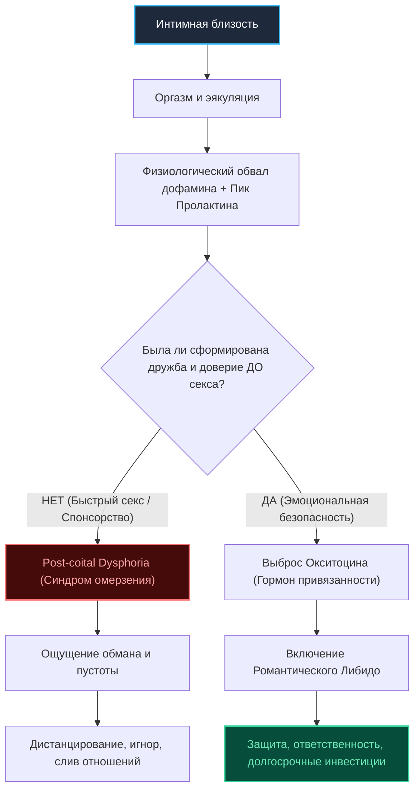

# Бизнес-Деконструкция: «Что возбуждает мужчину в женщине? Сексуальность vs Сексапильность»

* **Источник:** [YouTube: АНЖЕЛИА](https://youtu.be/FjdYd8dSdBM)
* **Спикеры:** [[Дмитрий Гухман]] (психолог-сексолог), [[Анжела Ильина]] (ведущая канала АНЖЕЛИА)
* **Хронометраж:** 56:00
* **Дата анализа:** 31 октября 2026 г.

---

## Блок 1. Интро, вердикт и скрытая повестка спикера

### 1.1. Кто, что и для кого
* **Кто спикер:** Дмитрий Гухман — практикующий психолог, сексолог, автор тренингов по парной коммуникации и сексуальности. Ведущая — Анжела Ильина (канал АНЖЕЛИА).
* **Суть выпуска:** Анализ анатомии мужского влечения: почему внешняя сексапильность (90-60-90) не гарантирует долгосрочной преданности; в чем разница между физиологическим и романтическим либидо; почему дружба и эмоциональная безопасность действуют на мужчину сильнее вызывающего белья.
* **Целевая аудитория:** Женщины и мужчины 25–45 лет, стремящиеся разобраться в механике долгосрочной моногамии, причинах измен и феномене «синдрома омерзения» после близости без контекста.

### 1.2. Аналитический вердикт
* **Оценка:** **7.8 / 10** («Смотреть выборочно»).
* **Резюме:** Выпуск содержит твердую практическую сексологическую и эволюционную базу, очищенную от эзотерики «женских энергий». Гухман четко раскладывает мужскую физиологию и психологию. Минус — периодический уход в поп-психологические клише и явная маркетинговая воронка курсов.

### 1.3. Детектор скрытой повестки спикера
* **Зачем пришел на интервью:** Монетизация женской тревожности по поводу измен, охлаждения партнера и одиночества.
* **Что на самом деле продает:** Авторский тренинг Дмитрия Гухмана «30 техник для любви» (gukhman.com), а также закрытые воронки наставничества. Спикер грамотно использует триггеры страха («мужчине после секса может стать противно быть с тобой», «90% изменяют из-за расщепления влечения»), чтобы подвести зрителя к необходимости платного обучения интимной коммуникации.

---

## Блок 2. Тепловая карта выпуска (Хронометраж и плотность пользы)

| Таймкод | Тема смыслового акта | Плотность пользы | Прикладная ценность для анализа |
| :--- | :--- | :---: | :--- |
| **00:00** | Что на самом деле заводит мужчин | 🟡 Вода/Интро | Вводная концептуализация, разбор стереотипов о «серых мышках» |
| **01:15** | Сексуальность vs сексапильность | 🟢 Мясо | Деконструкция мифа 90-60-90: атрибуты против внутреннего состояния |
| **03:37** | Дружба с мужчиной: норма или угроза | 🟡 Вода | Разбор женских страхов растратить энергию |
| **04:30** | Дружба как главный афродизиак | 🟢 Мясо | Механика романтического либидо: пробуждение ответственности |
| **06:12** | Биохимия влюбленности и вред пластики | 🟢 Мясо | Гормональный коктейль (дофамин, окситоцин, тестостерон), маркер «свой-чужой» |
| **08:05** | Когда мужчина влюбляется по-настоящему | 🟢 Мясо | Служение через признание мужской силы и интеллекта |
| **09:25** | Синдром омерзения после секса (Post-coital Dysphoria) | 🟢 Мясо | Биологический откат дофамина и пролактиновый спад при отсутствии близости |
| **12:02** | Необходимость дружбы до первого секса | 🟡 Вода/Совет | Опасность попадания во френдзону vs построение доверия |
| **14:18** | Разница потребности в сексе у М и Ж | 🟢 Мясо | Автономность мужской эрекции от чувств vs женская потребность в безопасности |
| **15:25** | Мужская меркантильность и оценка статуса | 🟢 Мясо | Мужской аудит «стоимости владения»: инвестиции женщины в себя |
| **21:50** | Почему женщины не хотят слабых мужчин | 🟢 Мясо | Эволюционный фильтр силы: потеря влечения при инверсии ролей |
| **26:35** | Ранний аудит изменщика на этапе свиданий | 🟢 Мясо | Родовые сценарии, реакция на неверность отца, релятивизм морали |
| **29:03** | Причины мужских измен: половая конституция | 🟢 Мясо | Сильная/средняя/слабая конституция, разрядка vs поиск эмоций |
| **32:05** | Самый крепкий союз и комплекс Мадонны-Блудницы | 🟢 Мясо | Фрейдовское расщепление: почему любят одних, а хотят других |
| **35:05** | Как ходить на свидания при длительном воздержании | 🟡 Вода/Лайфхаки | Снятие завышенной значимости и сексуального голода |
| **39:40** | «Правило 30 дней»: сколько выдерживать дистанцию | 🟡 Спорно | Проверка инвестиционной готовности мужчины |
| **42:49** | Индикаторы мужской влюбленности | 🟢 Мясо | Взгляд, потеря контроля, готовность отдавать ресурсы без торга |
| **47:41** | Взрослая любовь vs дофаминовый угар | 🟢 Мясо | Переход от страсти к зрелому партнерству |
| **51:05** | Алгоритм формирования эмоциональной близости | 🟢 Мясо | Совместный контекст, регулярность качественного контакта, уязвимость |

---

## Блок 3. Детальный разбор («МЯСО ВЫПУСКА»)

### 3.1. Архитектура мужского влечения: физиологическое vs романтическое либидо
Фундаментальный тезис Гухмана: мужская сексуальность дуальна и функционирует на двух не пересекающихся уровнях:
1. **Физиологическое либидо (Сексапильность / Механика):** Работает на визуальных маркерах фертильности (симметрия, соотношение талии к бедрам, ухоженность, открытые сигналы тела). Его задача — чистая разрядка семенной жидкости. Оно не требует уважения, интереса или симпатии к личности женщины. Мужчина может заняться сексом с объектом, который презирает на когнитивном уровне.
2. **Романтическое либидо (Сексуальность / Влюбленность):** Включается исключительно через **эмоциональную безопасность и дружбу**. Женщина в романтическом либидо активирует в мужчине инстинкт покровительства, ответственности и инвестиций. 

> **Бизнес-аналогия:** Физиологическое либидо — это разовая спотовая сделка с минимальным LTV. Романтическое либидо — это стратегическое совместное предприятие с капитализацией в десятки лет.

### 3.2. Феномен омерзения после секса (Post-coital Dysphoria)
Один из самых табуированных мужских феноменов: чувство тошноты, отторжения и желания мгновенно покинуть помещение после эякуляции.
* **Гормональный механизм:** Во время полового акта мозг мужчины залит дофамином, блокирующим критическое мышление. В момент оргазма происходит резкий выброс пролактина и обвал дофамина ниже базовой линии.
* **Когнитивный диссонанс:** Если между партнерами не было дружбы, уважения и эмоциональной связи, пролактиновый спад оставляет мужчину наедине с чужим человеком. Иллюзия привлекательности испаряется за 3 секунды, обнажая пустоту. Мужчина чувствует себя обманутым собственной физиологией.
* **Вывод:** Секс до формирования дружбы — рулетка с 80% вероятностью посткоитального отторжения со стороны мужчины.

### 3.3. Мужская меркантильность и аудит ресурсоемкости
Гухман разрушает миф о мужском бескорыстии. Мужчины сканируют женщину прагматично:
* Мужчина мгновенно считывает уровень инвестиций женщины в себя (качество кожи, зубов, волос, одежды, осанки).
* Дело не в стоимости брендов, а в **сигнале самоуважения**. Женщина, экономящая на себе, подает невербальный сигнал: «Со мной можно обращаться дешево».
* Успешный мужчина ищет партнершу, которая усиливает его статус, а не становится иждивенцем, требующим постоянного психологического обслуживания.

### 3.4. Комплекс Мадонны и Блудницы: корень 90% семейных измен
Психоаналитическое расщепление влечения по Фрейду у мужчин со средней половой конституцией:
* После рождения детей муж начинает бессознательно проецировать на жену архетип Матери. Мать священна, ее нельзя желать грязно и порочно.
* В результате сексуальное желание в браке блокируется чувством вины. Мужчина начинает любить жену как родственника, но сексуальные фантазии вытесняются наружу.
* **Решение:** Женщине и мужчине критически важно сохранять ролевую гибкость — уметь выходить из роли «родителей» и переключаться в роли «соратников-любовников» вне домашней обстановки.

---

## Блок 4. Сводка цифр, бенчмарков и развилок (A vs B)

### 4.1. Сводная таблица метрик выпуска

| Метрика / Параметр | Значение в выпуске | Научная / Практическая интерпретация | Оценка реалистичности |
| :--- | :---: | :--- | :---: |
| **«Правило дистанции» до секса** | **30 дней** | Оптимальный срок калибровки: мужчина успевает проявить характер, снять маску и включить романтическое либидо. | 🟢 Высокая (отсекает пикаперов) |
| **Период дофаминового угара** | **6 месяцев** | Срок естественного угасания страсти («розовые очки разбиваются стеклами вовнутрь»). | 🟢 Подтверждено нейробиологией |
| **Типы половой конституции** | **3 типа** | Сильная (ежедневно), Средняя (2–3 раза/нед), Слабая (1 раз в 10–14 дней). | 🟢 Сексологический стандарт |
| **Доля измен не ради секса** | **~80–90%** | Измены мужчин со средней конституцией происходят из-за дефицита эмоционального признания или комплекса Мадонны. | 🟢 Высокая точность |
| **Скорость включения защиты** | **Первые 3 свидания** | Мужчина принимает решение об инвестициях в женщину за 3–4 встречи. | 🟡 Субъективно, но эмпирично |

### 4.2. Управленческие развилки в отношениях (A vs B)

| Сценарий A (Интуитивный / Ошибочный) | Сценарий B (Стратегический / Зрелый) | Риск сценария A | Преимущество сценария B |
| :--- | :--- | :--- | :--- |
| **Быстрый секс на 1–2 свидании** для «удержания» мужчины. | **Формирование дружбы и контекста** на протяжении 3–4 недель. | Посткоитальное отторжение (пролактиновый спад), статус «легкой добычи». | Активация романтического либидо, мужчина берет ответственность. |
| **Тотальная роль «Хорошей матери»** (готовка, контроль, опека). | **Роль «Соратника и автономной личности»** с личными границами. | Комплекс Мадонны: потеря сексуального влечения у мужа. | Сохранение сексуального напряжения и взаимного уважения. |
| **Маскировка уязвимости** под образ «холодной недоступной королевы». | **Искренний диалог и принятие** мужской слабости без осуждения. | Мужчина быстро устает от психологического штурма и уходит. | Мужчина обретает безопасную гавань и эмоциональную зависимость. |

---

## Блок 5. Ментальные модели, карта мышления и Mermaid-диаграмма

### 5.1. Ключевые ментальные модели спикера
1. **Модель «Пролактинового сита»:** Отношения проверяются не в момент возбуждения, а через 5 минут после оргазма. Если после разрядки хочется обнять и поговорить — контакт истинный. Если хочется сбежать — связи не было.
2. **Модель «Эмоционального банковского счета»:** Взрослая любовь строится на регулярных вкладах признания мужской компетентности. Женщина, признающая силу мужчины, получает в ответ неограниченный поток ресурсов и верности.

### 5.2. Mermaid-диаграмма: Развилка мужского поведения после интимной близости

---

## Блок 6. Расширение кругозора: Книги, Словарь понятий и Персоны

### 6.1. Фундаментальные книги выпуска
1. **Эрих Фромм — «Искусство любить»:** Разграничение невротической зависимости и зрелой любви как сознательной практики заботы, уважения и ответственности.
2. **Зигмунд Фрейд — «Очерки по психологии сексуальности»:** Классическое описание расщепления любви и вожделения (комплекс Мадонны-Блудницы).
3. **Дэвид Басс — «Эволюция вожделения: Стратегии поиска партнеров человеком»:** Эволюционная психология брачных рынков, сигналы статуса и фертильности.

### 6.2. Банк понятий
* **Post-coital dysphoria (Посткоитальная дисфория):** Состояние меланхолии, тревоги или раздражения после полового акта, обусловленное резким нейроэндокринным сдвигом.
* **Половая конституция:** Генетически детерминированный уровень сексуальной потребности и выносливости организма, не поддающийся волевому изменению.
* **Романтическое либидо:** Психологическая надстройка над базовым половым инстинктом, конвертирующая влечение в альтруистическую заботу о партнере.
* **Комплекс Мадонны-Блудницы:** Неспособность мужчины испытывать сексуальное возбуждение к женщине, которую он глубоко уважает и считает святой.

### 6.3. Ключевые персоны
* **Дмитрий Гухман:** Российский сексолог, популяризатор практической психосоматики и гармонии в паре.
* **Зигмунд Фрейд:** Австрийский психоаналитик, первооткрыватель механизмов сексуального вытеснения.

---

## Блок 7. Золотые формулировки и панчлайны выпуска

* «Мужчине не нужны твои модельные параметры, если рядом с тобой он чувствует себя ничтожеством.»
* «Сексапильность продает первый вечер. Сексуальность покупает всю оставшуюся жизнь.»
* «Если мужчина кончил, и ему противно быть с тобой рядом — вы не занимались любовью, вы просто утилизировали биологическое напряжение.»
* «Мужчина меркантильнее любой женщины: он с первого взгляда считает, во сколько ты сама себя оцениваешь.»
* «Самый крепкий брак — это когда блудница и святая уживаются в одной женщине, а друг и самец — в одном мужчине.»

---

## Блок 8. Внешний фактчек, материалы и реакция аудитории

### 8.1. Фактчек и критика спорных утверждений
* **Тезис о «Правиле 30 дней»:** Гухман подает это как догму. С точки зрения доказательной сексологии, жестких временных рамок нет — критичен не календарный срок, а глубина взаимного раскрытия и преодоление кризиса уязвимости.
* **Отказ женщине в сексуальной потребности:** Спикер утверждает, что «у женщин нет физиологической потребности в сексе без любви». Это грубое обобщение: женщины с сильной половой конституцией обладают выраженным автономным либидо.

### 8.2. Анализ реакции аудитории
* Зрители отмечают высокий контраст между глубокими ответами Гухмана и упрощенными провокационными вопросами ведущей.
* В комментариях подтверждают точность описания феномена отторжения после случайного секса со стороны мужчин.

---

## Блок 9. Пошаговый 72-часовой план внедрения

### Этап 1: 72 часа (Аудит личной стратегии)
1. Провести аудит текущих или последних отношений: на каком либидо (физиологическом или романтическом) они держались.
2. Исключить из коммуникации манипуляции ревностью и обесценивание мужских успехов.
3. Проанализировать собственный язык уважения: когда вы в последний раз искренне благодарили мужчину за его решения.

### Этап 2: 7 дней (Калибровка контакта)
1. Внедрить практику «безопасного диалога»: 30 минут совместного времени без гаджетов с фокусом на эмоциональном состоянии партнера.
2. Провести аудит баланса ролей: не превратились ли отношения в симбиоз «строгой мамы и виноватого сына».
3. Проверить совпадение половой конституции в паре без обвинений и давления.

### Этап 3: 30 дней (Закрепление взрослой привязанности)
1. Сформировать общий внешний контекст (спорт, путешествие, совместный проект), укрепляющий дружбу.
2. Создать традицию регулярных «свиданий вне дома» с переключением в амплуа страстных любовников.
