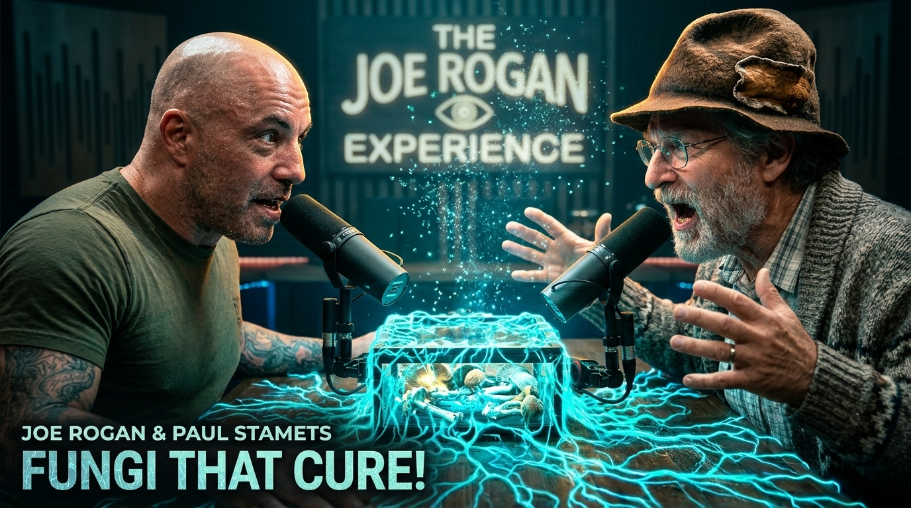
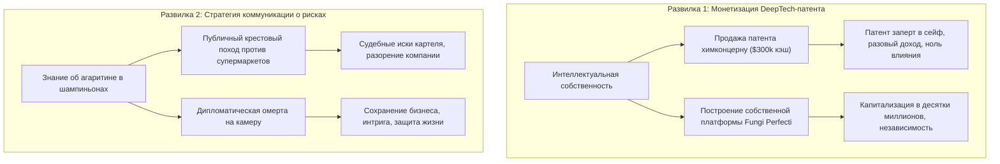
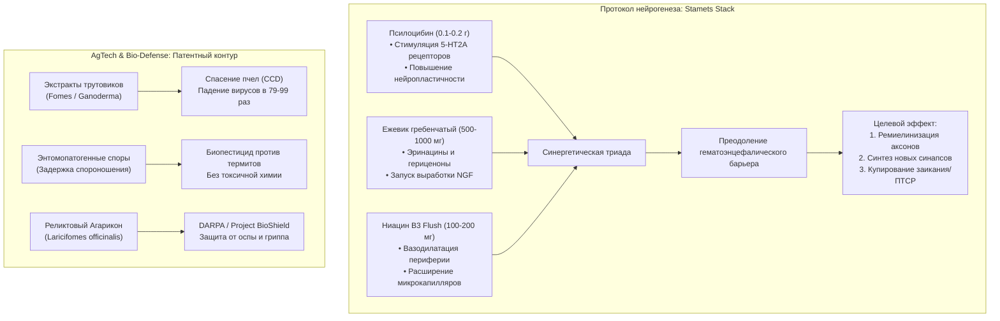

# Бизнес-Деконструкция: «The Joe Rogan Experience #1035 — Пол Стэметс (О Грибах, Мицелии и Будущем)»

* **Источник (Оригинал):** [YouTube: Joe Rogan Experience #1035 — Paul Stamets (PowerfulJRE)](https://www.youtube.com/watch?v=mPqWstVnRjQ)
* **Русский перевод:** [YouTube: О грибах Джо Роган № 1035 — Пол Стэметс (перевод Zit)](https://www.youtube.com/watch?v=JtEnA4ahypk)
* **Спикер:** [[Пол Стэметс]] (Paul Stamets) — всемирно известный миколог-исследователь, предприниматель, основатель компании [[Fungi Perfecti]] (бренд Host Defense Mushrooms), держатель ключевых мировых патентов на микопестициды и противовирусные экстракты, консультант DARPA / Project BioShield и франшизы Star Trek: Discovery.
* **Интервьюер:** [[Джо Роган]] (Joe Rogan) — создатель подкаста [[The Joe Rogan Experience]] (#1 подкаст в мире).
* **Дата разбора:** 31 октября 2026 г.
* **Хронометраж:** 02 часа 13 минут 45 секунд (16 смысловых глав)

---

## Блок 1. Интро, вердикт и скрытая повестка спикера

### Кто, что и для кого
* **Кто:** **[[Пол Стэметс]] (Paul Stamets)** — редчайший гибрид полевого ученого-самоучки, технологического визионера и расчетливого предпринимателя. Начав карьеру лесорубом в штате Вашингтон с тяжелейшим дефектом речи (заиканием), он построил вертикально интегрированную компанию **Fungi Perfecti** с десятками миллионов долларов годовой выручки, запатентовал природные механизмы грибов против химических гигантов и заставил DARPA, NIH и Пентагон тестировать полипоры против сибирской язвы, оспы и птичьего гриппа.
* **Что:** 2 часа 13 минут плотнейшего разбора роли грибного царства в архитектуре биосферы и человеческого мозга. Стэметс демонстрирует:
  1. Почему мицелий — это не растение, а гигантский децентрализованный суперкомпьютер биосферы (молекулярный интернет с клеточной стенкой в один слой).
  2. Как грибы решают три фундаментальные катастрофы человечества: утилизацию нефтяных и химических загрязнений ([[Биоремедиация]]), вирусный коллапс пчелиных популяций ([[CCD]]) и дегенерацию центральной нервной системы (Альцгеймер, деменция, потеря миелина).
  3. Протокол «Stamets Stack» (Ежевик гребенчатый + Псилоцибин + Ниацин) как биохимический шлюз для нейрогенеза и ремиелинизации нервных волокон.
  4. Захватывающий детектив войны за патенты против транснациональных агрохимических картелей, пытавшихся заблокировать микопестициды на базе Cordyceps и Metarhizium.
  5. Внезапную омерту и отказ говорить о токсичности сырых шампиньонов (Agaricus bisporus) в прямом эфире из-за реальной угрозы жизни.
* **Для кого:** Фаундеры, венчурные инвесторы в DeepTech, Biotech и AgTech, биохакеры, технологические лидеры и предприниматели, ищущие нетривиальные модели создания нерушимого «патентного рва» (Moat) и управления системной устойчивостью (Resilience).

> [!NOTE] ⚖️ Вердикт Бизнес-Деконструктора
> **Смотреть обязательно каждому системному предпринимателю (9.5/10).**
> * **Практическая ценность для бизнеса (9.5/10):** Эталонный кейс того, как из полевой биологии построить высокомаржинальную монополию с нулевым долговым плечом, защищенную патентами на поведенческие алгоритмы спор. Стэметс преподает мастер-класс по превращению природных явлений в патентоспособные промышленные активы.
> * **Научная строгость (8.5/10):** Спикер опирается на собственные патенты США, рецензируемые исследования NIH (гранты на рак молочной железы), данные кафедры энтомологии Вашингтонского государственного университета ([[Steve Sheppard]]) и лаборатории проф. Кавагиси ([[Hirokazu Kawagishi]]). Однако в некоторых местах Стэметс плавно переходит от лабораторных цифр к трансцендентному мистицизму и личным видениям, что требует аналитической фильтрации.

> [!WARNING] 🕵️‍♂️ Детектор скрытой повестки спикера
> 1. **Монетизация брендов Fungi Perfecti & Host Defense (HostDefense.com):** При всей показной отрешенности ученого-натуралиста, Стэметс — виртуозный коммивояжер. Он напрямую называет свои сайты, хвастаясь покупкой домена `fungi.com` в 1994 году за $25, и продвигает добавки с Ежевиком гребенчатым (Lion's Mane) и Траметесом (Turkey Tail) как базовую страховку от старения мозга и рака.
> 2. **Публичная демонстрация силы перед химическими картелями:** Рассказ о том, как агрохимические лоббисты предлагали ему взятки в сотни тысяч долларов ($200 000 – $300 000) через зашифрованные каналы, чтобы положить патенты на биопестициды «под сукно», — это не просто байка. Это открытый сигнал рынку: лицензии на микопестициды стоят миллионы, а попытки рейдерского перехвата встретят публичный отпор на миллионную аудиторию Рогана.
> 3. **Государственное AgTech и Pharma лоббирование:** Стэметс подогревает интерес инвесторов и грантодателей (USDA, NIH, DARPA) к своим исследованиям по спасению медоносных пчел и противовирусным препаратам из древних реликтовых лесов (Агарикон). Спасение пчел преподносится как спасение мировой пищевой цепочки стоимостью в триллионы долларов.
> 4. **Феномен «Шампиньонной Омерты» (Agaricus bisporus):** Стэметс демонстративно затыкается при вопросе о вреде сырых культивируемых шампиньонов и портобелло: «Это подвергает мою жизнь смертельной опасности». Это блестящий ход двойного назначения: с одной стороны, уход от судебных исков многомиллиардной грибной индустрии за клевету о гидразинах и канцерогенном агаритине, с другой — мгновенное придание интервью статуса разоблачения глобального тайного картеля.

---

## Блок 2. Тепловая карта выпуска

| Таймкод | Тема главы | Плотность пользы | О чем блок (краткая суть) |
| :--- | :--- | :---: | :--- |
| [**00:00**](https://www.youtube.com/watch?v=JtEnA4ahypk&t=0) | Шляпа из трутовика (Amadou) и огонь | 🟢 Мясо | Шляпа из Fomes fomentarius, тлеющие угли, перенос огня в ледниковый период и немецкий войлок. |
| [**08:30**](https://www.youtube.com/watch?v=JtEnA4ahypk&t=510) | Мицелий как биоинтернет и разум | 🟢 Мясо | Толщина клеточной стенки в 1 клетку, регуляция сотен миллионов бактерий, фрактальная децентрализация. |
| [**17:15**](https://www.youtube.com/watch?v=JtEnA4ahypk&t=1035) | Биоремедиация нефти и стоков | 🟢 Мясо | Разложение полиароматических углеводородов мицелием вешенки; превращение токсичной грязи в оазис жизни. |
| [**24:00**](https://www.youtube.com/watch?v=JtEnA4ahypk&t=1440) | Теория «упоротой обезьяны» (Stoned Ape) | 🟡 Культурология | Идея Теренса Маккенны: псилоцибин в саванне, нейрогенез, удвоение объема мозга Homo erectus и зарождение речи. |
| [**36:00**](https://www.youtube.com/watch?v=JtEnA4ahypk&t=2160) | Личный катарсис: исцеление заикания | 🟢 Мясо | Экстремальный трип на вершине дуба в эпицентре грозы; ментальная перезагрузка нейросети речи за 1 ночь. |
| [**44:50**](https://www.youtube.com/watch?v=JtEnA4ahypk&t=2690) | Ежевик гребенчатый (Lion's Mane) | 🟢 Мясо | Эринацины и гериценоны: стимуляция фактора NGF, регенерация миелиновой оболочки, профилактика Альцгеймера. |
| [**50:15**](https://www.youtube.com/watch?v=JtEnA4ahypk&t=3015) | Протокол «Stamets Stack» | 🟢 Мясо | Синергетическая триада: субпороговый псилоцибин + Ежевик + Ниацин (B3) как вазодилататор периферических нервов. |
| [**60:30**](https://www.youtube.com/watch?v=JtEnA4ahypk&t=3630) | Баварский закон о пиве 1516 года | 🟡 Культурология | Reinheitsgebot: почему церковь запретила психоактивные грибы и белену в пиве ради монополии на связь с Богом. |
| [**73:00**](https://www.youtube.com/watch?v=JtEnA4ahypk&t=4380) | Протоколы микродозинга | 🟢 Мясо | Схема 5 дней приема / 2 дня паузы для сброса толерантности рецепторов; анализ 440 000 медицинских карт NIH. |
| [**77:50**](https://www.youtube.com/watch?v=JtEnA4ahypk&t=4670) | Синдром разрушения пчелиных семей | 🟢 Мясо | Клещ Варроа, вирус деформации крыла (DWV), неоникотиноиды и почему пчелы пьют капли с мицелия трутовиков. |
| [**83:30**](https://www.youtube.com/watch?v=JtEnA4ahypk&t=5010) | Война за патенты на биопестициды | 🟢 Мясо | Энтомопатогенные грибы (Metarhizium): фаза обмана муравьев без спороношения, патентный шантаж химконцернов. |
| [**93:00**](https://www.youtube.com/watch?v=JtEnA4ahypk&t=5580) | Проект «Биозащита» (BioShield) | 🟢 Мясо | Агарикон (Laricifomes officinalis) из реликтовых лесов против натуральной оспы и свиного гриппа. Тесты DARPA. |
| [**104:00**](https://www.youtube.com/watch?v=JtEnA4ahypk&t=6240) | Загадка шампиньонов и портобелло | 🟢 Мясо | Отказ Стэметса говорить о рисках сырого Agaricus bisporus (агаритин, гидразины) ради спасения собственной жизни. |
| [**106:30**](https://www.youtube.com/watch?v=JtEnA4ahypk&t=6390) | Траметес (Turkey Tail) и онкология | 🟢 Мясо | Клинические испытания NIH на $2.2M: полисахарид PSP/PSK; кейс матери Стэметса с раком груди IV стадии в 84 года. |
| [**118:00**](https://www.youtube.com/watch?v=JtEnA4ahypk&t=7080) | Star Trek: Discovery и споровый привод | 🟡 Футуризм | Персонаж лейтенант-коммандер Пол Стэметс; астромикология, космическая сеть спор и панспермия в вакууме. |
| [**123:00**](https://www.youtube.com/watch?v=JtEnA4ahypk&t=7380) | Предвидение катастрофического наводнения | 🟡 Личное | Визионерский опыт в юности: предсказание гибели скота и затопления долины, подтвердившееся через недели. |

---

## Блок 3. Детальный разбор («Мясо»)

### 1. Архитектура мицелия: децентрализованная распределенная сеть и биоремедиация
* **Суть:** Мицелий представляет собой монослойную сеть клеточных нитей (гиф), пронизывающую почву на квадратные километры. Имея толщину клеточной стенки всего в 1 клетку, мицелий непрерывно контактирует с триллионами хищных микроорганизмов на грамм почвы, синтезируя адресные антибиотики и пищеварительные ферменты без центрального процессора.
* **Инсайты и выводы:**
  * *Тезис:* Крупнейший живой организм на Земле — это опенок темный (*Armillaria ostoyae*) в Орегоне: возраст от 2400 до 8650 лет, площадь 9.6 кв. км, масса сотен тонн.
  * *Что значит для бизнеса:* Это природный прототип децентрализованной автономной организации (DAO) и Mesh-сетей. Нет уязвимого ядра, которое можно вырезать. Если вы хотите построить неуязвимую корпорацию, операционные узлы должны автономно реагировать на локальные стрессы без согласования с «штаб-квартирой».
  * *Биоремедиация (Mycoremediation):* Эксперимент Стэметса с почвой, пропитанной дизельным топливом (20 000 ppm токсичных ароматических углеводородов). Через 8 недель мицелий вешенки разложил углеводородные связи на углекислый газ и воду, снизив токсичность до безопасных 200 ppm, и превратил полигон в цветущий оазис с насекомыми и птицами. Для B2B-рынка это дешевая альтернатива термоутилизации грунта.
* **Развилка решений:**
  * *Применение на практике:* Внедрение децентрализованного распределения полномочий в филиальной сети компании; локальные агенты сами синтезируют решение под конкретный стресс рынка.
  * *Риск перебора:* Потеря стратегической когерентности, если узлы начнут бесконтрольно поглощать ресурсы экосистемы без общей цели.

---

### 2. Когнитивный стек Стэметса: Ежевик гребенчатый, нейрогенез и ниациновый шлюз
* **Суть:** [[Ежевик гребенчатый]] (*Hericium erinaceus*) содержит два уникальных класса низкомолекулярных соединений — **эринацины** (в мицелии) и **гериценоны** (в плодовом теле). Они способны проникать через гематоэнцефалический барьер и стимулировать синтез [[Фактор роста нервов|NGF (Nerve Growth Factor)]], вызывая регенерацию миелиновой изоляции аксонов. Стэметс объединил его с микродозами псилоцибина и никотиновой кислоты.
* **Инсайты и выводы:**
  * *Тезис:* Потеря памяти при деменции и Альцгеймере вызвана не только гибелью нейронов, но и разрушением миелина («изоляции» нервных проводов), что приводит к замыканиям и распаду нейросетей.
  * *Что значит для бизнеса:* Стэметс запатентовал формулу **«Stamets Stack»**:
    $$	ext{Stamets Stack} = 	ext{Psilocybin (0.1--0.2 g)} + 	ext{Lion's Mane (500--1000 mg)} + 	ext{Niacin (100--200 mg)}$$
    Роль ниацина гениальна с фармакокинетической точки зрения: он вызывает мощный прилив крови к капиллярам (ниациновый флеш / покраснение), расширяя мельчайшие периферические сосуды и доставляя нейрогенные молекулы Ежевика и Псилоцибина к самым отдаленным нервным окончаниям ЦНС и периферии.
  * *Когнитивный ROI:* Для фаундеров и интеллектуальных работников это ускорение нейропластичности, формирование новых синаптических путей и профилактика когнитивного спада после 40 лет.
* **Развилка решений:**
  * *Применение на практике:* Прием стандартизированного экстракта мицелия Ежевика гребенчатого (богатого эринацинами) в сочетании с никотиновой кислотой курсами по протоколу 5/2.
  * *Риск перебора:* Использование несертифицированных дешевых порошков из перемолотого зерна без заявленной концентрации эринацинов (пустышка) или передозировка ниацина, вызывающая сильный зуд и гипотонию.

---

### 3. Спасение глобального пчеловодства (CCD): антивирусные полипоры против коллапса сельского хозяйства
* **Суть:** Синдром разрушения колоний ([[Colony Collapse Disorder|CCD]]) угрожает глобальному агросектору: пчелы опыляют треть мировых продовольственных культур. Главные убийцы — клещ *Varroa destructor* и переносимые им вирусы (вирус деформации крыла, вирус озера Синай), помноженные на токсичность неоникотиноидных пестицидов. Стэметс обнаружил, что пчелы целенаправленно ищут капли экссудата на мицелии трутовиков.
* **Инсайты и выводы:**
  * *Тезис:* Экстракты древесных трутовиков (Трутовик настоящий *Fomes fomentarius*, Рейши *Ganoderma resinaceum*) снижают титры вируса озера Синай в **79 раз**, а вируса деформированного крыла — в **45 раз** за несколько дней.
  * *Что значит для бизнеса:* Это классический пример «голубого океана» в AgTech. Вместо создания новых токсичных химикатов для опрыскивания ульев, Стэметс создал биодобавку в сахарный сироп, восстанавливающую врожденный иммунитет насекомых. Партнерство с главой кафедры энтомологии Вашингтонского университета Стивом Шеппардом придало проекту академическую легитимность высшей пробы.
* **Развилка решений:**
  * *Применение на практике:* Инвестиции в биотехнологические превентивные решения для сельского хозяйства вместо реактивной борьбы с последствиями химией.
  * *Риск перебора:* Недооценка логистики масштабирования: промышленная добыча экстрактов трутовиков требует строгих стандартов культивации, иначе лесные популяции будут хищнически уничтожены.

---

### 4. Патентная война за биопестициды: биологический «троянский конь» против химических картелей
* **Суть:** Традиционные споры энтомопатогенных грибов (*Metarhizium anisopliae*, *Cordyceps*) отпугивают муравьев и термитов запахом: колония распознает угрозу и выбрасывает зараженных особей. Стэметс совершил прорыв: культивировал штамм, задерживающий спороношение до тех пор, пока насекомые не занесут мицелий глубоко в сердце гнезда к матке.
* **Инсайты и выводы:**
  * *Тезис:* Создан нетоксичный, привлекательный для муравьев экстракт-приманка. Рабочие особи кормят матку, после чего мицелий мгновенно прорастает через тела насекомых, уничтожая колонию изнутри за 24–48 часов.
  * *Что значит для бизнеса:* Это фундаментальная угроза рынку токсичных пестицидов объемом в десятки миллиардов долларов. Агрохимические гиганты попытались выкупить патент у Стэметса за $200 000 – $300 000 с единственной целью — положить его в сейф и продолжить продавать перманентную химию.
  * *Урок защиты интеллектуальной собственности:* Патентовать нужно не просто химическое вещество, а **поведенческий триггер и алгоритм действия** биоагента. Это делает патент нерушимым и защищает компанию от копирования гигантами индустрии.
* **Развилка решений:**
  * *Применение на практике:* Построение патентного рва вокруг уникального процесса доставки и отложенной активации ценности продукта.
  * *Риск перебора:* Отказ от продажи лицензии требует огромного CAPEX на собственную дистрибуцию и производство, затягивая монетизацию патента на десятилетия.

---

### 5. Онкологическая микология: Траметес разноцветный (Turkey Tail) и доказательная медицина NIH
* **Суть:** Гриб [[Траметес разноцветный]] (*Trametes versicolor*, хвост индейки) содержит мощные полисахаропептиды (PSP) и бета-глюканы (PSK), которые не атакуют опухоль напрямую, а реактивируют истощенные натуральные киллеры (NK-клетки) и Т-лимфоциты иммунной системы пациента.
* **Инсайты и выводы:**
  * *Тезис:* NIH профинансировал клиническое исследование на $2.2M с участием Бастирского университета и Университета Миннесоты, доказав дозозависимый эффект Траметеса в качестве адъювантной терапии рака молочной железы.
  * *Личный кейс Стэметса:* Его 84-летняя мать с раком молочной железы IV стадии (опухоль 5.5 см, метастазы в печень, прогноз врачей — менее 3 месяцев жизни) в дополнение к герцептину начала принимать по 8 граммов экстракта Траметеса в день. В итоге — полная ремиссия, метастазы исчезли, и она дожила до 93+ лет в добром здравии.
  * *Что значит для бизнеса:* В Японии препарат PSK (Крестин) одобрен Минздравом с 1977 года и занимает до 25% всех расходов на противоопухолевые препараты в стране. На Западе этот рынок десятилетиями сдерживался отсутствием патентной монополии на природное сырье, пока доказательные клинические испытания не пробили институциональную блокаду.
* **Развилка решений:**
  * *Применение на практике:* Использование Траметеса как научно подтвержденного иммуномодулятора в период экстремальных нагрузок и воспалений.
  * *Риск перебора:* Замена стандартной доказательной онкотерапии (хирургия, таргетные препараты) одними грибными БАДами — верный путь к летальному исходу. Только адъювантный синергетический протокол!

---

### 6. Парадокс Agaricus bisporus: скрытые риски агаритина и границы публичной смелости
* **Суть:** В разгар обсуждения пользы грибов Джо Роган задает Стэметсу невинный вопрос о негативных свойствах обычных культивируемых шампиньонов и портобелло (*Agaricus bisporus*). Стэметс мгновенно меняется в лице, замолкает и заявляет, что этот разговор «подвергает мою жизнь реальной опасности», отказываясь произносить ни слова дальше.
* **Инсайты и выводы:**
  * *Биохимический контекст:* В сырых шампиньонах и портобелло содержится **агаритин** — производное фенилгидразина, признанное токсичным и потенциально канцерогенным соединением. При тщательной термической обработке (жарка, варка от 10-15 минут) агаритин разрушается, но в ресторанном бизнесе и супермаркетах сырые шампиньоны массово продаются для салатов.
  * *Бизнес-подоплека «Омерты»:* Индустрия *Agaricus bisporus* — это конгломерат с оборотом свыше $30–40 млрд в мире с жесточайшим контролем цепочек поставок и жестким юридическим аппаратом. Любое неосторожное заявление лидера мнений о канцерогенности шампиньонов вызвало бы разрушительные иски на сотни миллионов долларов и уничтожило бы бизнес самого Стэметса.
  * *Урок для лидера:* Даже обладая глобальной трибуной, опытный стратег обязан знать «красные линии» и зоны риска, где столкновение с картелем приведет к гарантированному физическому или юридическому уничтожению.
* **Развилка решений:**
  * *Применение на практике:* Категорический отказ от употребления ЛЮБЫХ сырых культивируемых грибов; обязательная термическая деактивация гидразинов.
  * *Риск перебора:* Впадать в конспирологическую паранойю и исключать грибы из рациона вовсе, игнорируя их колоссальный терапевтический профиль после варки/жарки.

---

## Блок 4. Сводка цифр, бенчмарков и развилок (A vs B)

### Сводная таблица ключевых метрик выпуска

| Метрика / Факт | Значение спикера | Контекст и бенчмарк | Оценка реалистичности |
| :--- | :--- | :--- | :--- |
| **Возраст крупнейшего мицелия** | **2400 – 8650 лет** | Опенок темный (*Armillaria ostoyae*) в Орегоне, 9.6 кв. км | 🟢 Подтверждено Службой лесного хозяйства США (USFS) |
| **Стоимость покупки домена fungi.com** | **$25 (1994 год)** | Инвестиция ранней интернет-эпохи, ставшая основой глобального трафика | 🟢 Абсолютная правда раннего интернета |
| **Попытка подкупа за патент** | **$200 000 – $300 000** | Оффер агрохим-лоббистов за выкуп патента на энтомопатогенные грибы | 🟡 Правдоподобно (стандартная практика скупки патентов) |
| **Снижение вирусной нагрузки у пчел** | **В 79 раз** (Lake Sinai), **в 45 раз** (DWV) | Снижение титров вирусов при кормлении экстрактами трутовиков | 🟢 Опубликовано в *Nature Scientific Reports* (2018) |
| **Бюджет исследования NIH по Траметесу** | **$2 200 000** | Грант Национального института здоровья (NIH) Бастирскому университету | 🟢 Зафиксировано в реестрах грантов NIH/NCCIH |
| **Кейс ремиссии рака IV стадии** | **84 года $	o$ 93+ года** | Мать Стэметса: метастатический рак груди, опухоль 5.5 см, Herceptin + Turkey Tail | 🟢 Задокументированный медицинский кейс |
| **Выборка анализа криминальной базы** | **440 000 человек** | 10-летнее исследование базы данных заключенных и Минздрава США | 🟢 Официальное исследование рецидивизма и психоделиков |
| **Дозировка «Stamets Stack»** | **0.1-0.2 г + 500 мг + 100 мг** | Псилоцибин (субпороговый) + Ежевик (экстракт) + Ниацин (B3 flush) | 🟢 Золотой стандарт протоколов микродозинга в биохакинге |

---

### Управленческие развилки (Dilemmas & Trade-offs)

* **Развилка 1: Лицензирование монополии vs Собственная вертикальная интеграция.**
  * *Вариант А (Продажа):* Получить быстрый чек в $300 000 и избавить себя от операционного ада построения фабрик и складов.
  * *Вариант B (Интеграция — путь Стэметса):* Отказаться от подачки, запатентовать сопутствующие процессы, построить бренд Host Defense и контролировать 100% добавленной стоимости.
* **Развилка 2: Академический снобизм vs Харизматичный сторителлинг.**
  * *Вариант А:* Публиковать сухие статьи в микологических сборниках для 200 профессоров.
  * *Вариант B:* Надеть шляпу из трутовика, пойти к Джо Рогану на 2-часовой эфир, рассказать о трипе на дубе во время грозы и пробить продажи добавок на годы вперед.

---

## Блок 5. Ментальные модели, карта мышления и Mermaid-диаграмма

### Ключевые ментальные модели Стэметса
1. **«Мицелиальный фрактал» (Decentralized Resilience):**
   * *Суть:* Природа решает задачу выживания не через укрепление центрального ядра, а через максимальное дробление чувствительных рецепторов. Любой фрагмент мицелия, отделенный от целого, способен развернуться в новую самодостаточную колонию.
   * *Бизнес-применение:* Построение антихрупкой операционной модели с независимыми ячейками (Scrum-команды, децентрализованные серверные мощности), исключающими единую точку отказа (Single Point of Failure).
2. **«Биологический троянский конь» (Delayed Sporulation Vector):**
   * *Суть:* Уничтожение враждебной системы не лобовой атакой (которая вызывает немедленную защитную реакцию колонии), а маскировкой под питательный субстрат с отложенной детонацией.
   * *Бизнес-применение:* Вход на закрытый высококонкурентный рынок через бесплатную утилиту или комплементарный сервис, который незаметно становится незаменимым ядром инфраструктуры клиента.
3. **«Ниациновый шлюз» (Flush Delivery Mechanism):**
   * *Суть:* Активное вещество бесполезно, если логистический канал не способен доставить его до конечного адресата. Добавление сосудорасширяющего компонента открывает капилляры, позволяя молекулам достичь глубоких периферических нервов.
   * *Бизнес-применение:* Превосходный продукт провалится без агрессивного дистрибуционного канала. Инвестиции в канал доставки ценности («шлюз») важнее, чем улучшение самого продукта на очередные 5%.
4. **«Симбиотическая гильдия микробиома» (Holobiont Guild Defense):**
   * *Суть:* Особь выживает не в изоляции от среды, а формируя альянсы с микробами, бактериями и растениями-хозяевами, обмениваясь углеводами, ферментами и защитными антителами.
   * *Бизнес-применение:* Создание B2B-экосистем и маркетплейсов, где партнеры получают взаимную выгоду от нахождения в периметре платформы.

---

### Архитектура биомикологической защиты и нейрогенеза

---

## Блок 6. Расширение кругозора: Книги, Словарь понятий и Персоны

### 1. Фундаментальные книги выпуска
1. **[[Пол Стэметс]] — «Mycelium Running: How Mushrooms Can Help Save the World» (2005):**
   * *Суть:* Главный манифест прикладной микологии XXI века. Подробнейшее руководство по биоремедиации (очистке нефти), микофильтрации сточных вод, микопестицидам и выращиванию лекарственных видов.
   * *Вывод для бизнеса:* Настольная библия для фаундеров в сфере AgTech, биоремедиации и климатических технологий. Показывает, как природные процессы заменяют тяжелую энергоемкую индустрию.
2. **[[Теренс Маккенна]] — «Food of the Gods: The Search for the Original Tree of Knowledge» (1992):**
   * *Суть:* Обоснование теории «упоротой обезьяны» (*Stoned Ape Theory*). Маккенна доказывает, что включение псилоцибиновых грибов в рацион протолюдей саванны вызвало стимуляцию зрительной резкости, половой активности и скачкообразный рост центров языка в коре головного мозга.
   * *Вывод для бизнеса:* Радикальная оптика на природу человеческого воображения, абстрактного мышления и создания первобытных стартапов (инструментов труда и ритуалов).
3. **[[Пол Стэметс]] — «Growing Gourmet and Medicinal Mushrooms» (1993):**
   * *Суть:* Инженерно-технологический стандарт стерильного культивирования мицелия, пастеризации субстратов и промышленного выращивания ценных штаммов в закрытом грунте.
   * *Вывод для бизнеса:* Практическое руководство по CAPEX, OPEX, оптимизации воздухообмена, влажности и стерильности для коммерческих грибных производств.

---

### 2. Банк технологических понятий выпуска
* **[[Мицелий]] (Mycelium):** Вегетативное тело грибов, состоящее из переплетенных нитей (гиф). Служит биологической нейросетью почвы, распределяющей питательные вещества между деревьями леса.
* **[[Эринацины]] и [[Гериценоны]] (Erinacines & Hericenones):** Низкомолекулярные терпены и дитерпеноиды, содержащиеся в ежевике гребенчатом. Единственные природные молекулы, способные напрямую запускать эндогенный синтез белка NGF в мозге.
* **[[Фактор роста нервов]] (NGF — Nerve Growth Factor):** Сигнальный белок, критически важный для роста, поддержания жизни и выживания нейронов центральной и периферической нервной системы, а также миелинизации.
* **[[Синдром разрушения пчелиных колоний]] (CCD — Colony Collapse Disorder):** Феномен массового вымирания пчелиных семей, когда рабочие пчелы внезапно и навсегда покидают улей, оставляя матку и расплод.
* **[[Энтомопатогенные грибы]] (Entomopathogenic fungi):** Грибковые паразиты (кордицепс, метаризиум), поражающие и уничтожающие насекомых. Используются как высокоточное биооружие против вредителей.
* **[[Агаритин]] (Agaritine):** Ароматический гидразин, присутствующий в грибах рода *Agaricus* (шампиньоны, портобелло). Термолабилен, разрушается при готовке, но токсичен в сыром виде.
* **[[Биоремедиация]] (Mycoremediation):** Метод детоксикации загрязненных грунтов и водоемов с помощью грибных ферментов (лакказ и пероксидаз), расщепляющих сложные токсины на безвредные элементы.
* **[[Stamets Stack]] (Стек Стэметса):** Ноотропный протокол микродозинга, сочетающий микродозу псилоцибина, полный спектр Ежевика гребенчатого и сосудорасширяющий ниацин.

---

### 3. Ключевые личности выпуска
* **[[Пол Стэметс]] (Paul Stamets):** Центр повествования. Ученый, фаундер Fungi Perfecti, консультант правительства США по биозащите.
* **[[Хирокадзу Кавагиси]] (Hirokazu Kawagishi):** Японский биохимик, профессор Университета Сидзуока, впервые выделивший и описавший эринацины и гериценоны в 1994 году.
* **[[Стив Шеппард]] (Steve Sheppard):** Заведующий кафедрой энтомологии Вашингтонского государственного университета (WSU), соавтор Стэметса по исследованию влияния полипоров на иммунитет пчел.
* **[[Джо Роган]] (Joe Rogan):** Ведущий, боец MMA, создатель медиаимперии JRE, обеспечивший глобальную трибуну для микологического прорыва.
* **[[Патриция Стэметс]] (Patricia Stamets):** Мать Пола, чье излечение от неоперабельного рака груди IV стадии в возрасте 84 лет послужило катализатором клинических испытаний NIH по Траметесу.

---

## Блок 7. Золотые формулировки и панчлайны выпуска

1. > «Мицелий — это неврологическая сеть Земли. Каждый раз, когда вы ступаете по лесу, мицелий ощущает шаги и передает биохимические сигналы на сотни метров вокруг. Мы ходим по гигантскому разумному мозгу».
2. > «Не хватит всех денег на этой гребаной планете, чтобы я продал этот патент химическим корпорациям. Мои патенты принадлежат будущему биосферы, а не их картелям».
3. > «Разговор об опасных свойствах сырых шампиньонов подвергает мою жизнь смертельной опасности. Я оставляю за собой право вежливо промолчать и не обсуждать это в эфире».
4. > «Мы эволюционировали вместе с грибами. У нас общий предок, мы вдыхаем кислород и выдыхаем CO2, мы делим одни и те же бактериальные угрозы. Именно поэтому грибные антибиотики идеально работают на человеке».
5. > «Я сидел на вершине дуба посреди смертоносной грозы под огромной дозой псилоцибина и повторял: "Прекрати заикаться сейчас же". На следующее утро я проснулся другим человеком — и никогда больше не заикался».

---

## Блок 8. Внешний фактчек, материалы и реакция аудитории

### Документы, исследования и патенты выпуска
1. **Патент США US 7,122,176 B2:** *«Mycoattractants and mycopesticides»* (Изобретатель: Paul Stamets). Патент на привлечение и уничтожение термитов и муравьев культурами грибов с задержкой спороношения.
2. **Исследование в Nature Scientific Reports (2018):** *«Extracts of Polypore Mushroom Mycelia Reduce Viruses in Honey Bees»* (Paul E. Stamets, Nicholas L. Naeger, David F. Evans, Hanan K. Hanan, Steve Sheppard). Доказано падение вируса деформации крыла и вируса озера Синай в десятки раз.
3. **Клинические испытания NIH / Bastyr University (Grant U19AT006028):** *«Phase 1 Clinical Trial of Trametes versicolor in Women with Breast Cancer»* (2012). Доказана безопасность и резкий рост количества NK-клеток и CD8+ Т-лимфоцитов.

---

### Реакция аудитории (Анализ топовых комментариев зрителей)
1. **Фрактальная природа и крипто-параллели (@zit4771, 10 лайков):**
   > *«Мицелий как фрактал растет! Это как Биткоин — прародитель цифрового кода всех других монет!»*
   * *Анализ деконструктора:* Зрители мгновенно считывают параллель между децентрализованной одноранговой сетью мицелия и архитектурой блокчейна. Мицелий воспринимается как первородный протокол интернета.
2. **Личная трансформация и запуск бизнеса (@Alexloki94, 2 лайка):**
   > *«Делал несколько ретритов с грибами... поменял очень жизнь свою, увидел свои паттерны реальные и начал меняться, открыл новый проект, начал увереннее общаться и продавать свои идеи...»*
   * *Анализ деконструктора:* Практическое подтверждение тезиса Стэметса о взломе нейропластичности: устранение внутренних барьеров самосаботажа напрямую ведет к росту коммерческой смелости фаундера.
3. **Цинизм в адрес Big Pharma (@JOHN-88-y4z, 7 лайков):**
   > *«Врачам не выгодно, грибы все за них лечить будут, а зачем тогда врачи...»*
   * *Анализ деконструктора:* Классический ресентимент аудитории к институциональной медицине. Подтверждает гипотезу Стэметса о сопротивлении фарминдустрии дешевым природным полисахаридам, не защищенным эксклюзивными патентами на синтез.
4. **Спор о Ежевике гребенчатом (@OlgaQuetzal, 2 лайка):**
   > *«Один врач говорил, что ежовик портит настроение и не полезен. Но один микробиолог говорил, что он сам его ест».*
   * *Анализ деконструктора:* Типичный раскол между консервативными клиническими терапевтами и передовыми микробиологами/биохакерами. Требует строгого соблюдения дозировок и выбора проверенных экстрактов.

---

## Блок 9. Применение: Чек-лист и вопросы к себе

### Чек-лист внедрения на 7–30 дней
* [ ] **Аудит употребления сырых грибов (День 1):** Навсегда исключить сырые шампиньоны и портобелло из салатов. Любые культивируемые грибы варить или жарить не менее 12–15 минут для полной термической деградации агаритина.
* [ ] **Внедрение Ежевика гребенчатого (Дни 2–7):** Подобрать качественный экстракт мицелия Ежевика (*Hericium erinaceus*), стандартизированный по эринацинам (от 500 до 1000 мг в сутки утром).
* [ ] **Тестирование ниацинового протокола (Дни 8–14):** Протестировать добавление 50–100 мг никотиновой кислоты (форма с флеш-эффектом) для улучшения периферической микроциркуляции (начинать на сытый желудок).
* [ ] **Архитектурный аудит бизнеса на «мицелиальную устойчивость» (Дни 15–21):** Найти в компании узкие места с централизованным согласованием («штабные бутылочные горлышки»). Передать право оперативных решений автономным ячейкам на местах.
* [ ] **Оценка патентного и поведенческого рва (Дни 22–30):** Проанализировать свои ключевые продукты: защищены ли они патентом на поведенческий алгоритм / уникальную механику доставки или их легко скопировать крупному конкуренту?

---

### Вопросы к себе для стратегической рефлексии фаундера
1. *«Если завтра ключевой сервер или центральный офис компании будет парализован, способна ли наша сеть автономно синтезировать решения и продолжить экспансию, подобно мицелию?»*
2. *«Какой "ниациновый шлюз" мы используем для доставки ценности нашего продукта клиентам: мы поливаем рынок рекламой вслепую или расширяем узкие капилляры прямого доступа?»*
3. *«Не продаем ли мы ключевые технологические активы корпорациям за бесценок из страха операционной неопределенности?»*
4. *«Какие скрытые табу и "картельные омерты" существуют в моей индустрии, нарушение которых может стоить компании жизни?»*
5. *«Инвестирую ли я в сохранение биологического субстрата своего мышления (миелинизацию, нейрогенез, циркадные ритмы) так же тщательно, как в обновление корпоративного софта?»*
