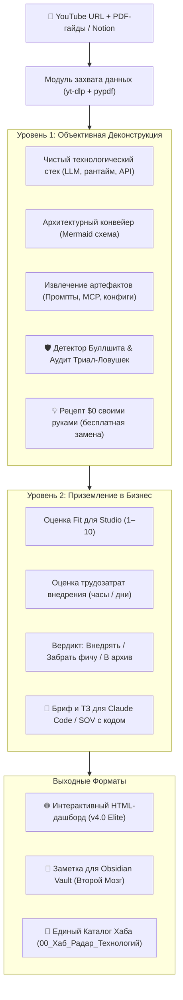
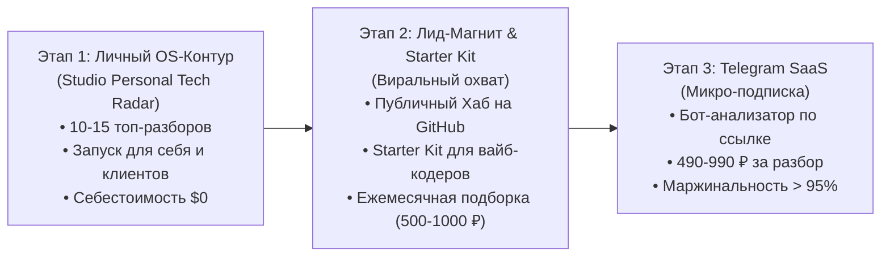

# 📡 Gemstudio Tech & Workflow Radar: Executive One-Pager & Концепция Продукта

> **Документ:** Описание инструмента, архитектура и бизнес-модель  
> **Проект:** Gemstudio Tech & Workflow Radar (`~/studio/dev/gemstudio-tech-radar`)  
> **Версия:** 1.0 Elite (Release)  
> **Автор / Владелец:** DimDim (Gemstudio R&D)  
> **Публичная витрина:** [evskrutyak-bit.github.io/gemstudio-radar](https://evskrutyak-bit.github.io/gemstudio-radar/)

---

## 1. Executive Summary (Что это такое)

**Gemstudio Tech Radar** — это автономная инженерно-аналитическая платформа, которая превращает хаотичный поток обучающих YouTube-роликов, гайдов из Instagram/Threads и PDF-материалов по AI в **готовые боевые решения для бизнеса с нулевыми затратами на рутину**.

Вместо того чтобы тратить 10–15 часов в неделю на просмотр вебинаров и тестирование псевдо-бесплатных нейросетей, предприниматель или разработчик получает:
1. **Объективную деконструкцию за 2 минуты:** чистый стек, схема архитектуры (Mermaid), аудит скрытых платных подписок и рецепт бесплатной замены на $0 своими руками.
2. **Готовое техническое задание (ТЗ):** архитектурный бриф для Claude Code / Codex с готовым кодом скриптов, скиллов (`SKILL.md`) и деревом папок для мгновенного внедрения.
3. **Интерактивный веб-дашборд:** автономная страница с 4 Bento KPI, видеоплеером, таймкодами и прикрепленными документами.

---

## 2. Проблематика Рынка (Боль Пользователя)

Индустрия ИИ-контента в 2026 году страдает от трёх системных проблем:

1. **Информационный шум и кликбейт:** 85% роликов в YouTube и Reels создаются ради охватов. За громкими заголовками *«Этот агент заменит 10 человек»* скрывается банальный пересказ документации или устаревший шаблон.
2. **Freemium-ловушки и подписочный ад:** Авторы заявляют инструмент как «бесплатный», но умалчивают, что триал даёт 3 запроса, а дальше требует карту и \$20/мес. Начинающему разработчику навязывают стек из 4 сервисов (\$80/мес), который заменяется бесплатным скриптом на Python за 30 минут.
3. **Вторичный контент Рунета:** 90% русскоязычных видеороликов — это переводы тредов из американского X (Twitter) двухнедельной давности, часто с искажением терминов и потерей технического контекста.

---

## 3. Решение: Двухуровневый Аналитический Движок

Платформа решает проблему за счёт жесткого разделения анализа на два изолированных контура:

---

## 4. Кластеризация и Систематизация (6 Направлений)

Все деконструкции автоматически распределяются по 6 технологическим направлениям:
1. `CLAUDE` — Claude Code, архитектурные скиллы (`~/.claude/skills/`), системные промпты.
2. `CODEX` — Codex CLI, консольные диспетчеры задач, фоновые пайплайны.
3. `MCP` — Model Context Protocol серверы (Google Search Console, GitHub, базы данных).
4. `TRAFFIC` — Автономные SEO-заводы, IndexNow-протоколы, генерация органического трафика.
5. `KNOWLEDGE` — Базы знаний Second Brain, Obsidian Wikilinks, локальные RAG-системы.
6. `AUTOMATION` — Make, n8n, Telegram-боты, системные вебхуки и парсеры.

---

## 5. Продуктовая Стратегия и Бизнес-Модель (3 Этапа)

### 1. Этап 1: Личный командный центр (Studio Personal OS)
* **Цель:** Быстрый аудит и сборка лучших связок для проектов Димы (`~/studio-v3/clients/` и `~/studio/projects/`).
* **Результат:** 10–15 глубоких деконструкций с проверенными ТЗ. Нулевые затраты на инфраструктуру ($0 хостинг на GitHub Pages).

### 2. Этап 2: Флагманский лид-магнит + GitHub Starter Kit
* **Для кого:** Вайб-кодеры, no-code разработчики, продакты, предприниматели.
* **Механика:** Бесплатный доступ к витрине лучших связок за подписку на Telegram-канал + открытый репозиторий на GitHub для самостоятельного разворачивания.
* **Монетизация:** Ежемесячный платный дайджест («5 закрытых боевых ТЗ месяца») за **500–1000 ₽**.

### 3. Этап 3: Telegram-Бот «Tech Radar» (Микро-SaaS)
* **Механика:** Пользователь отправляет боту ссылку на видео/PDF $\to$ оплачивает 490–990 ₽ $\to$ через 2 минуты получает личный дашборд и Markdown для Obsidian.
* **Юнит-экономика:** Затраты на LLM API (Gemini Flash) — ~5–10 ₽. Чек: 490–990 ₽. **Маржинальность > 95%**.

---

## 6. Рыночные Бенчмарки (Чем мы сильнее конкурентов)

| Критерий | ThoughtWorks Radar | Google NotebookLM | Snipd / Readwise | Обычный ChatGPT | **Gemstudio Tech Radar** |
| :--- | :---: | :---: | :---: | :---: | :---: |
| **Анализ видео + PDF** | ❌ Нет | 🟡 Частично | 🟡 Только аудио | ❌ Нет | 🟢 **Да (yt-dlp + pypdf)** |
| **Детектор Буллшита & Paywall** | ❌ Нет | ❌ Нет | ❌ Нет | ❌ Нет | 🟢 **Да (аудит затрат и $0 замена)** |
| **Схема архитектуры (Mermaid)** | ❌ Нет | ❌ Нет | ❌ Нет | 🟡 По запросу | 🟢 **Да (авто-генерация)** |
| **Готовое ТЗ для Claude Code** | ❌ Нет | ❌ Нет | ❌ Нет | ❌ Нет | 🟢 **Да (DoD + код файлов)** |
| **Автономный Web-дашборд** | 🟡 Статичный сайт | ❌ Нет | ❌ Нет | ❌ Нет | 🟢 **Да (Bento KPI + плеер)** |
| **Obsidian Sync (Второй Мозг)** | ❌ Нет | ❌ Нет | 🟡 Экспорт заметок | ❌ Нет | 🟢 **Да (чистый Markdown)** |

---

## 7. Текущий Статус и Доступ

* **Ядро инструмента:** Реализовано на 100% (`scripts/radar.py`, `render_dashboard.py`, `build_radar_hub.py`).
* **Витрина:** Развернута на GitHub Pages: [https://evskrutyak-bit.github.io/gemstudio-radar/](https://evskrutyak-bit.github.io/gemstudio-radar/)
* **База разборов:** Запущены первые боевые кейсы (SEO-завод Васина, Моушн-видео в Claude, Второй мозг Obsidian).
